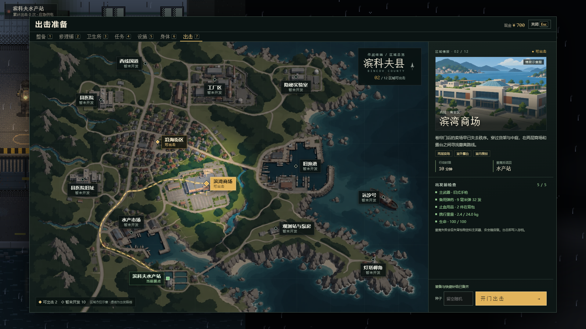
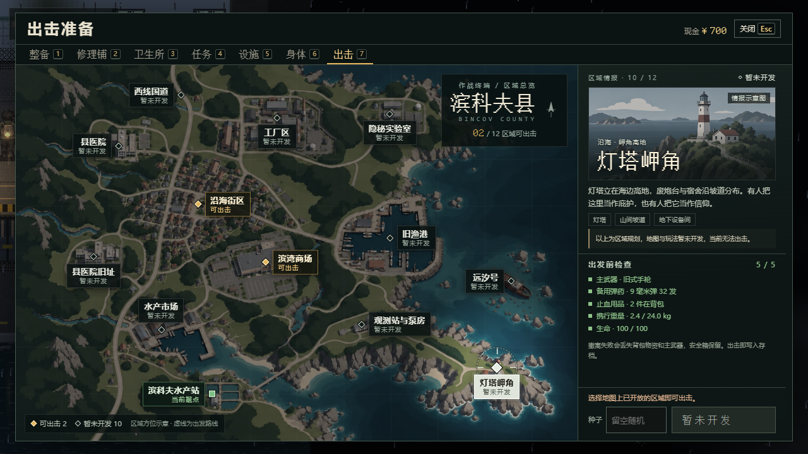
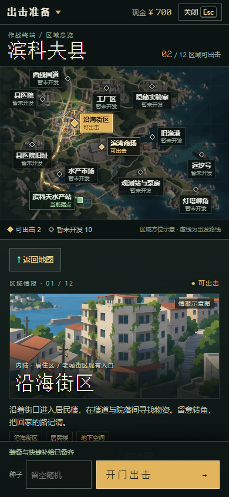

<div align="center">

# 🌊 逃离滨科夫

**E S C A P E  B I N C O V**

**台风过后，海没有退去。带上最后一匣子弹，活着回到水产站。**

[](https://github.com/xuys2025/escape-bincov/actions/workflows/ci-pages.yml)


### [▶️ 在线试玩](https://xuys2025.github.io/escape-bincov/) · [🎯 试枪场](https://xuys2025.github.io/escape-bincov/?range=1) · [📦 下载离线版](https://github.com/xuys2025/escape-bincov/releases/download/main-latest/Escape-Bincov-portable.zip)

<a href="https://xuys2025.github.io/escape-bincov/">
  
</a>

<sub>实际构建截图 · 单人撤离生存 · 无账号 · 单文件离线运行 · 部分人物与场景仍为占位素材</sub>

</div>

## 🎒 回来，才算带走

超强台风与异常赤潮封锁了虚构的滨科夫县。你从滨科夫水产站出发，在限时行动中搜集物资、应对交战，带着战利品回来交易、交任务、修建设施，再准备下一次出击。

游戏采用俯视角像素画面，**水产站院子和行动都使用 2.5D 画面**。项目仍在开发中，已有完整的「整备 → 出击 → 搜刮与交战 → 撤离或失败 → 回站」单人循环。

> 本页于 **2026-10-23** 按已合并至 `main` 的内容核对，基线为 [`b475b1b`](https://github.com/xuys2025/escape-bincov/commit/b475b1b76a71af5223dc63971c75074547e390f6)。包版本号仍为 `0.2.0`；[v0.2.0 公告](docs/releases/v0.2.0.md)记录的是早期发版，后续已合并功能见下文。最新构建与上线状态以 [Actions](https://github.com/xuys2025/escape-bincov/actions/workflows/ci-pages.yml) 为准。

## 🏚️ 现在可以玩什么

| 内容 | 已接入的玩法 |
| --- | --- |
| 序幕 | 新档首次进站前播放开场动画，可暂停、跳过，也可从标题页「序幕」重看。 |
| 水产站院子 | 雨夜院落、进屋揭顶、人物互动、修复供电；可步行、点击寻路，也可用快捷栏直接打开功能。 |
| 整备与交易 | 仓库、背包、安全箱、武器与护符；拖放、旋转、拆分物品；修理铺和卫生所先加入购物车，再统一结算。 |
| 据点成长 | 电台任务、仓库扩建、身体与成长，以及休息区、医疗区、训练区、工作台、黑市五项设施；支持生产、领取与实际走动训练。 |
| 行动 | 两个区域入口、枪械与近战、箱子和尸体搜刮、地图与撤离指引；每局限时 10 分钟，撤离需要停稳并按住交互键 3 秒。 |
| 射击 | 精瞄举枪、移动与急转带来的晃动、连续射击的散布和后坐；准星与武器卡显示当前状态。另有独立试枪场。 |
| 搜刮与交互 | 「附近」列表可逐件拾取地面物品；治疗被拒、门被占用时显示原因，搜刮面板保留危险提示。 |
| 潮汐与生存 | 行动第 4 分 30 秒预警、第 5 分钟潮位变化；留意污染、流血、水分、饱食与携行重量。 |
| 存档与恢复 | 浏览器本地保存、检查点续局、JSON 备份迁移；交易与结算写入失败可重试，多窗口冲突有保护。 |

出击面板以县域地图展示十二个规划区域：沿海街区、滨湾商场可以出击，其余十区标记「暂未开发」，可查看规划简介和区域情报示意图（概念插图，不是关卡截图）。老城街区位置提供现有沿海街区入口，完整老城仍待扩展。当前两处可玩区域都使用 2.5D 画面，美术仍在补齐：

| 区域 | 内容 | 美术进度 |
| --- | --- | --- |
| 沿海街区 | 沿海街区，以及可进入的居民楼一楼、二楼和地下 | 街口一带已精修；其余地方暂用通用画面 |
| 滨湾商场 | 两层与露台（布局三版） | 正门广场到露台一段已布置；其余区域陆续补齐（[#47](https://github.com/xuys2025/escape-bincov/issues/47)） |

原「沿海封锁区」和沿海街区是同一张地图，已经关闭，之后作为新地图重做。此前开始、还没结束的封锁区行动和商场旧布局行动，仍可从标题页「继续」，同样在 2.5D 画面上打完。



<p align="center">
  
  
</p>

<sub>2026-10-24 实际构建截图（新档，无资源或进度修改）：桌面 1920×1080 与 1280×720、手机竖屏 390×844。地图底图和区域插图是示意美术，插图不是关卡截图。实现与验证见[县域选图记录](docs/tasks/county-map-select.md#opus-视觉深化2026-10-24)。</sub>

标题页、院子和所有行动都由 PixiJS 绘制；旧页签界面和结算页是 HTML 界面，背景为固定的站外画。各画面共用正式的会话、存档和交易服务。院子画面启动失败时会回到旧页签界面；玩家也可以主动切换。


<sub>首图与训练面板复用 2026-10-11 的实际构建验收截图，包含测试用进度和物资配置，不代表新档初始资源。截图来源：[进站验收](docs/station-relief-20261011/README.md)、[训练与补给验收](docs/station-tier2-20261011/README.md)。</sub>

## ▶️ 开始第一局

游戏需要浏览器支持 **WebGL**；不支持时页面只显示提示，不进入游戏，存档不受影响。

**在线：** 用电脑端 Chrome 或 Edge 打开 [GitHub Pages](https://xuys2025.github.io/escape-bincov/)。页面加载完成后，游戏运行无需外部素材、账号或服务器连接。

**离线：** 下载 [便携 ZIP](https://github.com/xuys2025/escape-bincov/releases/download/main-latest/Escape-Bincov-portable.zip)，解压到固定目录，双击 `start the game.html`。它是 `main` 最近一次通过全部检查的构建，每次验证成功后自动更新（[发布页](https://github.com/xuys2025/escape-bincov/releases/tag/main-latest)写明对应提交）。游玩无需 Node.js 或联网；若打开了编辑器，请右键选择 Chrome 或 Edge。

1. **进站整备**：标题页点击「进入」，新档会先播放序幕，可点「跳过」或按 `Esc`。进入院子后按 `Tab` 打开整备，检查主武器、备用弹药和药品。购买的物资结算后进入仓库，需要自行整理到背包。
2. **选择区域**：走到院门互动，或按 `G` 打开「出击准备」，选区域后出击。第一次可将行动种子留空。
3. **搜刮与交战**：`M` 看地图与撤离点，`E` 拾取或打开箱子、尸体，`Tab` 整理背包。背包、搜刮和地图打开时，行动仍继续。
4. **及时撤离**：到达本局启用的撤离区，停稳并按住 `E` 满 3 秒。成功保存结算后，在结果页返回水产站。

成功撤离会保留带回的物资；死亡、超时或放弃会失去背包物资与主武器，安全箱物品和水手匕首保留。负重上限会受成长等状态影响，以界面显示为准。

### 🎯 先试试枪

打开 [试枪场](https://xuys2025.github.io/escape-bincov/?range=1)，可切换手枪、卡宾枪、霰弹枪、匕首、G17 与 M4A1 自动步枪，以及 M4A1 的「轻快」「稳定」两套配装，对固定靶和移动靶练习。面板显示命中数、散布、后坐偏移与举枪进度；试枪场使用内存中的临时进度，**不读取或改写正式存档**，刷新后重置。

本地源码仓库先运行 `pnpm build`，再双击 `试枪场.html`；下载的便携版则打开 `start the game.html`，在浏览器地址末尾加 `?range=1`。

### 🔧 改装枪械

M4A1 和 G17 是正式枪械，另有 20 件样板配件。老栓出售 G17、三件基础配件和 G17 的微型点瞄、加长弹匣；M4A1 和其余配件要在沿海街区、商场的物资里找，少数尸体身上也有配件。

在整备里点主武器槽或枪的详情上的「改装」，或在工作台设施页点「打开改枪」，进入改枪工作台。点枪身上的位置挑配件，点配件只改预览，按「确认」才会改到枪上；换小弹匣时多出的子弹放回仓库。常用的配置可以存成预设（每种枪最多 10 套），在同型号的枪上一键放进预览。商店可按类别筛选，或只看基地里的枪能用的配件。

枪上装了激光或灯光时，行动中按 `G` 开关激光、`F` 开关灯光，触屏点「设备」；装了双档瞄具时按 `V`（触屏「切档」）切换远近两档。精瞄时远距瞄具让视野看得更远，装了脚架的枪站定一会儿就会架稳。二十枪、一百配件的完整改枪系统仍在开发。

### 样板入口（看美术进度用）

普通入口已经是 2.5D 画面。另有两个样板入口，方便看美术做到哪里：[`?sample=village`](https://xuys2025.github.io/escape-bincov/?sample=village) 预选沿海街区，种子留空时挑一个从精修街口出发的种子；[`?sample=mall`](https://xuys2025.github.io/escape-bincov/?sample=mall) 预选滨湾商场。两个入口都会把还没精修的地方压暗，并在左上角地点后标「样板外」。

本地仓库运行 `pnpm build` 后，可双击根目录的 `城中村试玩.html` 或 `商场试玩.html`。样板和普通入口在同一网站使用同一份存档。

### 保存与迁移

存档保存在当前浏览器中，**没有云存档**。进入院子会受控升级旧存档并启用成长系统，保留原有的钱、物品、任务和统计。有进行中的行动时，从最近成功写入的检查点恢复，少量未保存进度可能回退。

换浏览器、网站或本地文件路径前，在院子按 `Esc` 打开菜单，选择「导出存档」，再到新入口「导入存档」。导入需要确认覆盖，两份进度不会合并。遇到保存失败，请按界面提示重试或先导出备份。

## ⌨️ 操作

### 水产站院子

| 输入 | 动作 |
| --- | --- |
| `W A S D` / 方向键，`Shift` | 移动，按住快走 |
| 左键点地面 / 人物或设施 | 走到目标位置 / 走近并打开对应功能 |
| `E` / 空格 | 与附近人物或设施互动 |
| `1`～`7` | 整备、修理铺、卫生所、任务、设施、身体、出击 |
| `Tab` / `J` / `C` / `G` | 整备 / 电台任务 / 身体与成长 / 出击准备 |
| `0` | 切换到旧页签界面；可从该界面返回院子 |
| 滚轮 / `+` / `-` | 缩放视野 |
| `Esc` | 关闭面板，或打开菜单；通电动画中可跳过 |

### 行动中

| 输入 | 动作 |
| --- | --- |
| `W A S D` / `Shift` | 移动 / 冲刺；搜刮时按下即离开搜刮界面 |
| 鼠标 / 左键 / 按住右键 | 瞄准 / 攻击（单发枪每次点击一枪，自动枪按住连发）/ 逐渐举枪精瞄 |
| `R` / `1` / `2` | 换弹 / 主武器 / 水手匕首 |
| `E` | 拾取、搜刮、开门或阅读；有效撤离区内按住 3 秒撤离 |
| 滚轮 | 切换附近箱子、尸体目标 |
| `Q` | 使用背包中的绷带或急救包 |
| `Tab` / `M` | 背包 / 地图，均不暂停 |
| `F` / `G` | 开关枪上的灯光 / 激光（装了对应设备时） |
| `V` | 切换双档瞄具的远近两档（装了双档瞄具时） |
| `Esc` | 关闭面板；没有面板时暂停，点击「继续」恢复 |

M4A1 可以连发，其余枪械为单发。停步、举枪后射击更准；走动、急转和连续射击会增加晃动、散布或后坐，停火后逐渐恢复。切枪、换层不会立即消除这些代价，读档后也需重新稳定瞄准。

整理库存可拖放或点选格位；拖动物品时 `R` 旋转、`Esc` 取消。商店购物车不支持旋转，物品加入待买或待卖后仍需点击「结算」。首次进入请点击游戏以启动声音，音量可在院子菜单或局内暂停面板调整。

### 📱 手机触控

院子支持摇杆移动和点击互动，窄屏通过「功能」按钮打开整备、商店等面板；行动中使用双摇杆与屏幕按钮，推荐横屏。站定并把瞄准摇杆停在内圈会逐渐举枪，推到外圈开火：单发枪按自身射速重复射击，自动枪持续连发。枪上装了激光或灯光时，点「设备」开关；装了双档瞄具时，点「切档」。库存支持点选物品与格位；改枪工作台在手机上分枪身、配件、属性三页，确认和取消固定在底部。切到后台后，行动会暂停，回来需点击「继续」。

移动端目前通过的主要是 Chromium 视口与触控仿真；iPhone、Android 真机手感和性能仍待验收。没有手柄支持。

## 🚧 当前边界与反馈

- **美术仍在补齐**：院子四位主要人物、关键道具、城中村首批素材，以及现有四类敌人的行走、尸体和持握图已接入。其余居民、环境与动画仍有占位或画风差异；全沿海精修、商场其余区域和院子昼夜变化尚未完成。
- **敌人体系正在扩展**：新街区行动有近身掠夺者、枪手和望风者样板，可利用前摇、换弹和失联搜索的空隙；近身掠夺者亲眼看见你上楼时可能沿入口跟来。现有活动行动保持原规则。完整十八原型及其正式美术仍在开发，详见[样板范围](docs/tasks/enemy-street-encounter.md)。
- **设计与可玩内容有区别**：十二地区地图、市场剧情与后续主线/人物结局尚未落地；改枪目前只有两把新枪和 20 件样板配件，二十枪、一百配件的完整版本仍在开发。进度见下方文档导航与任务清单。
- **长期稳定性仍需验证**：资源释放、行动恢复、交易与结算已有修复和回归；长期内存验收仍未完成。历史未签收项与后续缺陷分别见 [#32](https://github.com/xuys2025/escape-bincov/issues/32) 和 [#60](https://github.com/xuys2025/escape-bincov/issues/60)。
- **自动通过不等于真人验收**：真机、实际 GPU 性能、长时间手感与平衡性仍需试玩反馈。多人联机、云存档未实现。

玩家遇到的问题请补到 [玩家反馈 #26](https://github.com/xuys2025/escape-bincov/issues/26)，写明入口、浏览器/设备、操作步骤和截图；开发任务从 [统一任务清单](docs/WORK-QUEUE.md) 查找，按各 issue/PR 的最新状态接手。

## 🛠️ 本地开发

需要 **Node.js 24** 与 **pnpm 11.19.0**。从最新 `main` 开始：

```bash
git clone https://github.com/xuys2025/escape-bincov.git
cd escape-bincov
npm install --global pnpm@11.19.0
pnpm install --frozen-lockfile
pnpm dev
```

打开 `http://127.0.0.1:4173`；样板入口在地址后加 `?sample=village` 或 `?sample=mall`。修改源码后刷新会重新构建。

| 命令 | 用途 |
| --- | --- |
| `pnpm test` | 领域规则、世界、Runtime、存档与事务单测 |
| `pnpm build` | 严格类型检查，生成 `dist/index.html` 与 `start the game.html`（生成物不入库，下同） |
| `pnpm package` | 构建并在 `release/` 生成离线 ZIP、网页 ZIP 和发布清单 |
| `pnpm test:station` / `pnpm test:hideout` | 院子交互与宿主切换 / 据点接口浏览器回归 |
| `pnpm test:station-tier1` / `pnpm test:station-tier2` / `pnpm test:station-relief` | 计数与护符 / 训练与补给 / 进站救济专项 |
| `pnpm test:raid-default` | 普通入口：两个区域、街区和商场走 2.5D、旧行动续玩、无 WebGL 提示 |
| `pnpm test:coast-sample` | 真实 Runtime 上的完整城中村样板门禁（手动套件） |
| `node scripts/coast-audio-test.mjs` | 样板实际音频输出、暂停与恢复 |
| `pnpm test:shop-drag` / `pnpm test:save-browser` | 商店拖放及触控 / 存档失败、导入导出与回滚 |
| `pnpm test:browser` / `pnpm test:desktop-input` | 基础浏览器流程 / 桌面输入 |
| `pnpm test:shooting` / `pnpm test:range` | 射击对齐、遮挡与开火方式 / 试枪场、靶标与正式存档隔离 |
| `pnpm test:opening` | 序幕首播、重看、跳过、暂停与存档隔离 |
| `pnpm test:mobile` / `pnpm test:mobile-ux` | 手机视口、触控与面板操作 |
| `pnpm test:portable` | 实际解压离线 ZIP 并验证启动与操作 |
| `pnpm test:play` | 约 10 分钟真实计时自动行动，不能替代真人试玩 |

浏览器检查前先执行 `pnpm package` 和 `pnpm exec playwright install chromium`；本地 Linux 缺少系统库时可用 `--with-deps`。已有 Chrome 可通过环境变量 `BINCOV_CHROME` 指定路径。Linux/macOS 便携包检查还需要 Python 3。完整命令见 [package.json](package.json)，测试选取与环境见 [开发手册](docs/AGENT-HANDBOOK.md)；CI 的浏览器分组、主机包缓存与 lavapipe 渲染器见 [CI 说明](docs/CI.md)。

## 🤝 协作与发布

本仓库是项目权威来源，`main` 是已接受版本。接手先读 [AGENTS.md](AGENTS.md)，从[代码导航](docs/CODEMAP.md)选择任务、定位契约和测试，再核对[任务清单当前入口](docs/WORK-QUEUE.md)与相关 PR 的实时状态。[开发手册](docs/AGENT-HANDBOOK.md)按相关流程/风险小节读取；[handoff.md](handoff.md)及历史报告按任务需要查证，不再要求每次全文加载。

当前只有一个行动 Runtime，兼容经典与分层两类存档；界面展示、实时模拟和最近检查点不是同一个状态。修改前先沿 [架构中的状态边界](docs/ARCHITECTURE.md) 确认权威值和提交入口。新增外部 ID、库存自动落格或计时逻辑时，保留非法输入、失败回滚和时间边界反例；本次审计及剩余风险见 [审计记录](docs/tasks/audit-contracts.md)。

同一交付目标继续原分支与 PR，独立任务才另开分支；不得覆盖他人工作或直接推送 `main`。打包生成的 HTML 和 ZIP 不提交，由 CI 构建。存档兼容、写入失败回滚与单文件离线能力必须保留。

PR 经 CI 验证、维护者确认合并后，`main` 的 CI 成功才会更新 GitHub Pages 和离线下载包。**PR 提交、PR 合并和试玩上线是三个不同状态**；公开试玩以最后一次成功部署为准。托管与存档迁移见 [部署手册](docs/DEPLOYMENT.md) 和 [大陆在线游玩指南](docs/ONLINE-CHINA.md)。

## 📚 文档导航

| 内容 | 入口 |
| --- | --- |
| 剧情转化制作流程、十八事件卡与市场样板（内容规格，待接入） | [工作方案](docs/NARRATIVE-ADAPTATION-PLAN.md) · [事件与线索登记](docs/story/CONTENT-REGISTER.md) · [市场与回站样板](docs/story/CH01-MARKET-SLICE.md) |
| 市场剧情首批实施范围、缺项与验收（草稿准备，未接入） | [实施任务书](docs/STORY-MARKET-IMPLEMENTATION.md) |
| 开场动画（已接入；方案与截图记录各自制作阶段） | [分镜稿](docs/OPENING-CUTSCENE-SCRIPT.md) · [制作方案](docs/OPENING-CUTSCENE-PLAN.md) · [实际画面](docs/opening-cutscene-p0-20261015/README.md) |
| 射击手感与试枪场（已接入）、改枪系统（开发中） | [射击实现与决定](docs/SHOOTING-SYSTEM-REWORK.md) · [改枪排期 PR #28](https://github.com/xuys2025/escape-bincov/pull/28) · [实施进度 #80](https://github.com/xuys2025/escape-bincov/issues/80) |
| 院子与城中村整合范围、发布边界 | [整合说明](docs/IMPLEMENTATION-RELEASE.md) |
| 水产站院子实现、快捷入口与真实接口 | [院子接线说明](docs/station-yard/README.md) · [HideoutRuntime](docs/hideout-runtime/README.md) |
| 城中村逻辑与样板接线历史 | [Coast Runtime](docs/COAST-RUNTIME-SAMPLE.md) · [样板接线](docs/COAST-SAMPLE-VIEW.md) |
| 游戏规则、物品与搜刮 | [游玩手册](docs/PLAYING.md) · [搜刮说明](docs/LOOTING.md) |
| 成长、基地、建筑与商场设计 | [RPG 系统](docs/RPG-SYSTEM-DESIGN.md) · [暴击与 Perk（已排期，待实现）](docs/CRITICAL-PERK-DESIGN.md) · [可行性与实施安排](docs/tasks/critical-perk-plan.md) · [建筑逻辑](docs/BUILDING-LOGIC.md) · [商场地图](docs/MALL-VALIDATION-MAP.md) |
| 现有四类敌人素材（已接入）、十八原型体系（开发中） | [素材与验收](docs/enemy-art/README.md) · [敌人详细设定](docs/ENEMY-DESIGN.md) · [实施进度 #78](https://github.com/xuys2025/escape-bincov/issues/78) |
| 改枪系统：20 枪、100 配件（已排期，M0 进行中） | [改枪计划](docs/gunsmith/README.md) · [任务与排期](docs/gunsmith/TASKS.md) · [进度 #80](https://github.com/xuys2025/escape-bincov/issues/80) |
| 世界观与长线故事（文稿已合入，后续玩法待开发） | [世界与主线](docs/WORLD-REGIONS-STORY.md) · [《等海退去》](docs/MAIN-STORY.md) · [文学改写记录](docs/story/GEMINI-REWRITE-20261014.md) |
| 地图、主线与人物结局的后续实施 | [十二地区 #82](https://github.com/xuys2025/escape-bincov/issues/82) · [市场首批 #83](https://github.com/xuys2025/escape-bincov/issues/83) · [后续主线 #84](https://github.com/xuys2025/escape-bincov/issues/84) · [人物与结局 #85](https://github.com/xuys2025/escape-bincov/issues/85) |
| 技术架构与贡献流程 | [架构](docs/ARCHITECTURE.md) · [贡献指南](CONTRIBUTING.md) · [任务清单](docs/WORK-QUEUE.md) |
| 历史版本与验收记录 | [更新记录](CHANGELOG.md) · [历史证据归档](docs/IMPLEMENTATION-ARCHIVE.md) · [交接记录](handoff.md) |

设计文档描述的长期目标不等于当前已实现内容；旧验收报告中的测试数量与结论仅适用于其注明的提交。

## 🎨 素材与许可

画面混合使用程序绘制和已内嵌的 PNG 素材，包含 AI 生成并经整理、校验的角色、道具与场景图片；声音通过 Web Audio 合成。游戏运行不依赖外部素材或 CDN，地名、组织、人物与故事均为虚构。

PixiJS 及其依赖的许可，以及内嵌字体的 OFL 声明，见 [THIRD_PARTY_NOTICES.md](THIRD_PARTY_NOTICES.md)，声明也随 HTML 保留。**公开仓库不等于已授予开源许可证**；原创源码目前未另行附加许可证。

<div align="center">

[🌊 进入滨科夫](https://xuys2025.github.io/escape-bincov/) · [🐛 玩家反馈](https://github.com/xuys2025/escape-bincov/issues/26) · [🔧 开发遗留](https://github.com/xuys2025/escape-bincov/issues/32)

</div>
