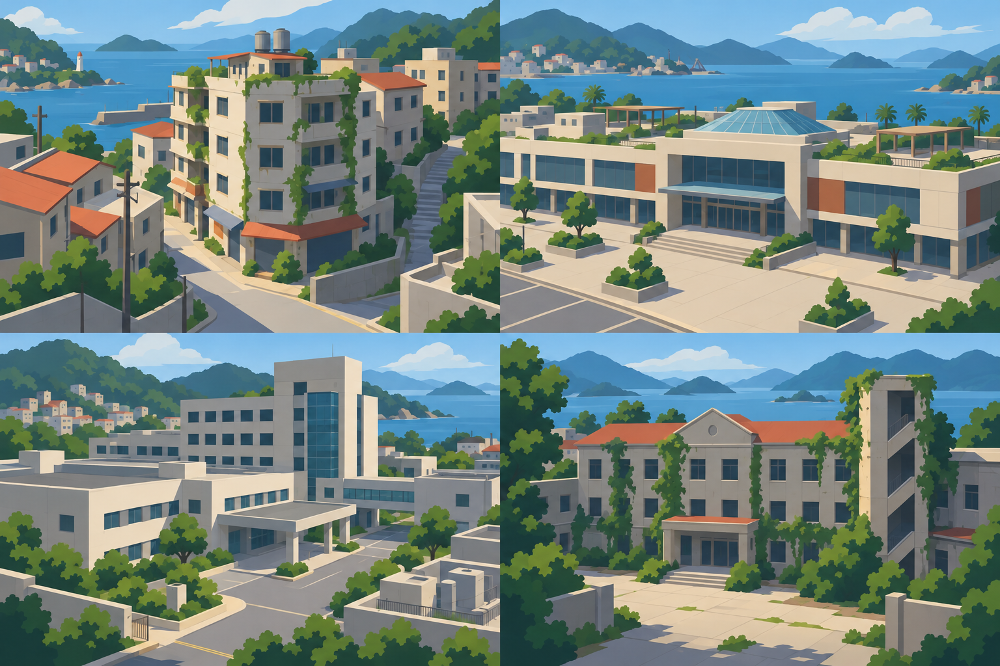
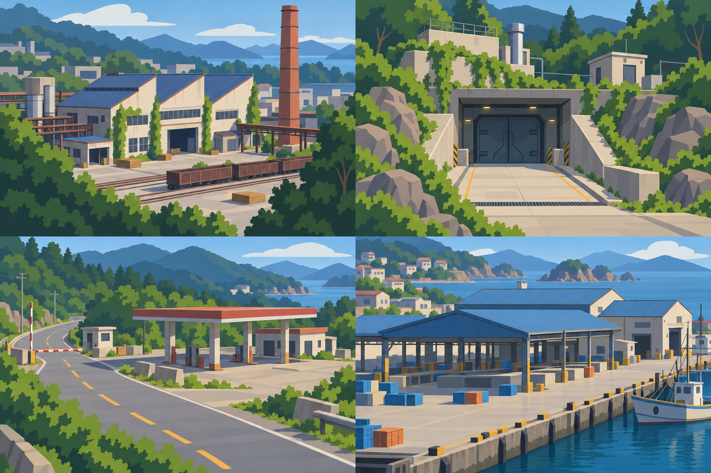
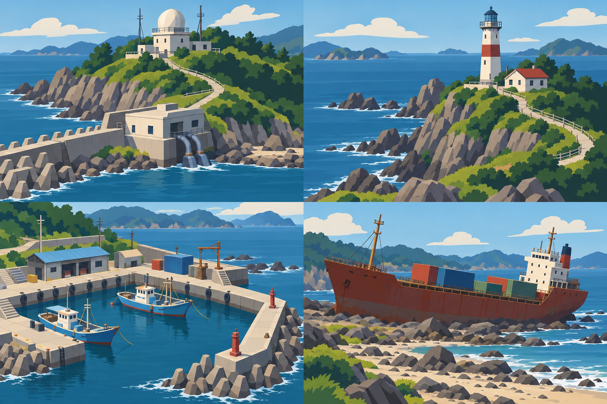

# 十二地区情报插图

维护者在 2026-10-23 要求「留一个改进空间给 Opus，多画点素材，再写个交接说明」。本包由内置 OpenAI `image_gen` 绘制，供 Opus 为选图界面设计区域情报卡、选中态或局部介绍。**十二张图均为概念插图，不是关卡截图，也不代表地区已经开放。** 2026-10-24 Opus 已把十二张全部接入出击面板的区域情报（见下文「接入结果」）。

源图以三张 2×2 图集绘制，经过第二轮风格重绘，减少写实表面、树叶和噪点。最终 PNG 原图保留；每个象限另导出一张 768×512 WebP，便于独立接入。文字、开发状态、危险信息、路线和交互标记继续由代码生成，不烘进图里。

十二张 WebP 合计 696,178 字节（约 680 KiB），内联后独立 HTML 增加约 0.89 MB。源图保留清晰的日光色阶，搭配深色终端时在组件内统一调色，不改动原图。

## 素材索引

| 区域展示 ID | 图集 / 象限 | 独立素材 | 视觉用途 |
| --- | --- | --- | --- |
| `old-town` | civic / 左上 | [老城街区](old-town.webp) | 住宅街角；现有入口仍标沿海街区，不能暗示完整老城已实现 |
| `mall` | civic / 右上 | [滨湾商场](mall.webp) | 商场外观与入口；不是现有 mall-v3 布局截图 |
| `hospital` | civic / 左下 | [县医院](hospital.webp) | 门诊及住院楼 |
| `old-hospital` | civic / 右下 | [县医院旧址](old-hospital.webp) | 旧病房与院落 |
| `factory` | infrastructure / 左上 | [工厂区](factory.webp) | 锯齿厂房、烟囱与货场 |
| `laboratory` | infrastructure / 右上 | [隐秘实验室](laboratory.webp) | 地下设施的封闭入口 |
| `highway` | infrastructure / 左下 | [西线国道](highway.webp) | 干燥公路、加油站与检查口 |
| `market` | infrastructure / 右下 | [水产市场](market.webp) | 交易棚与冷库 |
| `observatory` | coast / 左上 | [观测站与泵房](observatory.webp) | 观测楼与海堤设施 |
| `lighthouse` | coast / 右上 | [灯塔岬角](lighthouse.webp) | 灯塔轮廓与岬角 |
| `harbor` | coast / 左下 | [旧渔港](harbor.webp) | 修船棚、码头与渔船 |
| `freighter` | coast / 右下 | [远汐号](freighter.webp) | 搁浅货轮全貌 |

## 图集预览

以下为概念素材，不是运行截图。

## 来源与重现

- [prompts.json](prompts.json)：三次初始绘图的完整提示词、统一返修提示词、各输入的角色。使用内置工具，无外部下载图片。底图作为风格参考，不将其地形当作关卡事实。
- [manifest.json](manifest.json)：三张原始 PNG 和十二张 WebP 的尺寸、SHA-256、字节数，以及每张 WebP 对应的源图裁切矩形。矩形为 `[x, y, width, height]`，左上角为原点。
- [export.mjs](export.mjs)：只做等分裁切和 WebP 0.88 编码，不绘制、填补或改变图内内容。仓库根目录运行 `node assets/county-map/briefing-concepts/export.mjs`；沿用仓库 Playwright 和 Chrome 配置，无新增依赖。
- 第一轮高细节草稿不作为交付版接入；本地保留在忽略的 `test-results/county-art-drafts/opus-briefings/`。最终图和提示词均在仓库内，Opus 无需访问生成工具的用户目录。

## 接入结果（2026-10-24）

- 十二张全部接入，未重新压缩（仍为 WebP 0.88、768×512）；清单 `status` 改为 `briefing-art`。
- 情报卡默认保留 3:2 完整画幅；高度不足 800 px 的桌面和手机裁成 2:1，每张图的纵向焦点写在 `src/station-view/deploy-map.ts` 的 `focus`（例如灯塔、烟囱、观测站穹顶保住顶部）。
- 组件内调色：可出击区域略降饱和，暂未开发区域降饱和并压暗；图片右上角标「情报示意图」，开发状态写在图片上方，规划说明在图片下方。

以下为 2026-10-23 的接图建议原文：

先做一张可玩的商场情报卡和一张暂未开发的灯塔卡，验证版式，再推广至其他地区。推荐保留 3:2 完整画幅；需窄横幅时由 Opus 明确焦点和裁切，不能把主体随意截断。候选图未承诺与现有俯视底图精确配准，不要直接当作地图上的可点击地形贴片。

图像只承担氛围和地点辨识；未开发状态应始终清晰可读。移动端先保证地图选点、返回与出击按钮可达，再增加图像高度。运行时只引用选定的 WebP，PNG 和草稿不入包；预览图导入留在渲染宿主，避免纯 Node 测试再次读取图片模块。接入后必须继续单文件离线。

接入实现与验证见 [Opus 视觉深化](../../../docs/tasks/county-map-select.md#opus-视觉深化2026-10-24)；原交接见 [Opus 交接](../../../docs/tasks/county-map-select.md#交给-opus-的续作入口)。
