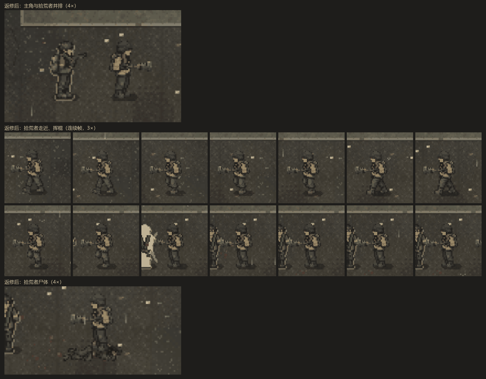
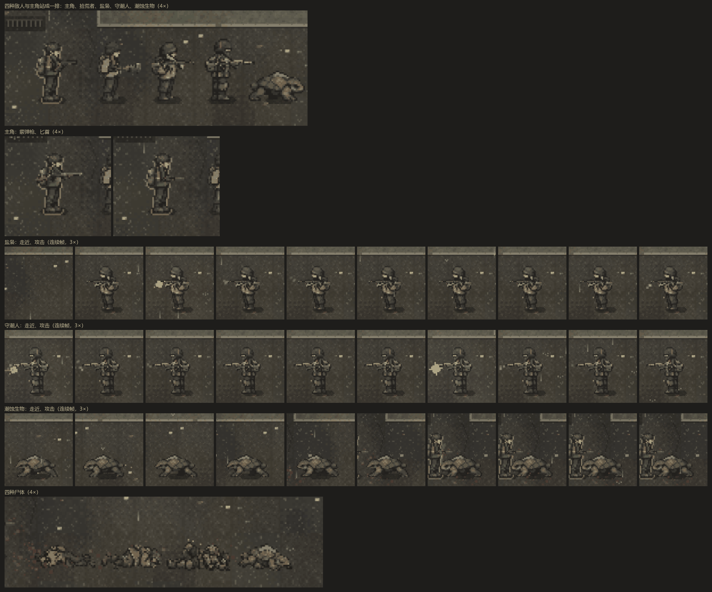

# 敌人与尸体的 2.5D 角色图（Sol P0 + P1）

2026-10-17。分支 `feat/enemy-art`，起点 main `345aff4`（#64 合并后）。Sol 的交付在仓库外的 `D:\bincov\敌人素材试样-20261017\`，原图、提示词、预览和自查记录都留在那里，仓库里只放运行时副本（[清单](../../assets/coast/manifest.json)）。

## 接入内容

- 四种敌人的身体帧：拾荒者、盐枭、守潮人、潮蚀生物，各五个朝向 × 5 帧（站立加 4 帧走路），朝西的三个方向在运行时镜像。潮蚀生物的画布是 40×28，其余是 32×48，脚底锚点都在底边中点。
- 四种尸体：各画一张朝东的，倒向西时镜像，锚点在图的中心。宿主按每张尸体图自己的锚点摆放，尸体的高亮描边也跟着走（[scene.ts](../../src/coast-view/scene.ts)）。
- 持握图：拾荒者的棍、盐枭步枪、守潮人重型步枪，主角的手枪、霰弹枪、匕首（卡宾枪沿用原图）。盐枭和守潮人在 Runtime 里拿的都是 `rifle`，按持有者选各自的图；握点和枪口（刀尖）的位置按清单里的数值写进 [sol.ts](../../src/coast-view/art/sol.ts)。
- 运行时素材从 43 张增加到 153 张，单文件从 5.35 MB 增加到 5.43 MB。

## 审阅经过

- P0（拾荒者）接进游戏后发现两处问题：外衣和主角同为深橄榄色，交战时分不清敌我；棍有 31 像素长，看起来像长矛。维护者决定先返修。返修后外衣改为沙褐色（接近 #ab9370）；棍的画布改为 24×10，可见长度 22 像素，包铁粗头。
- P1 一并把拾荒者的尸体改成沙褐色，和活着时一致。

| 画面 | 截图 |
| --- | --- |
| 拾荒者返修后：和主角并排、走近挥棍、尸体 |  |
| 四种敌人和主角站成一排；主角的霰弹枪和匕首；三种新敌人走近、攻击的连续帧；四种尸体 |  |

## 验证

- `pnpm test` 452/452，CI 规则测试 38/38，`pnpm package` 通过。
- 浏览器（本地）：art（角色、尸体、箱子纹理）、coast-animation（死亡倒地、手臂够到握点）、issue26-spatial（门口引导和楼梯名检查里的敌人像素）、tactical，都通过。

## 没做的

- 枪口火光沿握点所在的那条线出现。手枪、霰弹枪和两种步枪的枪口比握点高 3–4 像素（卡宾枪两者同高），近看火光略低于枪管。要对齐的话，需要让武器图带一个枪口高度偏移（前端小改）。
- 没在真机和没有显卡的慢设备上看过。
