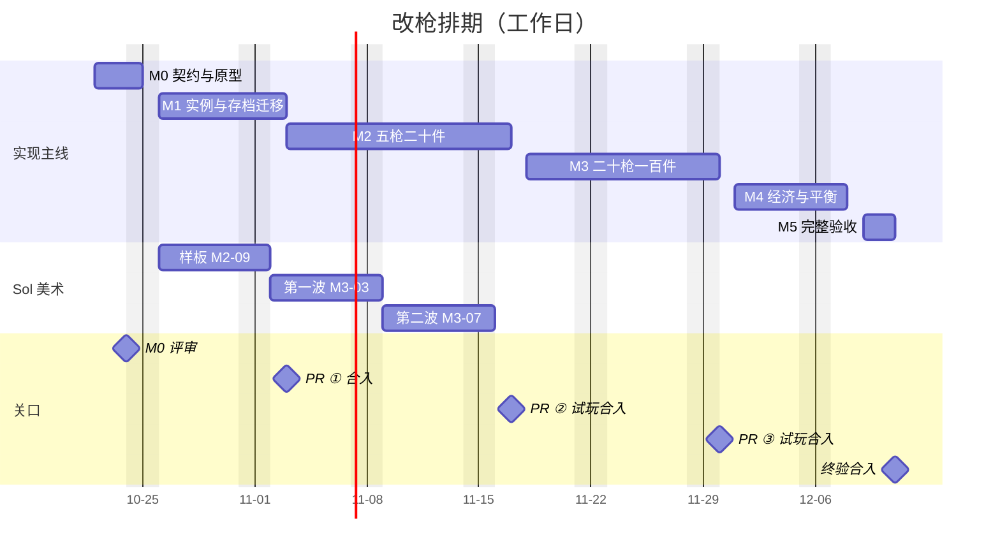

# 改枪任务拆分与排期

2026-10-22 排期。维护者要求把[改枪计划](PLAN.md)拆成可执行的小任务并排期，#28 合入 main 表示已排期；同日要求能做的先派子代理做，进度实时更新到 [#80](https://github.com/xuys2025/escape-bincov/issues/80)。

本页是实现入口：现在的代码起点、交付方式、要维护者定的事、每项任务和日期。设计依据仍是 PLAN、[WEAPONS](WEAPONS.md)、[ATTACHMENTS](ATTACHMENTS.md)；实际进度以 #80 和各实现 PR 为准。

## 1. 现在的起点

核对 main `4141503`（10-24，已含 #39 射击、#79 审计修复、#89 旧接口退役、#92 Perk、#97 命中确认）。计划写于 main `6450504` 的 Phaser 时期，下面是与计划假设不同或计划没写到的地方。

**射击（M0-S，#39 已完成）**

- 手感在 `src/shooting.ts`：`Handling`（mode、hip、precise、raise、sway、bloom/bloomMax、kick/kickMax、settle、recover）按武器 id 由 `handlingOf(id)` 查表，未知 id 静默落到没有后坐的默认值。身体晃动 `SWAY` 是全局的。
- 维护者选定“稳定”一套参数；“轻快”一套记在 [射击系统改造](../SHOOTING-SYSTEM-REWORK.md)，可作为“改好的枪”的参考。
- 其余武器数值在 `src/domain.ts` 的 `WeaponDef`（ammo、magazine、damage、range、cooldown、reload、pellets、spread），重量和价格在 `ITEMS`。
- 样本 M4A1 只在测试夹具、显式样板网址和试枪场出现，id 是 `m4a1`，不是物品，不进存档。M2-01 起样本已退役：试枪场和测试驱动改发正式的 `mb4a1`，数值和手感不变，网址标记已删除（见 [CONTRACTS](CONTRACTS.md#g17m4a1-与样板配件m2-0102)）。
- RPG 的后坐倍率（技巧、精神、疼痛）只在分层行动里，乘在整个散布锥和后坐偏移上。
- #92 的 Perk 另有两处：`perkEffects().recoil` 只缩放每发新增的散布和后坐（`recoil(aim, h, scale)`），`perkEffects().reload` 乘换弹时间（`CoastRaidRuntime.reloadTime`）。配件改的是枪本身的手感和换弹时间，与 RPG 倍率、Perk 各乘一次，不能叠两遍。
- Runtime 读武器的入口是 `CoastRaidRuntime` 的 `currentWeapon` 和 `grip`；`reloadMagazine`、`cleanMagazine`、`carriedWeight`、各存档校验、测试夹具和试枪场绕过它们直接按 id 查表。

**存档与物品**

- `Item` 只有 `{uid, id, qty, x, y, relief?, rotated?}`。各处按精确键校验，多一个字段就拒读；profile 还要求 `migrateSave` 规范化后不变。加实例数据必须升版本。
- 装备的枪是 `Equipment.weapon` 字符串，没有 UID。装备、卸下、行动内换枪、快速移动、放入安全箱、丢地再拾取、检查点重建安全箱，都会重新生成 UID 或丢掉未知字段。
- 弹匣上限在至少四处直接用 `WEAPONS[id].magazine`。
- 版本：会话记录 v3/v4/v5（键 `escape-bincov.session.v2`；v5 是 #92 加的，对应带 Perk 选择的扩展 v3），profile v2，扩展 v1/v2/v3，检查点 `coast-v2`（兼容 `coast-v1`）。新出击只有分层行动。
- #60 登记的原型键问题（`validateExpansion` 查武器表没用 `Object.hasOwn`）已由 #79 修复。
- 救济规则写死了 `ammo9`，新增弹药组时要一起改。

**界面、美术、声音**

- 院子已有“工作台”设施，但只做绷带、急救包、除藻药剂的生产队列，没有改枪。物品详情在院子 `panels.ts`、旧页签 `ui.ts`、行动内 `coast-view/inventory.ts` 各有一份。
- 手持枪图按 `WeaponLook`（pistol/shotgun/carbine/knife/club/claw/rifle）选，`HELD` 表给握把、枪口等锚点；物品图标是程序绘制，按物品 id 缓存。没有按配置的图。
- 开火声音不分枪，只分匕首、霰弹和敌人；#75 计划按枪种重做枪声，#97 已加受伤、命中、击杀、暴击声。枪声吸引半径是全局的 `SURVIVAL.gunNoiseRange`（510），按直线距离、不算墙，存进检查点。
- 没有激光、灯光这类设备。
- 新文字要进字体子集：构建检查 `assets/fonts/manifest.json` 的码位，重做子集用固定上游 TTF 和 `scripts/subset-font.py`（本机已有可用环境）。

**商店与掉落**

- 商人货架是固定的 `MERCHANTS` 加 RPG 额外项，没有按种子、进度或时间的轮换（PLAN 第 10 节以为有）。
- 目录是一张 6×5，待买、待卖各 4×3。购买不看待买区的摆放，结算时自动放进仓库。
- 每局 60 份物资（58 个随机点加样本和账册）；普通点里每把枪 1/26；尸体掉落有手枪和霰弹枪，没有卡宾枪。商场把同一批记录分到三层。
- #81（开发中）在重做敌人体系，尸体掉落以它合入后的版本为准，M2-13、M4-02 开工时核对。
- M2-13 已接上样板获取：老栓在旧货后面加 G17、三件基础件和 G17 的 O01、G01（M2 决定 8），目录仍一页放下；新街区和商场的枪、贵重品记录，以及旧敌人尸体的枪、贵重品掉落，各有六分之一变成 M4A1 或配件，其余记录和 #81 战术敌人的掉落都不变。见 [CONTRACTS](CONTRACTS.md#样板获取路径m2-13)。

**会被新物品打破的检查**

- `tests/domain.test.ts` 断言正好 30 种物品；`test:art` 要求每种物品有独立图标；`test:tactical` 把每种物品各放一件进 10×6 仓库。
- `tests/shooting.test.ts` 断言样本 M4A1 不在物品表，`tests/shooting-save.test.ts` 断言存档里没有手感字段。
- M2-01/02 已按原意更新这些检查：物品表 52 种；`test:tactical` 按需用几个 10×6 仓库放下全部物品；样本退役，`shooting-save` 仍检查手感不进存档，只是 `mb4a1` 的 id 现在会出现在存档里。
- 新增浏览器套件要同时改 `package.json`、`scripts/ci/browser-suites.mjs`、`scripts/ci/policy.test.mjs` 和 `docs/CI.md`。

**模块边界**：`domain.ts`、`balance.ts`、`world.ts` 只能互相引用（`scripts/ci/source-health.test.mjs` 的 `PURE`），domain 不能读 `shooting.ts`。改枪的纯规则模块加入这个名单，由 domain 单向引用，不能反过来。

## 2. 交付方式

#28 合入表示已排期。实现另开 PR，每个里程碑一个，任务在 PR 内逐个提交；不为单个任务另开 PR，也不自动合并，合并要维护者明确同意。

| PR | 内容 | 玩家能看到什么 |
| --- | --- | --- |
| ① `feat/gunsmith` | M0 + M1 | 没有变化：旧三枪数值和手感不变，存档升级为枪械实例 |
| ② | M2 | 第一次可见：五枪二十件、工作台、样板美术 |
| ③ | M3 | 扩到二十枪一百件 |
| ④ | M4 + M5 | 经济平衡与完整验收 |

- 同一时间一条实现主线：一个 PR 一个主 agent，可以派子代理分做互不重叠的文件，再由主 agent 合并、打包、跑 CI。Sol 的美术并行。维护者在每个里程碑末评审或试玩。
- 1 工是一个 agent 一个工作日，含自测和 CI，不含等评审。日期按工作日排，周末不排。
- 进度只在 #80 实时更新；实现 PR 正文用[短摘要模板](../TASK-HANDOFF-TEMPLATE.md)；里程碑结束时在本页对应小节末尾补一行实际用时，并重排后面的日期。

## 3. 要维护者定的事

2026-10-24 评审已定：下表全部按默认做法；包体上限放宽，只要能正常运行就行。完整结论（含工作台、瞄具、美术、配件细节）见 [CONTRACTS.md](CONTRACTS.md) 开头的「M0 评审决定」。

| 事项 | 默认做法 | 何时定 |
| --- | --- | --- |
| 首版三项选择（PLAN 第 16 节） | 完整原厂枪加模块化配件；六种虚构弹药组；完整拆装只在回站后做 | M0 评审 |
| 内部 ID | 沿用 WEAPONS.md 的 id（`gb17`、`mb4a1` 等）；#39 的样本 `m4a1` 在 M2 换成正式的 `mb4a1` | M0 评审 |
| 配件护栏 | PLAN 第 6 节的初值：散布、后坐改善不超过 40%，操控时间不短于原厂 65%，射程增加不超过 25%，消音后声音不低于 40% | M0 评审，M4 按实测调 |
| 改枪入口 | 院子工作台和整备里的物品详情都能打开同一界面，旧页签同一面板；不要求先建好工作台（现在建工作台要先修复供电） | M0 评审 |
| 存档版本号 | 已定：profile 2→3，会话记录与恢复备份统一 v6，原字节存 `gunsBackup`，行动中的档读档时就地迁移（M0-06） | M0 评审 |
| 美术先后 | Sol 先做改枪样板（M2-09），再继续 #47 商场其余区域 | M0 评审 |
| 交付分 4 个 PR | 见第 2 节 | 合入 #28 即按此执行 |

## 4. 排期总览

| 里程碑 | 交付 | 估算 | 日期 | 关口 |
| --- | --- | --- | --- | --- |
| M0 契约与风险原型 | PR ① 第一阶段 | 4.5 工，多数并行 | 10-22 → 10-24（实际） | 10-24 评审完成 |
| M1 实例贯穿与存档迁移 | PR ① 第二阶段 | 5.5 工，复核 0.5 工 | 10-26 → 11-02 | 11-03 合入 PR ① |
| M2 五枪二十件完整流程 | PR ② | 9.75 工，Sol 3 工 | 11-03 → 11-16 | 11-17 试玩、合入 |
| M3 扩到二十枪一百件 | PR ③ | 7 工，Sol 8 工 | 11-18 → 11-27 | 11-30 试玩、合入 |
| M4 经济与平衡 | PR ④ 第一阶段 | 4.5 工 | 12-01 → 12-07 | 12-08 试玩 |
| M5 完整验收与交付 | PR ④ 第二阶段 | 2 工 | 12-09 → 12-10 | 12-11 终验、合入 |
| 合计 | | 约 33 工，Sol 11 工 | 10-22 → 12-11 | |

## 5. 任务

负责一栏：“实现”是该里程碑 PR 的主 agent（可派子代理），“复核”是另一个只做检查的 agent。

### M0 契约与风险原型（PR ① 第一阶段）

M0-01/02/03、M0-08、M0-09 于 10-22 由子代理开工，被停电和暂停打断，10-24 重新开工。M0 的纯规则模块先不接入游戏。

| 编号 | 任务 | 产出与完成判据 | 依赖 | 负责 | 工 | 日期 |
| --- | --- | --- | --- | --- | --- | --- |
| M0-01 | 目录类型、插槽模型与模块边界 | `src/gunsmith/` 下的纯规则模块和类型：插槽分类、配件效果字段；加入 `PURE`，domain 单向引用；决定记入 CONTRACTS.md | — | 实现 | 0.25 | 10-22 → 10-23 |
| M0-02 | 二十枪目录 | 20 枪定义：WEAPONS.md 的 id、弹药组、容量、手感、占格、重量、价格档；旧三枪与现有 `WEAPONS`、`ITEMS`、`HANDLING` 逐项相等（有测试）；新枪数值标为提案 | M0-01 | 实现 | 0.25 | 10-22 → 10-23 |
| M0-03 | 一百配件目录与兼容判定 | 100 件定义；四层兼容判定，中文拒绝原因，拆父件时子件进待卸；测试从 ATTACHMENTS、WEAPONS 两张表独立推出 2000 个枪型×单件关系并逐一比对 | M0-01 | 实现 | 0.5 | 10-22 → 10-23 |
| M0-04 | 有效属性与配件护栏 | 原厂值 → 互斥替换 → 同维度汇总 → 护栏，得到枪本身的数值；RPG 倍率和 #92 的 Perk 仍由 Runtime 在原处各乘一次，不进这一步；给 `handlingOf` 和 `WeaponDef` 的读者一个统一入口；旧三枪无配件时结果与现在逐项相等 | M0-02、M0-03 | 实现 | 1 | 10-23 → 10-26 |
| M0-05 | 枪械实例模型 | 枪 UID、配件树、各节点 UID、设备开关、逐节点救济标记；全记录 UID 唯一、树深不超过 3、最多 12 件、依赖合法的校验；成枪占格（基础形状加配件延伸）、重量、售价按组成汇总 | M0-03 | 实现 | 0.5 | 10-23 → 10-26 |
| M0-06 | 存档版本与迁移表 | 列出 profile、会话记录、扩展、检查点、两种备份要升的版本和字段；旧三枪 → 原厂实例的纯函数（UID 确定、不耗战斗随机数、重复加载不重复生成）；用已结算档、旧备份、活动分层行动、待保存结算、内含迁移备份的样本证明无损。只证明，不接入读档 | M0-05 | 实现 | 1 | 10-26 → 10-27 |
| M0-07 | 瞄具观察范围原型 | 在试枪场试远距瞄具的精瞄前探上限（#39 后只在右键精瞄时前探）；光标不动时瞄准仍不漂移；给出上限建议和截图 | — | 实现 | 0.5 | 10-23 → 10-26 |
| M0-08 | 工作台交互原型 | 仓库外单文件：桌面和手机布局，预览不落地、缩容卸弹、拆父件、拒绝原因、预设；四个尺寸截图 | — | 实现 | 1 | 10-22 → 10-23 |
| M0-09 | 美术规格与 Sol 样板任务书 | `docs/gunsmith/ART-SPEC.md`：三种输出的尺寸、锚点、组合缓存键与上限、体积预算、交付规则、分批；本机 Sol 任务书 | — | 实现 | 0.5 | 10-22 → 10-23 |
| M0-10 | M0 评审（关口） | 维护者看目录、实例和迁移表、两份原型、美术规格，定第 3 节各项；按实际用时重排 M1 之后的日期 | M0-01 至 M0-09 | 维护者 | — | 10-24（提前） |

实际：M0-01～M0-09 于 10-24 全部完成（10-23 停电和暂停没有进度），维护者当天评审，比计划早两个工作日；M1 起的日期随之提前两个工作日。

### M1 实例贯穿与存档迁移（PR ① 第二阶段）

| 编号 | 任务 | 产出与完成判据 | 依赖 | 负责 | 工 | 日期 |
| --- | --- | --- | --- | --- | --- | --- |
| M1-01 | 实例字段与严格校验 | `Item`、`Equipment` 带实例数据；profile（`validInventory`、`validEquipment`）、分层行动（`validateExpansion`）、检查点、备份按新版本严格校验 | M0-10 | 实现 | 1 | 10-26 |
| M1-02 | 旧档迁移接入读档 | 旧版本读档时走 M0-06 的迁移，原字节按现有策略保留；未知版本拒绝覆盖；旧页面读新档时安全拒读；导入预览和确认沿用 | M1-01 | 实现 | 1 | 10-27 |
| M1-03 | 装备、卸下、换枪搬运同一实例 | `equip`、`unequip`、`equipRun`、`CoastRaidRuntime.equipItem` 不再重建物品；卸枪时普通弹、救济弹分别退回；容量按有效属性 | M1-02 | 实现 | 0.5 | 10-28 |
| M1-04 | 转移不再换 UID | 快速移动、放入安全箱、丢地与拾取、`checkpointSafe`、尸体和箱子转移都保留实例；空间不足整次不提交 | M1-02 | 实现 | 0.5 | 10-28 |
| M1-05 | Runtime 读有效属性 | `currentWeapon`、`grip`、`reloadMagazine`、`cleanMagazine`、`carriedWeight`、HUD 武器卡、试枪场和测试夹具都走 M0-04 的入口；按评审补上锥级护栏（腰射锥、精瞄锥不低于原厂 0.6）；旧三枪无配件时实验台结果不变 | M1-03 | 实现 | 1 | 10-29 |
| M1-06 | 估值与售价按组成 | 结算估值、商店报价按枪加配件逐件算；救济组成不可售，整件含受限组成时拒绝出售并说明原因，不自动拆、不销毁 | M1-03 | 实现 | 0.5 | 10-30 |
| M1-07 | 守恒与往返测试 | 固定种子生成合法组合，跑装卸、转移、买卖、死亡、结算重试、跨层、保存失败回滚，查物品、弹药来源、现金守恒；`test:save-browser` 等存档浏览器回归 | M1-04、M1-05、M1-06 | 实现 | 0.5 | 10-30 |
| M1-08 | 独立复核存档迁移 | 只看迁移和校验：旧档样本、拒读、回滚、重复迁移；只报自己确认的缺陷 | M1-07 | 复核 | 0.5 | 11-02 |
| M1-09 | PR ① 合入（关口） | 同步 main、重新打包、CI 全绿后由维护者同意合入 | M1-08 | 维护者 | — | 11-03 |

实际：M1-01～M1-08 于 10-24 全部完成。两个实现子代理并行（数据与事务、Runtime 读数值），集成时 #81 已占用会话记录 v6/v7，改枪顺延为 v8；守恒属性测试 200 个种子；两个独立复核共 5 个低级问题，4 个已修，详情售价归 M2-08。PR ① 合入时间见 #80。

### M2 五枪二十件完整流程（PR ②）

| 编号 | 任务 | 产出与完成判据 | 依赖 | 负责 | 工 | 日期 |
| --- | --- | --- | --- | --- | --- | --- |
| M2-01 | G17、M4A1 正式入目录 | `gb17`、`mb4a1` 成为物品；样本 `m4a1` 退役，试枪场改用正式枪；更新物品数、图标、仓库摆放三处测试 | M1-09 | 实现 | 0.5 | 11-03 |
| M2-02 | 二十件样板配件生效 | O01、O03、O08、M03、M06、B01、B08、H01、H05、S01、S02、P01、P02、F01、F03、G01、G10、T01、T05、A07 成为物品，经有效属性真实影响散布、后坐、举枪、射程、弹量、换弹、重量和声音 | M2-01 | 实现 | 1 | 11-03 → 11-04 |
| M2-03 | 激光与灯光 | 设备开关（键盘和触屏），按件保存；激光和腰射握把只影响有效距离内的腰射，随举枪淡出；灯光只提示同层、视线内、已揭示区域的可交互物；开启有暴露代价；隐藏房间不泄露 | M2-02 | 实现 | 0.5 | 11-04 |
| M2-04 | 改装事务 | 选枪 → 预览候选 → 核对所有权 → 依赖、冲突、弹量、占格 → 一次保存 → 显示成功；确认时核对修订号，拒绝过期预览；缩容先卸弹，放不下整次不提交 | M2-02 | 实现 | 1 | 11-05 |
| M2-05 | 工作台界面（桌面） | 按 M0 评审定的方案做进院子工作台和物品详情，旧页签同一面板；1280×720、1920×1080 截图 | M2-04 | 实现 | 1.5 | 11-06 → 11-09 |
| M2-06 | 工作台界面（手机） | 分页，确认、取消固定可见，全部能点击完成；旋转、退出、重新选枪时保留或明确取消候选；844×390、740×300、640×300、390×844 | M2-05 | 实现 | 1 | 11-09 → 11-10 |
| M2-07 | 预设 | 最多十套，只存枪型和配件定义；应用时匹配现有库存，列出缺件，不自动购买 | M2-05 | 实现 | 0.5 | 11-10 |
| M2-08 | 详情、商店与售卖预览 | 三处物品详情显示制造商、适配枪、仓库里有没有适配枪、缺哪个基座；商店按类别和适配枪筛选、目录分页；待买、待卖区放得下最大合法成枪；售卖预览逐件列价格 | M2-04 | 实现 | 1 | 11-11 |
| M2-09 | 样板美术 | 按 ART-SPEC 交 G17、M4A1 的三种输出和 20 件配件图；原创像素画，不用现实标志 | M0-10 | Sol | 3 | 10-26 → 10-30 |
| M2-10 | 美术接入与组合缓存 | 库存和地面图标、手持组合、工作台大图按配置组合并缓存（键含枪型、配置、素材版本、手套）；缓存有上限、换场景释放；20 次往返资源不增长 | M2-05、M2-09 | 实现 | 1 | 11-12 |
| M2-11 | 枪声与听觉按配置 | 在 #75 按枪种的枪声上加消音等配置变体，开火事件带音色和消音状态；Runtime 按有效声音半径决定敌人听觉，替代全局 510；前端每个事件只消费一次 | M2-02 | 实现 | 0.5 | 11-13 |
| M2-12 | 字体与文案 | 新名称和界面文字进字体子集（重做 WOFF2 与 manifest）；文案按 [COPY-GUIDE](../COPY-GUIDE.md) | M2-08 | 实现 | 0.25 | 11-13 |
| M2-13 | 样板获取路径 | 老栓常备 G17 和基础件；常规件进分区掉落；每局 60 份预算不变，只从武器、贵重份额里分 | M2-02 | 实现 | 0.5 | 11-13 |
| M2-14 | 改枪浏览器专项 | 新套件覆盖获取 → 改装 → 出击 → 撤离或死亡 → 恢复，桌面两种尺寸和手机矮屏；登记进 CI | M2-10 至 M2-13 | 实现 | 0.5 | 11-16 |
| M2-15 | 试玩与合入（关口） | 维护者试玩，轻快配装和稳定配装的 M4A1 能感到区别；CI 全绿后合入 PR ② | M2-14 | 维护者 | — | 11-17 |

### M3 扩到二十枪一百件（PR ③）

| 编号 | 任务 | 产出与完成判据 | 依赖 | 负责 | 工 | 日期 |
| --- | --- | --- | --- | --- | --- | --- |
| M3-01 | 第一波七枪 | P226、MP5、Vector 9mm、M870、M1014、AK-74、AK-103，只用现有三种弹药；数值、手感、开火方式、占格 | M2-15 | 实现 | 1 | 11-18 |
| M3-02 | 第一波四十件配件 | 适配前 12 枪的 40 件，清单按兼容表生成后写回本页；每件有合法适配和获取路径 | M3-01 | 实现 | 1 | 11-19 |
| M3-03 | 第一波美术 | 7 枪三种输出、40 件配件图 | M2-09 | Sol | 4 | 11-02 → 11-06 |
| M3-04 | 第一波接入 | 美术、字体、获取池；浏览器专项扩到 12 枪 | M3-02、M3-03 | 实现 | 1 | 11-20 |
| M3-05 | 第二波八枪与新弹药组 | M1911、UMP45、P90、SVD、M14、M700、AUG、RPK；新增 ammo45、ammoPDW、ammoHeavy（物品、商店、掉落、存档校验）；救济规则改为按弹药组 | M3-04 | 实现 | 1.5 | 11-23 → 11-24 |
| M3-06 | 第二波四十件配件 | 其余 40 件 | M3-05 | 实现 | 1 | 11-24 → 11-25 |
| M3-07 | 第二波美术 | 8 枪、40 件 | M3-03 | Sol | 4 | 11-09 → 11-13 |
| M3-08 | 第二波接入 | 同 M3-04，扩到 20 枪 | M3-06、M3-07 | 实现 | 1 | 11-26 |
| M3-09 | 目录完整性门禁 | CI 检查 20 枪、100 件：每件有图、功能、代价、获取路径、合法适配；没有孤立配件和占位；每枪至少两种合理配装方向 | M3-08 | 实现 | 0.5 | 11-27 |
| M3-10 | 试玩与合入（关口） | 维护者抽查各类枪和配件；CI 全绿后合入 PR ③ | M3-09 | 维护者 | — | 11-30 |

### M4 经济与平衡（PR ④ 第一阶段）

| 编号 | 任务 | 产出与完成判据 | 依赖 | 负责 | 工 | 日期 |
| --- | --- | --- | --- | --- | --- | --- |
| M4-01 | 商人分层供货与轮换 | 入门枪和基础件常备；常规件随任务、行动进度进轮换货架；稀有件靠高风险物资点和后期货架；轮换由存档里的进度和种子决定，刷新页面不刷货。现在没有轮换，这是新功能，存档要加字段 | M3-10 | 实现 | 1 | 12-01 |
| M4-02 | 掉落重分配 | 配件按类别、区域、进度分池；每局 60 份预算和任务、食药供给不变 | M4-01 | 实现 | 1 | 12-02 |
| M4-03 | 价格与收入校准 | 按真实撤离收入试算：基础件 40–150，常规件 150–450，稀有件 450–1200；一次正常撤离能做一次小改装 | M4-02 | 实现 | 0.5 | 12-03 |
| M4-04 | 二十局资源样本 | 自动游玩连续二十局，统计弹药断供、无用配件积压、任务物资完成率 | M4-03 | 实现 | 1 | 12-03 → 12-04 |
| M4-05 | 配装对比与占优修正 | 轻快、安静、稳定、大容量四类配装实测对比；修掉全面占优的组合；RPG 倍率和 #92 Perk 只乘一次 | M4-04 | 实现 | 1 | 12-07 |
| M4-06 | 试玩（关口） | 维护者试玩经济节奏 | M4-05 | 维护者 | — | 12-08 |

### M5 完整验收与交付（PR ④ 第二阶段）

| 编号 | 任务 | 产出与完成判据 | 依赖 | 负责 | 工 | 日期 |
| --- | --- | --- | --- | --- | --- | --- |
| M5-01 | 全量回归与改枪专项 | 全部 CI 套件和改枪专项；保存失败、普通离线入口、备份必测 | M4-06 | 实现 | 0.5 | 12-09 |
| M5-02 | 性能与资源 | 多次切换预设、进出工作台、十分钟行动后缓存不持续增长；同设备 P95 帧耗时回退不超过基线 10% | M4-06 | 实现 | 0.5 | 12-09 |
| M5-03 | 多尺寸截图与真机登记 | PLAN 第 15 节六种尺寸的真实截图；真机、真人缺口如实登记 | M5-01 | 实现 | 0.5 | 12-10 |
| M5-04 | 文档、打包与交接 | 游玩手册、更新记录、发布清单、handoff；本页补实际用时 | M5-03 | 实现 | 0.5 | 12-10 |
| M5-05 | 终验与合入（关口） | 维护者终验，CI 全绿后合入 PR ④ | M5-04 | 维护者 | — | 12-11 |

## 6. 风险与重排

- 估算是 M0 之前的判断。PLAN 原本要求 M0 之后再估工期，所以 M0 评审时按实际用时重排一次。
- 最不确定的四处：存档迁移（M1）、手机工作台（M2-06）、百件美术（受 Sol 排队影响）、经济调参（M4）。
- 能提前的地方：M2 的规则和界面分给两个子代理并行，约提前 4 个工作日；M3 的数据和接入也能并行。
- Sol 同时有 #47 商场和新封锁区的美术，先后由维护者定；Sol 推迟时 M2-10、M3-04、M3-08 跟着顺延。
- #60 Q-E02 B 段改的也是行动内背包面板（`coast-view/inventory.ts`），和 M1-04、M2-08 是同一个文件；开工前在 #60 确认谁先做。
- 存档版本：#92 已占用会话记录 v5、扩展 v3，改枪接着往上加；以后再有人升版本，先合入的先占。
- #75 的枪声配方和 M2-11 改的是同一处（`SynthAudio.shot`），开工前在 #75、#80 互相登记。
- 每次推送都会跑一轮全量 CI（约 8 分钟），里程碑内的修改攒齐再推。
- 地图边瞄准偏转（M0-07 发现的现有问题）按评审单独修复，不占改枪任务。
