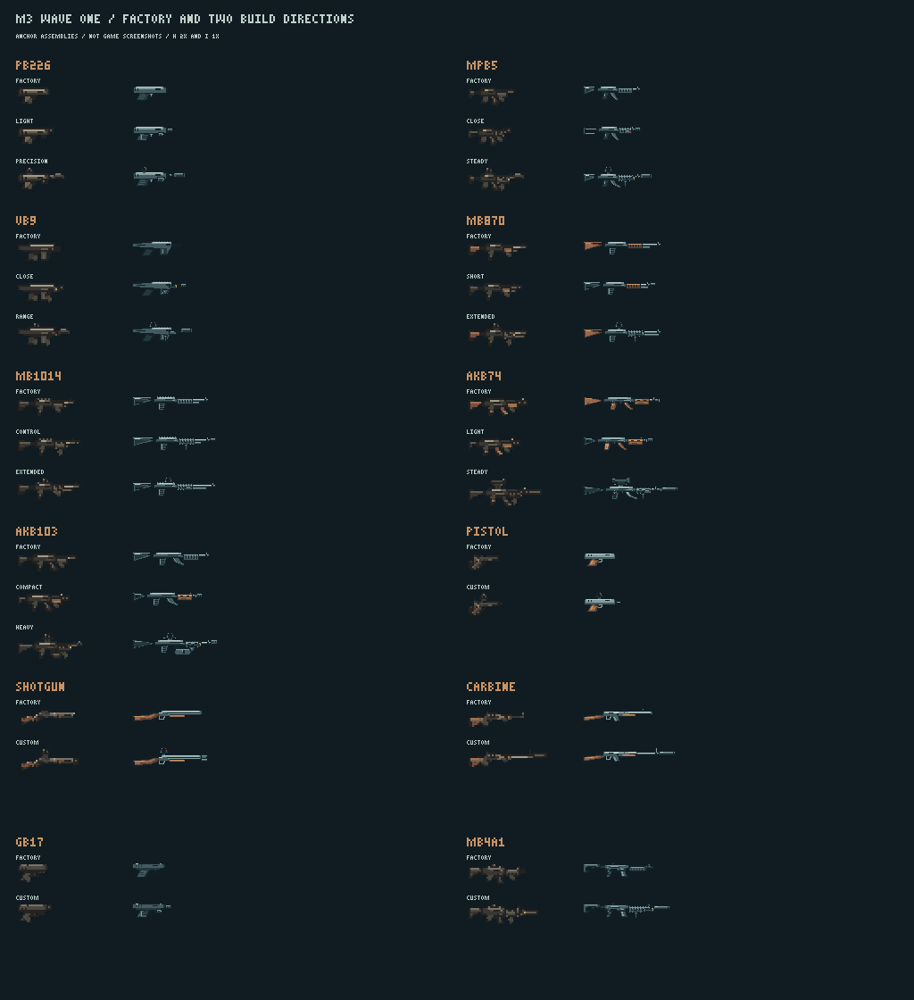

# M3 第一波美术 · P0 + P1 交付

2026-10-28，承接 [PR #132](https://github.com/xuys2025/escape-bincov/pull/132) / #28 M3-03。
维护者在 P0 提交后明确要求“按任务书处理所有美术任务”，本批据此完成 [BRIEF](BRIEF.md) 的第一波全部图包。
**图包齐备；独立自查 386/386 通过。** 维护者已明确保留旧双管原图，并仅将这张旧整枪图列为色数例外；新图限色不变。

## 交付清单

| 类别 | 范围 | PNG 数 |
| --- | --- | ---: |
| 七枪机匣 H/I/W、Q24/Q32 | P226、MP5、Vector 9mm、M870、M1014、AK-74、AK-103 | 35 |
| 原厂可换件 H/I/W | MP5 四件；两把新霰弹枪、两把 AK 各五件 | 72 |
| 四十配件 | 各 I/W/Q24；H 除 P03、P04、P06、P07 | 156 |
| 旧枪补层 | 旧手枪/双管 H；卡宾 H/W 机匣 v2 与原厂枪管 | 6 |
| 旧枪专用变体 | M01 的 pistol H/I/W；M05、M07 的 carbine H | 5 |
| 合计 | 任务书约 269 图，加 5 张必要变体 | **274** |

运行 PNG 合计 **38,807 字节（37.90 KiB）**，低于整波参考预算 88 KiB。
M2 的 24,419 字节加本批为 **63,226 字节**，只是素材累计，不是已导入的正式包体积。
完整 id、路径、字节、SHA-256、尺寸、颜色与挂点见[暂存清单](../../../../assets/gunsmith/incoming/m3-w1/manifest.json)。

四十配件按 id 齐备：

- A01、A02、A04、A05、A06、A08；B03、B05、B06、B07、B09。
- H02、H03、H04、H06、H07、H08、H09；S03、S04、S05、S07、S08。
- P03、P04、P06、P07；G03、G06、G07、G08、G09。
- M01、M02、M05、M07、M10、M11；T04、T08。

P0 的 62 张运行图保留 `7060db4` 的原 SHA-256；M2 的全部 115 张运行图也未改。
两把 AK 的机匣三种输出各自共用同一套挂点；P07 按任务书标为 `aboveReceiver`。
旧枪变体保留旧图的整数/半像素枪口轴线，避免共享件按新枪坐标安装后偏移；文件名遵循 `gs-<件>-<输出>-<枪>-v1`。
卡宾新版机匣使用 `-v2` 与 `replacesSha256`，没有覆盖 M2 原文件。

## 预览



| 枪 | H/I/W 配装与人物比例 | 逐件三底色与灰度示例 |
| --- | --- | --- |
| P226 | [原厂/轻巧/精确](preview/pb226-wave1-configurations.png) | [Q 灰度](preview/contact-pb226-q-gray.png) |
| MP5 | [原厂/近战/稳定](preview/mpb5-wave1-configurations.png) | [H](preview/contact-mpb5-h-color.png) |
| Vector | [原厂/近战/远射](preview/vb9-wave1-configurations.png) | [Q 灰度](preview/contact-vb9-q-gray.png) |
| M870 | [原厂/短/扩展](preview/mb870-wave1-configurations.png) | [I](preview/contact-mb870-i-color.png) |
| M1014 | [原厂/控制/扩展](preview/mb1014-wave1-configurations.png) | [Q 灰度](preview/contact-mb1014-q-gray.png) |
| AK-74 | [原厂/轻快/稳定](preview/akb74-wave1-configurations.png) | [W](preview/contact-akb74-w-color.png) |
| AK-103 | [原厂/紧凑/重火](preview/akb103-wave1-configurations.png) | [Q 灰度](preview/contact-akb103-q-gray.png) |
| 旧手枪 | [原厂/改装](preview/pistol-wave1-configurations.png) | [H](preview/contact-pistol-h-color.png) |
| 双管 | [原厂/改装](preview/shotgun-wave1-configurations.png) | [H](preview/contact-shotgun-h-color.png) |
| 卡宾 | [原厂/精确管与消音器](preview/carbine-wave1-configurations.png) | [W](preview/contact-carbine-w-color.png) |
| G17 | [原厂/握片与侧挂](preview/gb17-wave1-configurations.png) | [Q](preview/contact-gb17-q-color.png) |
| M4A1 | [原厂/长导轨护木](preview/mb4a1-wave1-configurations.png) | [W](preview/contact-mb4a1-w-color.png) |

每枪都有 `contact-<枪>-<h|i|w|q>-<color|gray>.png`：每件 1 倍和 3 倍，三种指定背景。
每套有 H/I 的 1、3 倍，W 的 1、2 倍，以及 `-body-1x/3x.png` 人物比例预览。
七把新枪另有 `-factory-ground-hud-1x/2x.png` 无手套原厂侧面图。
身体预览按 bore 对齐第 26 行，grip 放在 x=16+forward；预览均不是游戏截图。

[assembly-records.json](assembly-records.json) 包含 12 枪的 **31 套、93 份 H/I/W 拼装记录**：任务书的 19 套改装、七枪与旧三枪原厂，另附 G17/M4A1 原厂作为对照。
每层位置只由清单挂点计算；没有手摆。包含全部需要复用的 M2 瞄具、前握把和侧挂件。
卡宾、旧手枪、双管的 H/I/W **9 项叠回全部为 0 差异像素**。

## 原稿、生成工具与复现

H/I/W/Q 独立用目标尺寸的整数像素画稿绘制。W 有独立墨线、螺钉、导轨、拉柄与纹理，没有将 I 放大作为 W。
原稿与导出在 [source/pixel-artwork.json](source/pixel-artwork.json)、[source/export.mjs](source/export.mjs)、[source/wave1.mjs](source/wave1.mjs)。
旧 I 图原稿由实际 `paintInventoryItem` 捕获，见 [source/legacy-inventory.json](source/legacy-inventory.json)；`virtual` 的 `rect`/`clearRects`/`fillRects` 记录拆层。

内置 image_gen：P0 **1 次成功**的造型参考与提示词保留在 [source/generation.json](source/generation.json)。
P1 发出 **3 次参考生成请求**，批调用返回连接失败，未取得可用输出；没有切换 CLI/API。请求与错误见 [source/p1-generation.json](source/p1-generation.json)。
运行图均来自可重放的原生像素画稿；造型参考不进游戏。

```text
node docs/gunsmith/art/m3-w1/source/wave1.mjs
node docs/gunsmith/art/m3-w1/source/batch-assemble.mjs
node docs/gunsmith/art/m3-w1/validate.mjs
```

最后一条检查包含维护者明确授权的旧双管整枪例外，并锁定其原始文件和 RGBA 哈希；其余单图仍严格限色。
可选真实规则复核：`node --import tsx docs/gunsmith/art/m3-w1/source/check-runtime.mjs`。

## 实际验证与已知冲突

本轮已接受基线 `origin/main`：`b5bd63b7896b3b0697d4ba38d02d000e78903047`；续作起点 `7060db44e1da8f72f53dc0c02661c9896f05d5fc`。
提交前再次 fetch，main 已前进到 `efe2bede6af0ed33fec065a26755e1f8ff7d0256`；本地验证对应本 PR 的原游戏代码，最终合成树由 GitHub CI 验证。
Windows，Node 24.22.1、pnpm 11.19.0；正式游戏代码与 M2 清单未改。

| 检查 | 结果 |
| --- | --- |
| 独立自查 | **386/386 通过**，含一项明确授权且哈希锁定的旧整枪色数例外，详见 [validation.json](validation.json) |
| 真实兼容/布局 | **31 套合法、93/93 布局、7/7 无手套原厂通过** |
| 单件适配与开槽 | **124 组合法适配通过**，覆盖 40 件新件及指定 10 件 M2 复用件；不是全排列测试 |
| 旧枪 H/I/W 叠回 | **9/9，差异均为 0** |
| P0 / M2 文件哈希 | **62/62、115/115 保持** |
| `pnpm test` | **1020/1020 通过** |
| `pnpm check:ci` | **73/73 通过** |
| `pnpm package` | **通过**；正式包仍只读 M2 的 115 图 |
| 预览大小 | 380 张，每张最大 36,005 字节，均小于 1 MiB |

真实规则证据见 [runtime-layout-check.json](runtime-layout-check.json)。它仅在进程内注入暂存元数据与虚拟切层，调用现有 `validateBuild`、`gunSize`、`gunArtLayout`，不写游戏文件。

**明确授权的例外：旧双管原图已有 10 色。**
任务书第 3 节要求单图 H/I ≤8 色；第 6 节又要求旧双管 H 机匣与已验收 `coast-weapon-shotgun-held-v1.png` 逐像素相同。
原图是整枪加画死的手套，共 10 色，两条要求不能同时满足。首次严格检查为 385 通过、1 失败，记录保留于提交 `175b559`。
维护者随后明确选择“保留原图，作为旧整枪色数例外（推荐）”。授权及原始文件/RGBA 哈希见 [source/legacy-palette-approval.json](source/legacy-palette-approval.json)。
例外只接受这张原图的固定哈希和 0 差异像素；新图仍执行原限色，没有将整批上限提高。所有新枪、新零件均满足各自限色；组合也在上限内。

自动验证覆盖完整清单、哈希、Alpha、尺寸、原稿重放、W 独立像素、挂点、配装尺寸、枪口轴线、附属件接触和不超枪口、叠回与字节。
交付者已查看成枪、逐件三底色与灰度、人物比例；几何接触检查不等于逐条墨线或维护者审美签收。

## 交接

- 图包无缺件。旧双管的单图色数冲突已按维护者决定，保留原图并记录这张旧整枪的固定哈希例外；独立自查 386 项全过。
- 七枪原厂 H 长度为 18、26、24、33、32、33、33 像素，高度都不超过 11。各预览配装满足 H 48×16、I 占格上限及 W 上限。
- 接入仍由 Opus 做 M3-04：搬入正式资源、生成元数据，给旧枪 I 的虚拟图片来源接上三层切分；现有游戏 `carbineLayers()` 仍是两层，不能直接当作新三层实现。`scripts/gunsmith-assets.mjs` 的输出后缀正则目前也不接受任务书明确允许的 `-h-pistol-v1` 等枪型专用变体，接入时须扩充命名检查；本批按任务书保留变体命名。枪械 Q 图已按正式导入契约填写 `item`。
- 游戏里八方向持枪、火光、前手、地上/HUD/仓库/工作台、1280×720 与 1920×1080 截图、真机与维护者试玩未在本美术暂存阶段执行。
- 只改任务书指定的两个目录；本 README 是局部短交接，不改根 `handoff.md`、正式清单、源码或其他任务分支。
- 本次交齐的是现有第一波任务书；第二波 M3-07 按任务书约定在第一波接入后另出任务书，同一 PR 承接。
- 仍为 Draft，未合并、未上线。准确提交和 GitHub CI 的最新结果见 PR #132 本轮汇报；远端 CI 不执行本目录的独立美术自查，不能代替本地自查证据与上述授权例外说明。
