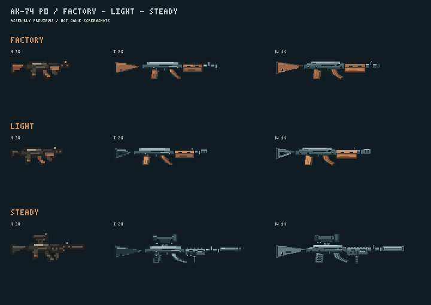

# M3 第一波 · P0 交付

2026-10-28，承接 [PR #132](https://github.com/xuys2025/escape-bincov/pull/132) / #28 M3-03。
按 [BRIEF](BRIEF.md) 只交 AK-74 样板，**停在 P0 图审关口，P1 未开始**。

## 交了什么

| 内容 | id 范围 | 张数 |
| --- | --- | ---: |
| AK-74 机匣与原厂件 | `gs-akb74-receiver`、`stock-factory`、`reargrip-factory`、`mag-factory`、`barrel-factory`、`handguard-factory`，各 H/I/W | 18 |
| AK-74 方图 | `gs-akb74-q24-v1`、`gs-akb74-q32-v1` | 2 |
| 11 件配件 | S03、H03、P04、B07、M05、S04、H04、P03、A08、G08、M07，各 I/W/Q24；P03、P04 不交 H，其余交 H | 42 |
| 合计 | 全部 id、路径、尺寸、挂点、颜色数、字节和 SHA-256 见[暂存清单](../../../../assets/gunsmith/incoming/m3-w1/manifest.json) | **62** |

运行 PNG 共 **9,216 字节（9.00 KiB）**；M2 的 24,419 字节加本批为 **33,635 字节**。
这只是素材累计数，正式构建尚未导入本批。第一波 88 KiB 是整波参考预算。

H、I、W、Q 各自用原生整数像素画稿导出。W 增加铆钉、机匣拉柄、木纹、导轨和弹匣筋条，没有将 I 放大当作 W。
S03 的镂空短托、S04 实心托，H03 木护木、H04 导轨护木及消音器用于区分两种配装。
H 的 P03、P04 按任务书沿用原厂握把和 M2 手套。

实际调用内置 **image_gen 1 次**，只制作造型参考，保存在 [source/akb74-design-reference.png](source/akb74-design-reference.png)；
完整提示词见 [source/generation.json](source/generation.json)。该参考不是运行图，也不是游戏截图。
62 张运行图的可重放原稿是 [source/pixel-artwork.json](source/pixel-artwork.json)，绘制与导出在 [source/export.mjs](source/export.mjs)。

## 看图



- 逐件三底色、1 倍和 3 倍：[H](preview/contact-h-color.png)、[I](preview/contact-i-color.png)、[W](preview/contact-w-color.png)、[Q](preview/contact-q-color.png)。
- 同一批灰度：[H](preview/contact-h-gray.png)、[I](preview/contact-i-gray.png)、[W](preview/contact-w-gray.png)、[Q](preview/contact-q-gray.png)。
- 人物比例 3 倍：[原厂](preview/akb74-factory-body-3x.png)、[轻快](preview/akb74-light-body-3x.png)、[稳定](preview/akb74-steady-body-3x.png)。同目录有 1 倍版本；按任务书把 bore 对齐身体第 26 行、grip 对齐 x=16。
- 地上/HUD 的无手套侧视：[1 倍](preview/akb74-factory-ground-hud-1x.png)、[2 倍](preview/akb74-factory-ground-hud-2x.png)。
- 每套独立 H/I 1、3 倍与 W 1、2 倍，文件名为 `preview/akb74-{factory|light|steady}-{h|i|w}-{倍数}x.png`。

所有拼装均由清单挂点计算，无手动摆层。[assembly-records.json](assembly-records.json) 的 `assemblies` 格式沿用 M2，
有原厂、轻快、稳定 × H/I/W 共九条；`bareFactory` 另外记录无手套的原厂 H。
稳定配装直接引用 M2 的 O08、F01、T01；这三件及三张手套没有复制或修改。

| 配装 | H 尺寸 / 色数 | I 尺寸 / 色数 | W 尺寸 / 色数 |
| --- | --- | --- | --- |
| 原厂 | 33×10 / 8 | 87×16 / 8 | 175×32 / 12 |
| 轻快 | 29×10 / 9 | 79×16 / 8 | 160×32 / 12 |
| 稳定 | 41×16 / 9 | 107×26 / 6 | 216×52 / 8 |

## 实际验证

核对时的已接受基线为 `origin/main` **b5bd63b7896b3b0697d4ba38d02d000e78903047**；
本批所用游戏代码来自 PR 原 head **d84956ff0ebe82ed2e0a3d2aa2b8819794d07904**。
本地 Windows，Node 24.22.1、pnpm 11.19.0。

| 命令 / 检查 | 结果 |
| --- | --- |
| `node docs/gunsmith/art/m3-w1/validate.mjs` | **77/77 通过**，详见 [validation.json](validation.json) |
| `node --import tsx docs/gunsmith/art/m3-w1/source/check-runtime.mjs` | **9/9 + 无手套原厂通过**，详见 [runtime-layout-check.json](runtime-layout-check.json) |
| `pnpm test` | **1020/1020 通过** |
| `pnpm check:ci` | **73/73 通过** |
| `pnpm package` | **通过**，正式包仍只读取 M2 的 115 图 / 24,419 字节 |
| 交付者视觉自查 | 已查看三底色与灰度、三种成枪轮廓和身体持握预览；维护者/Opus 签收尚未进行 |

自查覆盖文件完整性、哈希、尺寸、二值 Alpha、非空、色数、挂点、原生画稿重放、W 非 I 放大、W/I 挂点误差、
配装尺寸、枪口轴线、附属件接触与不超枪口、预览像素、字节统计，以及 M2 全部 115 图哈希不变。
自动接触检查不等于审美签收或逐条墨线签收；最终以看图为准。

可选 `check-runtime.mjs` 仅在进程内临时加入暂存元数据，调用真实 `validateBuild` / `gunArtLayout` 对比尺寸、层序、
每层坐标、枪口、手的位置和出光点，不写 `src/` 或正式清单。
首次在受限 Windows 沙箱运行 tsx 时，`os.userInfo` 报 `uv_os_get_passwd ENOMEM`；允许访问系统用户资料后重跑成功。

复现导出：

```text
node docs/gunsmith/art/m3-w1/source/export.mjs
node docs/gunsmith/art/m3-w1/source/assemble.mjs
node docs/gunsmith/art/m3-w1/validate.mjs
```

## 下一步与边界

- P0 清单内无缺件。没有发现需要偏离任务书的规则；稳定配置恰好用满 H/I/W 的高度上限，后续扩展须重新检查。
- P1 尚未制作：其余六枪与配件、旧手枪/双管补挂点、卡宾拆层、AK-103 共用坐标及相关预览。旧枪零差异叠回本阶段不适用，不能记作已验。
- 维护者和 Opus 先审本批；确认后再做 P1。接入、八方向持枪、火光、实际地上/HUD/工作台、1280×720 与 1920×1080 游戏截图、真机与试玩均留给 M3-04。
- 仅写 `assets/gunsmith/incoming/m3-w1/` 与本目录。沿用任务书的局部交接入口，不改根 `handoff.md`、任务清单或正式资源。
- 不改存档或游戏行为；素材尚未进入游戏，不能将本次提交视为已上线。准确提交与 CI 状态见 PR #132 的本批汇报。
