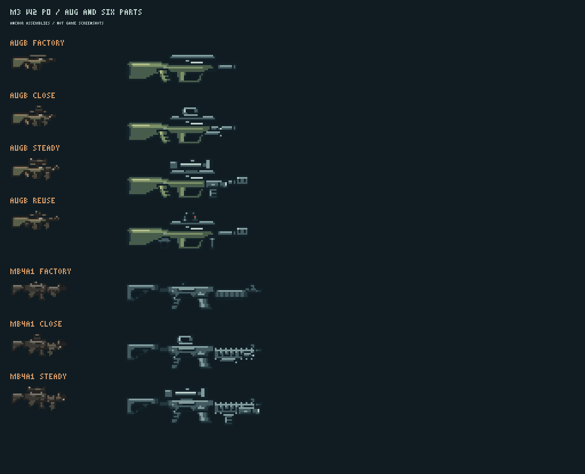

# M3 第二波美术 · P0 交付

2026-10-28，承接 [PR #132](https://github.com/xuys2025/escape-bincov/pull/132) / #28 M3-07。
按 [任务书第 9 节](BRIEF.md#9-分两段交)先交 AUG 与六件配件，共 **32 张运行 PNG，5,129 字节（5.01 KiB）**。P0 图包齐备，等待维护者审图及 Opus 接入预览，再继续 P1。

## 本次交付

| 类别 | 内容 | PNG |
| --- | --- | ---: |
| AUG | 机匣 H/I/W、原厂弹匣 H/I/W、Q24/Q32 | 8 |
| 六件配件 | O05 全息、O10 双档镜、F04 挡手、F07 重握把、T02 激光器、T10 组合器；各 H/I/W/Q24 | 24 |

完整 id、字节、SHA-256、尺寸、挂点和层序见[本批清单](../../../../assets/gunsmith/incoming/m3-w2/manifest.json)。
AUG 弹匣在握把后方，原厂弹匣标为 `aboveReceiver`；F04 的 `hand` 在前方挡手后面。H 原厂为 **26×10**，稳定配装为 **28×13**；I 稳定配装 **72×24**，W 为 **145×49**。G10 可直接复用，未增加变体。

已有 387 张正式图及正式清单均保留原 SHA-256；正式素材 62,146 字节，加本批共 **67,275 字节（65.70 KiB）**。本批未进正式包。

## 审图入口



- [AUG 原厂、近战、稳定及旧件复用](preview/augb-p0-configurations.png)：复用组同时装 O03、F01、G10、M06。
- [M4A1 原厂、P0 近战及稳定六件](preview/mb4a1-p0-configurations.png)：F/T 件装在已有 H02 导轨护木上。
- 逐件三底色，均含 1 倍和 3 倍：[H](preview/contact-h-color.png)、[I](preview/contact-i-color.png)、[W](preview/contact-w-color.png)、[Q](preview/contact-q-color.png)；[H 灰度](preview/contact-h-gray.png)、[I 灰度](preview/contact-i-gray.png)、[W 灰度](preview/contact-w-gray.png)、[Q 灰度](preview/contact-q-gray.png)。
- [人物比例](preview/augb-steady-body-3x.png)，[无手套原厂地上/HUD 图](preview/augb-factory-ground-hud-2x.png)。人物比例按身体帧第 26 行对齐 bore、grip 放在 x=16+forward；只做整数像素平移。
- 通用件装在旧枪：[卡宾](preview/fit-carbine.png)、[双管](preview/fit-shotgun.png)、[MP5](preview/fit-mpb5.png)、[Vector](preview/fit-vb9.png)、[M870](preview/fit-mb870.png)、[M1014](preview/fit-mb1014.png)、[AK-74](preview/fit-akb74.png)、[AK-103](preview/fit-akb103.png)、[M4A1](preview/fit-mb4a1.png)；另有 [AUG 全部指定复用件](preview/fit-augb.png)。

共 **79 张预览**，最大 25,648 字节。7 套配置、21 份 H/I/W 拼装记录和 1 份 AUG 无手原厂记录见 [assembly-records.json](assembly-records.json)。单独的 H/I 为 1、3 倍，W 为 1、2 倍；图片均不是游戏截图。

## 原稿与复现

沿用第一波的可编辑原生像素画稿格式；H、I、W、Q 各自在最终尺寸下绘制。W 另画螺钉、导轨齿、镜体环、机匣销、弹匣纹理，并用逐像素检查排除 I 的最近邻放大。

内置 **image_gen 调用 1 次、成功 1 次**，只用于 AUG 造型参考；[完整提示词及工具记录](source/generation.json)、[参考原图](source/augb-design-reference.png)。未使用 CLI/API。运行图来自 [原生画稿](source/pixel-artwork.json) 和 [导出脚本](source/export.mjs)；透明度、颜色及挂点由最终 PNG 实测。

```text
node docs/gunsmith/art/m3-w2/source/export.mjs
node docs/gunsmith/art/m3-w2/source/assemble.mjs
node docs/gunsmith/art/m3-w2/validate.mjs
node --import tsx docs/gunsmith/art/m3-w2/source/check-runtime.mjs
```

前三条只依赖本批脚本和已有素材；最后一条在进程内注入暂存元数据，用现有兼容和排布规则复核，不写正式文件。

## 实际验证

读图起点/本机受检游戏代码为 `7cb90766087ab54ed3cf1ee546681d2d2d8ddd32`；开始时已接受 main 为 `681426b0`，提交前 fetch 后 main 已到 `6758d654`。本次仅在原任务分支的两个指定目录交图。

| 检查 | 本次结果 |
| --- | --- |
| 独立素材自查 | **62/62 通过**；[详细报告](validation.json) |
| 指定配置与实际排布 | **7 套合法、21/21 布局一致、1 份无手原厂一致** |
| 通用件及 AUG 旧件复用 | **61 组合法适配、183 份 H/I/W 排布通过**；[证据](runtime-layout-check.json) |
| 已有正式素材 | **387/387 原哈希保留**，正式清单原哈希保留；[锁定表](source/baseline-lock.json) |
| `pnpm test` | **1037/1037 通过** |
| `pnpm check:ci` | **110/110 通过** |
| `pnpm package` | **通过**；便携 ZIP 6,064,513 字节，仅报数 |

51 组是六件新通用件在已有十二枪及 AUG 中所有具备合法导轨入口的适配，10 组是 AUG 的指定旧件复用。旧手枪、G17、P226 的微型瞄具位不接受这批顶部瞄具，也没有对应长枪导轨；其余七把第二波新枪和新基座待 P1。以上为逐件与指定组合复核，不是所有配装的穷举。

首轮发现 O10 在 AK 基座上的 W 成枪为 175×53，超高 1 像素；已把 O10 I/W 重画为 26×8、52×16，保留独立细节与底行锚点，完整复核通过。[首败及修正记录](source/first-layout-failure.json)保留，不修改旧图或验收上限。

本机 Node 24.21.0、pnpm 11.19.0。共享依赖 junction 触发 pnpm 自动安装前检，安装被其安全检查拒绝；随后以进程环境 `pnpm_config_verify_deps_before_run=warn` 运行现有依赖，三项检查全部成功，没有重装依赖。复核摘要见 [source/repository-checks.json](source/repository-checks.json)。GitHub 准确 head CI 以 #132 本轮汇报为准，远端 CI 不运行本目录的独立美术自查。

## 接入与剩余范围

- 图包仅位于 `incoming/m3-w2/`，由 Opus 做 M3-08 正式导入、元数据生成及游戏验收。
- 当前游戏 `gunArtLayout` 对机匣原生 `hand` 返回前手坐标，但只对前握把/护木补前手手套。AUG 原厂预览遵循这个现有实现，机匣上没有画手；M3-08 应核对原厂前手手套。装 F01/F04/F07 时按现有逻辑补前手手套。
- 尚未执行游戏内八方向、火光、仓库/工作台/地上/HUD、1280×720 与 1920×1080 截图和维护者试玩。这些由接入阶段验收。
- P1 尚余 **217 张基础运行图**：其余七把新枪、34 件配件、旧手枪/双管/卡宾三张无手侧视图、三种新弹药 Q24/Q32；有需要再另加枪型变体。
- 按任务书交完 P0 后停下，等待维护者和 Opus 审图确认。PR 保持 Draft，未合并、未上线。
