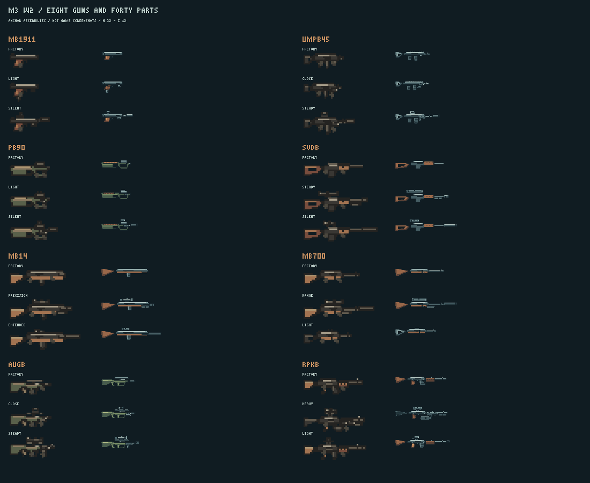

# M3 第二波美术 · P0 + P1 全部交付

2026-10-28，承接 [PR #132](https://github.com/xuys2025/escape-bincov/pull/132) / #28 M3-07。
维护者与 Opus 已在 [P0 审图留言](https://github.com/xuys2025/escape-bincov/pull/132#issuecomment-6469034451)明确通过 P0，要求 P1 一次交完。本目录现已交齐[任务书](BRIEF.md)全部 **249 张运行 PNG、36,786 字节（35.92 KiB）**，没有缺件。

P0 的 32 张原图保持核准哈希；已由 Opus 在 `d3eb43f` 复制进正式目录。本次新增待接入 **217 张、31,657 字节（30.92 KiB）**，仍交在暂存目录，正式接入由 Opus 执行 M3-08。

## 图包与清单

| 类别 | 内容 | PNG |
| --- | --- | ---: |
| 八枪机匣及方图 | M1911、UMP45、P90、SVD、M14、M700、AUG、RPK；各 H/I/W、Q24/Q32 | 40 |
| 原厂可换件 | 共十四件，各 H/I/W | 42 |
| 四十件配件 | 各 I/W/Q24；H 除 P05、P08 | 158 |
| 旧枪无手侧视 | 旧手枪、双管、卡宾；原画布和原图色板 | 3 |
| 三种弹药图标 | ammo45、ammoPDW、ammoHeavy；各 Q24/Q32 | 6 |
| 合计 | 无额外枪型变体 | **249** |

[本批清单](../../../../assets/gunsmith/incoming/m3-w2/manifest.json)列出全部 id、字节、SHA-256、尺寸、挂点和层序。弹药素材 id 按统一规则全小写，分别为 `gs-ammo45-*`、`gs-ammopdw-*`、`gs-ammoheavy-*`；`item` 保持目录的 `ammo45`、`ammoPDW`、`ammoHeavy`。

419 张正式图、正式清单及 P0 的 32 张暂存图均保持原哈希。去重后，419 张已接入图加 217 张待接入图，共 **636 张、98,932 字节（96.61 KiB）**；没有把已接入的 P0 重复计入累计值。本批参考预算 96 KiB，仅报数。

## 审图入口



| 枪 | 原厂与两套任务配装 |
| --- | --- |
| M1911 | [原厂、轻巧、消音](preview/mb1911-wave2-configurations.png) |
| UMP45 | [原厂、近战、稳定](preview/umpb45-wave2-configurations.png) |
| P90 | [原厂、轻快、消音](preview/pb90-wave2-configurations.png) |
| SVD | [原厂、稳定、隐蔽](preview/svdb-wave2-configurations.png) |
| M14 | [原厂、精确、扩容](preview/mb14-wave2-configurations.png) |
| M700 | [原厂、远射、轻便](preview/mb700-wave2-configurations.png) |
| AUG | [原厂、近战、稳定、旧件复用](preview/augb-wave2-configurations.png) |
| RPK | [原厂、重火、轻快](preview/rpkb-wave2-configurations.png) |

任务书的六套旧枪接装：[旧手枪](preview/pistol-wave2-configurations.png)、[双管](preview/shotgun-wave2-configurations.png)、[卡宾](preview/carbine-wave2-configurations.png)、[M4A1](preview/mb4a1-wave2-configurations.png)、[AK-74](preview/akb74-wave2-configurations.png)、[Vector](preview/vb9-wave2-configurations.png)。M4A1 同时保留 P0 六件接装配置。

[六种弹药的彩色对照](preview/ammunition-six-color.png) · [灰度对照](preview/ammunition-six-gray.png)。旧三种由实际 `paintItem` 捕获，三种新图各在 Q24、Q32 下与它们一起比较。

每套 H/I 有 1、3 倍，W 有 1、2 倍；人物比例有 1、3 倍。逐件图以 `contact-full-{guns|parts}-{h|i|w|q}-<页>-{color|gray}.png` 分页，每件在三种指定底色上放 1 倍与 3 倍。共 **430 张预览**，最大 66,075 字节；均不是游戏截图。

[assembly-records.json](assembly-records.json) 包含 **39 套配置、117 份 H/I/W 拼装、11 份无手原厂记录**。包含任务书 22 套改装、八把新枪原厂，并保留 P0 复用与必要旧枪原厂对照。每层位置只由清单锚点计算。

## 关键画法与接入契约

- RPK 的 `mount`、`handguard`、`stock`、`rearGrip`、`mag` 与两把 AK 在 H/I/W 中逐项同坐标。加长枪管画在机匣中，不给可替换枪管位；F08 仅画收起状态。
- P90 为顶置横弹匣，AUG 弹匣在握把后；原厂弹匣和 G05 标为 `aboveReceiver`，G02、P08 同样显式标层序。P05、P08 不交 H，持枪保留原厂握把。
- M700 画出拉机柄，不给弹匣位；SVD 用镂空枪托和长裸枪管；M14 用木托。原厂 H 长度依次为 18、25、25、37、35、35、26、37 像素，原厂高度均不超过 11。
- 拼装脚本已跟上 `d3eb43f` 的前手规则：机匣原生 `hand` 与 `grip` 不同、且没有画死手套时添加 `glove-front`。P90、AUG 的原厂记录含此前手层。P0 PNG 保持原样，记录与预览反映已修正的逻辑。
- Vector 的既有挂点依维护者决定保持原样；F06 仍可能在侧视投影上遮到弹匣，没有擅自移动第一波挂点。

三张旧枪无手图及差异：[旧手枪](preview/pistol-bare-comparison.png)、[双管](preview/shotgun-bare-comparison.png)、[卡宾](preview/carbine-bare-comparison.png)。分别改变 8、14、9 个像素；手套遮罩外均 **0 差异**，仅使用原图已有颜色。[遮罩与补画操作](source/bare-repairs.json)可重放。三张是 `role: bare` 的整枪图，按整枪 H 16 色上限检查；双管保留 9 个原色，其余两张为 8 色。新零件 H/I/Q 8 色、W 12 色的限制保持不变；原双管持握图的既有固定哈希例外未改。

## 原稿、工具与复现

H/I/W/Q 分别在最终尺寸上绘制，W 单独补螺钉、导轨、镜环、拉柄和材质细节，逐像素排除了 I 的最近邻放大。

内置 **image_gen 共 3 次调用、3 次成功**：P0 的 AUG 参考 1 次；P1 的 P90、SVD 参考 2 次。参考不直接进游戏，运行图使用项目可编辑原生像素画稿格式。[P0 提示词](source/generation.json) · [P1 提示词及记录](source/p1-generation.json) · [像素画稿](source/pixel-artwork.json)。未使用 CLI/API。

```text
node docs/gunsmith/art/m3-w2/source/wave2.mjs
node docs/gunsmith/art/m3-w2/source/assemble.mjs
node docs/gunsmith/art/m3-w2/validate.mjs
node --import tsx docs/gunsmith/art/m3-w2/source/check-runtime.mjs
```

前三条仅依赖本批脚本和已有图片/清单。可选运行 `node --import tsx docs/gunsmith/art/m3-w2/source/capture-ammo.mjs` 重抓旧弹药参照；现有快照在 `source/legacy-ammo.json`。真实布局复核只在进程内注入暂存元数据，不改游戏和正式清单。

## 本次验证

已接受 main 为 `6758d654`。P1 起点 `d3eb43f`；并行实现方随后追加浏览器专项 `7d7490db`，本机检查均在该代码 head 上运行。419 张正式素材基线按维护者留言更新为修订 4，P0 核准 32 图另行锁定。

| 检查 | 本次实际结果 |
| --- | --- |
| 独立美术自查 | **434/434 通过**；[完整报告](validation.json) |
| 真正规则与排布 | **39 套合法、117/117 指定布局一致** |
| 单件合法适配和指定旧件复用 | **307 组、921 份 H/I/W 通过**；[报告](runtime-layout-check.json) |
| 无手原厂 | 八把新枪无手拼装一致；三张旧枪遮罩外 0 差异 |
| 原素材保护 | 正式 419/419、P0 32/32 的哈希保持；正式清单保持 |
| `pnpm test` | **1057/1057 通过** |
| `pnpm check:ci` | **110/110 通过** |
| `pnpm package` | **通过**；便携 ZIP 6,071,052 字节，仅报数，不提交生成物 |

真实复核覆盖二十枪、四十件第二波配件、全部任务指定的旧件复用以及 22 套任务改装；并非所有配装的穷举。RPK 重火 W 为 199×52，达到高度上限；其余配置也在限额内。首轮 P0 的 O10 超高已修正，[首败记录](source/first-layout-failure.json)保留。

本机 Node 24.21.0、pnpm 11.19.0，沿用共享依赖 junction；检查进程使用 `pnpm_config_verify_deps_before_run=warn`，没有安装依赖或修改项目配置。[仓库检查摘要](source/repository-checks.json)保存准确代码 head、计数与制品哈希。远端准确提交 CI 以 #132 本轮交付留言为准，CI 不执行本目录的独立美术自查。

## 交接

本批图包无缺件，运行图及说明只写任务书指定的两个目录。正式资源、导入器、游戏源码、测试和根交接由 Opus 维护，本次未提交这些文件。

M3-08 剩余：搬入其余 217 图、接 `bare` 角色、导出元数据，按图包记录核对游戏拼装；验收八个朝向、火光、前手、仓库/工作台/地上/HUD 和 1280×720、1920×1080 截图。长枪 HUD 卡加宽按任务书由接入方处理。

P0 已接入的事实见 #132；本次 P1 尚未接入、未合并、未上线，维护者游戏内审图与试玩由接入阶段验收。
