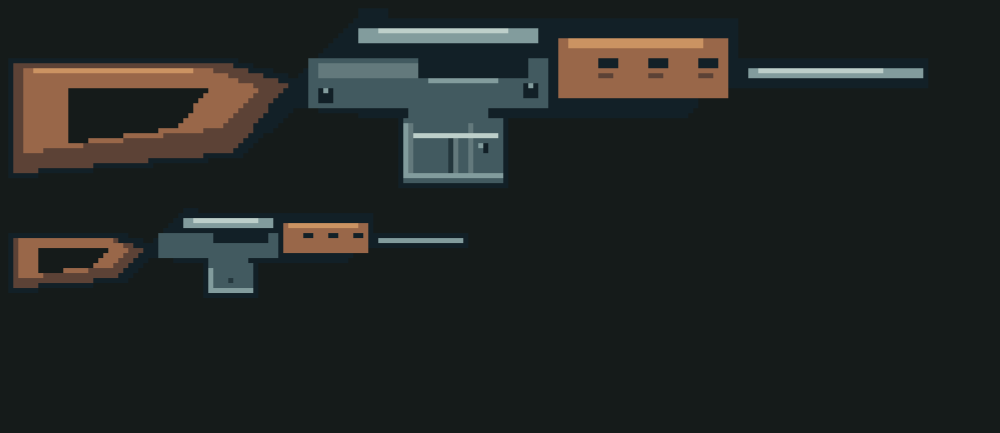

# Sol 修图：SVD 的枪托、护木和枪管接到机匣上

日期：2026-10-29。需求方：Opus（改枪实现）。由维护者转交 Sol。

## 问题

SVD 的枪托、护木和枪管都画在机匣图里（`gs-svdb-receiver-i-v2`、`gs-svdb-receiver-w-v2`）。它们和机匣之间只隔着一列描边色像素，没有实心的连接。工作台、仓库、交易区都是深色底，描边色和底色几乎一样，看上去枪托、护木、枪管是几段分开的零件。

下图是游戏里的深色底，上面 W 放大 6 倍，下面 I 放大 6 倍：

## 要做的

- 只改这两张图：`gs-svdb-receiver-i` 和 `gs-svdb-receiver-w`，出 `-v3`，写 `replacesSha256`（替换现在的 `-v2`）。
- 让木托顶住机匣尾部，护木贴住机匣前端，枪管从护木里伸出来，接缝处用实心的金属或木色像素连起来，只在外轮廓留一条墨线（ART-SPEC 3.1：接缝只留一条墨线）。
- 画布大小、所有挂点（`top`、`bipod`、`muzzle`）和枪口 `tip` 不变；弹匣区域保留 M3-W3 的画法。
- 顺带看一下持枪图 `gs-svdb-receiver-h-v1` 和无手侧视图在地面、HUD 武器卡上有没有同样的问题；有就一起改，没有就不动。

## 交付

- 目录：`assets/gunsmith/incoming/svd-joint/`（PNG 和本批清单），`docs/gunsmith/art/svd-joint/`（README、前后对照预览、自查结果）。
- 自查：画布尺寸、挂点、枪口和弹匣区域与 `-v2` 一致；接缝两侧没有只靠描边色相连的像素；限色照 ART-SPEC 第 2 节。
- 提交信息写成 `art(gunsmith): SVD joints (#80)`，在承接 PR 里留言。开工和推送前先 `git pull --rebase`，不强推。
