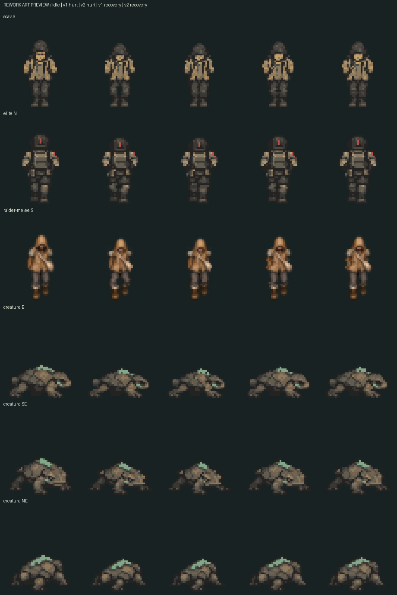
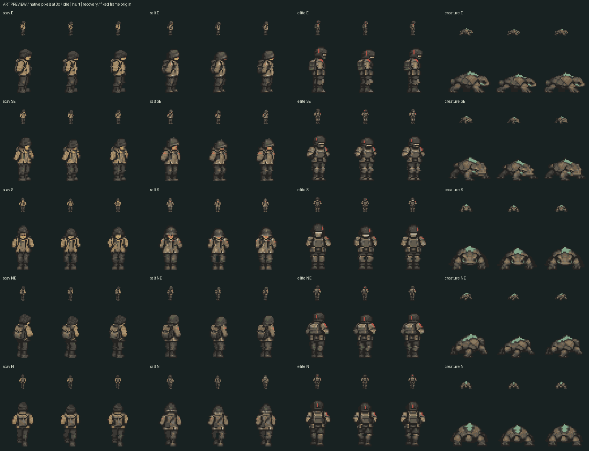
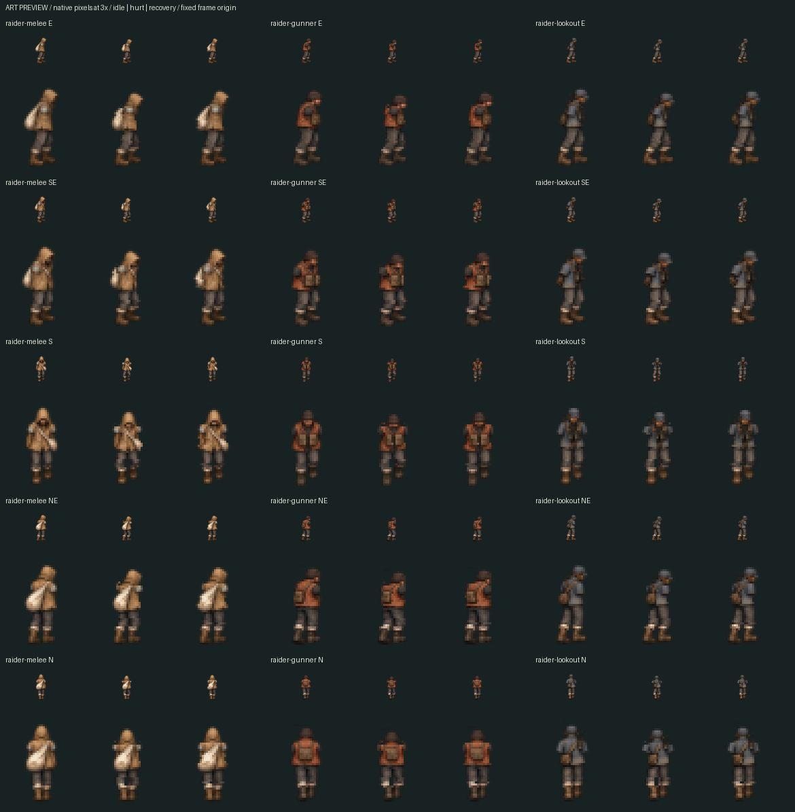
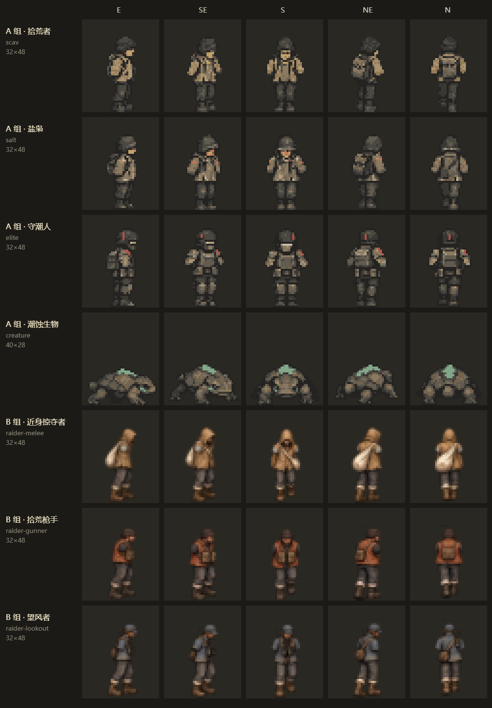
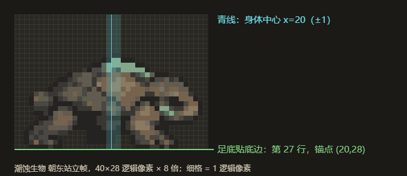

# 受击姿态美术需求（#75 打击感）

七类角色的受击／恢复 **pixel-v2 已通过独立复验**（[复验评论](https://github.com/xuys2025/escape-bincov/pull/96#issuecomment-6379336021)），是游戏接入的输入；v1、8 张 image_gen 原图与实际提示词完整保留。A 组已经 #99、B 组已经 #103 接进游戏，见下方“接入状态”。#81 其余 15 类原型（C 组）由 Sol 按 [C 组任务书](TASK-C.md) 在 #122 交付，独立复验通过，随 `feat/hurt-poses-c` 的 PR 接入。生物“头部前缘”按足底以上的头部测区验收，见下方记录。

## 接入状态

**A 组（拾荒者、盐枭、守潮人、潮蚀生物）已经 #99 接入（`f73e9de`）；B 组（#81 的近身掠夺者、拾荒枪手、望风者）已经 #103 接入（`5adc64a`）。**

- **切帧**：[export-hurt-poses.ts](../../scripts/export-hurt-poses.ts) 从七张 pixel-v2 图集切出 70 张运行帧，放在 `assets/coast/poses`。
  - 受击帧是帧号 5，恢复帧是帧号 6，和 Sol 的站立、走路帧（0–4）同样命名；B 组用原型自己的样式名，例如 `coast-raider-melee-body-e-f5-v1`。闪白、描边和遮挡轮廓都从同一帧派生。
  - 切帧时逐块校验，并要求第 0 列与运行站立帧一致。
  - B 组图集的第 0 列有画布取整误差：只出现在半透明像素上，单个通道差 1 级。`driftMap` 先把这些颜色还原成运行帧的值再比对，受击、恢复格里的同一批颜色也一并还原；其他任何差异都报错。A 组素材没有半透明像素，不受影响。
  - [hurt-poses.test.ts](../../tests/hurt-poses.test.ts) 守住运行帧的脚底、肩点所在行、配色和头顶位移，并覆盖还原规则的正反例；`build.mjs` 核对哈希。
- **加载**：[pose-assets.ts](../../src/coast-view/pose-assets.ts) 在海岸素材加载后把这些帧并入同一张素材表。加载失败时只记日志，敌人照常显示站立身体。
- **播放**：[scene.ts](../../src/coast-view/scene.ts) 中弹后先放受击帧约 90 ms，再放恢复帧约 60 ms，命中那一帧至少显示一次受击帧。敌人走动时也会切换，因此有一瞬间脚步停住。帧序列与实景见 [A 组接入证据](../evidence/issue75-hurt-poses/README.md)和 [B 组接入证据](../evidence/issue75-hurt-poses-b/README.md)。
- **适用范围**：按角色身体实际使用的样式判断（`posable` 调用 [textures.ts](../../src/coast-view/textures.ts) 的 `hasBodyFrame`）。原型有自己的身体图就用原型的，否则用种类的；这个样式有受击帧才换帧。

**C 组（#81 其余 15 类原型）**：Sol 按 [C 组任务书](TASK-C.md) 在 #122 交付，[首轮验收](https://github.com/xuys2025/escape-bincov/pull/122#issuecomment-6398466408)让盐背犬、囊腹喷吐兽返工（整只缩小），[复验](https://github.com/xuys2025/escape-bincov/pull/122#issuecomment-6398909150)后 15 类全部签收，随 `feat/hurt-poses-c` 的 PR 接入。

- 图集版本按类记在 `POSE_KINDS`：A、B 组用 pixel-v2，C 组用 v1，返工的犬和喷吐兽用 v2。
- 游戏不给爪击类原型画手臂（`CoastView.syncArms` 只在武器可见时画），这 6 类和 A 组潮蚀生物记在 `ARMLESS`，单测不检查它们的肩线。
- 接入后，A 组四类和 #81 的 18 类原型中弹时都有受击和恢复帧。证据见 [C 组接入证据](../evidence/issue75-hurt-poses-c/README.md)。

## 2026-10-24 v2 返工

按维护者的[两项返工要求](https://github.com/xuys2025/escape-bincov/pull/96#issuecomment-6379082043)，以 `34e1dea` 的 pixel-v1 为基线，仅修改指定的 **30 格**：六类人形 S／N 受击、恢复共 24 格；生物 E／SE／NE 受击、恢复共 6 格。其余 40 个动作格及 35 个站立格逐像素保持 v1，v1 与生成原图的 28 张 PNG／GIF 原始字节全部不变。最新 main 仍为 `4141503`；#81 head `71cf986` 的参考图核对仍 35/35 一致。

| 角色 | 本轮 v2 图集 |
| --- | --- |
| 拾荒者 | [scav-hurt-sheet-pixel-v2.png](../../assets/hit-feel/sources/scav-hurt-sheet-pixel-v2.png) |
| 盐枭 | [salt-hurt-sheet-pixel-v2.png](../../assets/hit-feel/sources/salt-hurt-sheet-pixel-v2.png) |
| 守潮人 | [elite-hurt-sheet-pixel-v2.png](../../assets/hit-feel/sources/elite-hurt-sheet-pixel-v2.png) |
| 潮蚀生物 | [creature-hurt-sheet-pixel-v2.png](../../assets/hit-feel/sources/creature-hurt-sheet-pixel-v2.png) |
| 近身掠夺者 | [raider-melee-hurt-sheet-pixel-v2.png](../../assets/hit-feel/sources/raider-melee-hurt-sheet-pixel-v2.png) |
| 拾荒枪手 | [raider-gunner-hurt-sheet-pixel-v2.png](../../assets/hit-feel/sources/raider-gunner-hurt-sheet-pixel-v2.png) |
| 望风者 | [raider-lookout-hurt-sheet-pixel-v2.png](../../assets/hit-feel/sources/raider-lookout-hurt-sheet-pixel-v2.png) |

人形正面、背面的膝部改用原裤装颜色绘制膝盖亮面与屈曲褶皱，恢复帧用较轻的明暗变化；第 33 行以下的透明轮廓与站立帧相同，两腿不再外分，不是只把洞涂掉。原有头部、肩点和脚部不动。24 格都没有新增封闭透明洞，内侧第 15／16 列原来不透明的腿部行继续不透明；膝部每格实际改变 5–18 个逻辑像素，整体水平重心偏移最大约 0.082 像素。

生物在壳体下压基础上，将右侧头部与前肢上段的连通像素向壳内收 2／1 像素；保留壳脊和足底，不裁切整帧、不移动脚点。六格没有洞或新增散点，仍为一个连通身体；生物 S／N 两行完全沿用 v1。

### 生物前缘测区（已核定）

复验结论：返工要求里“整帧最右侧不透明列”与“第 24–27 行足底不变”互相矛盾，是要求本身写错了。验收改按第 0–23 行的头部测区，与站立帧同一测区比较。E、SE、NE 受击都收回 3 像素，恢复都收回 1 像素，足底不变，达标（[复验评论](https://github.com/xuys2025/escape-bincov/pull/96#issuecomment-6379336021)）。下面保留返工时的原始记录。

返工要求同时写了“头部前缘（最右侧不透明列）”和“第 24–27 行足底完全不变”。但 SE 原足底第 24–25 行到 x=38，NE 第 24 行到 x=35；因此若统计整帧，无法同时达到 SE 受击 ≤36／恢复 ≤37、NE 受击 ≤34。此处没有修改脚底来追数值，也没有把检查范围的解释当作维护者已经同意。

当前同时记录两组实际数值，**第 24 行以上仅作为待确认的头部／前肢上段测区**：

| 方向 | 要求受击／恢复 | v2 第 0–23 行受击／恢复 | v2 整帧受击／恢复 |
| --- | --- | --- | --- |
| E | ≤36／≤37 | 35／37 | 35／37 |
| SE | ≤36／≤37 | 34／36 | 38／38（由固定足底决定） |
| NE | ≤34／≤35 | 33／35 | 35／35（受击整帧由固定足底决定） |

绘图已按“缩头、收前肢、足底不动”交付，最终统计区域待维护者／复验者明确。报告中的 `status: PASS` 仅指已经定义的像素约束；`reviewAcceptance: PENDING_HEAD_REGION_DEFINITION` 和 3 条 `wholeFrameMetricConflicts` 明确保留上述问题，不能据此声称全部返工验收通过。

### v2 验证与审看入口

- 可复现绘制：`python docs/hit-feel-art/author-pixel-poses.py --edition v2`；[v2 登记与 SHA-256](../../assets/hit-feel/sources/pixel-editions-v2.json)包含每张 v1 来源哈希。重复运行七张 v2 的图像哈希和登记内容完全一致。
- 独立检查：`python docs/hit-feel-art/audit-pixel-poses.py --edition v2`；[实际 v2 报告](pixel-audit-v2.json)。7 图集／35 朝向／70 姿态的像素检查 0 失败，3 条整帧前缘／足底指标冲突待核定。增加了四邻域透明洞、内侧腿部不透明、膝部改动、水平重心 ≤0.5、原有部件连通和非目标格不变检查。
- 有效负对照：把同样返工检查用于未修改的 v1，实际得到 52 项失败（24 格膝洞与腿内侧共 48 项，头部区域前缘 4 项）；[失败摘要](pixel-v1-rework-negative.json)保留准确命令与问题，没有修改旧报告或放宽断言。
- Windows / Node 24.19.0 / pnpm 11.19.0：本轮 `pnpm test` 653/653、`pnpm package` 通过；两份 HTML、两份 ZIP 与发布清单相对 main `4141503` 逐字节不变。本地游戏浏览器套件未运行，准确 head CI 以本 PR 最新检查为准。
- 完整审图：[A 组 1 倍／3 倍](pixel-preview-a-v2.png)、[B 组 1 倍／3 倍](pixel-preview-b-v2.png)、[固定脚点慢放 GIF](pixel-preview-v2.gif)。这些是美术预览，不是游戏截图或实际播放验收。

游戏内接入、运行帧与两档分辨率验收继续由后续接入 PR 承接。当前返工稿只提交原分支，保持草稿、未合并；独立复验结论以维护者后续评论为准。

## 工具依赖

本目录的 Python 脚本是**可选的本地美术编辑／审图工具**，使用 Python 3 和 Pillow；游戏运行、离线包、Node 构建和 CI 不依赖 Pillow。本轮本机使用 Pillow 11.0.0，其分发元数据标为 `MIT-CMU`，随包 LICENSE 说明为 HPND，原文见 [Pillow 11.0.0 LICENSE](https://github.com/python-pillow/Pillow/blob/11.0.0/LICENSE)。没有新增游戏依赖或修改锁文件，也没有把 Pillow 打包到游戏中。

## 2026-10-24 像素规范版

原图两轮未能锁定画布与站立列后，维护者明确同意“允许像素工具返修，保留原图”，随后要求继续。本轮按此授权制作独立 `pixel-v1` 版，不覆盖原图、不把原图失败项改记为通过。最新同步 main 为 `4141503c813cc5aaf415d9257e53c679f9878b62`（#91 已合入）；B 组参考仍匹配 #81 head `174341b`。

| 角色 | 最终规范版 | 整张尺寸 |
| --- | --- | --- |
| 拾荒者 | [scav-hurt-sheet-pixel-v1.png](../../assets/hit-feel/sources/scav-hurt-sheet-pixel-v1.png) | 768×1920 |
| 盐枭 | [salt-hurt-sheet-pixel-v1.png](../../assets/hit-feel/sources/salt-hurt-sheet-pixel-v1.png) | 768×1920 |
| 守潮人 | [elite-hurt-sheet-pixel-v1.png](../../assets/hit-feel/sources/elite-hurt-sheet-pixel-v1.png) | 768×1920 |
| 潮蚀生物 | [creature-hurt-sheet-pixel-v1.png](../../assets/hit-feel/sources/creature-hurt-sheet-pixel-v1.png) | 960×1120 |
| 近身掠夺者 | [raider-melee-hurt-sheet-pixel-v1.png](../../assets/hit-feel/sources/raider-melee-hurt-sheet-pixel-v1.png) | 768×1920 |
| 拾荒枪手 | [raider-gunner-hurt-sheet-pixel-v1.png](../../assets/hit-feel/sources/raider-gunner-hurt-sheet-pixel-v1.png) | 768×1920 |
| 望风者 | [raider-lookout-hurt-sheet-pixel-v1.png](../../assets/hit-feel/sources/raider-lookout-hurt-sheet-pixel-v1.png) | 768×1920 |

每张保持原 3 列 × 5 行：站立／受击／恢复，E／SE／S／NE／N。第 0 列直接保留模板原始像素；动作在原 32×48／40×28 逻辑网格分部位编辑，再作精确最近邻 8 倍放大。没有把不合格生成图逐帧裁切、居中或缩放来伪装合格图。

人形受击时头帽／兜帽下收 2 像素，恢复下收 1 像素；躯干局部向内收 1 像素，膝部微屈。肩点所在的第 19–21 行完全不动，鞋底及脚部固定区完整保留，守潮人的躯干与膝部变化更小。生物壳体下压 2／1 像素、上部向内收，底部 4 行支撑足完全不动。角色身份、五朝向、已有身体部件、光照和像素配色沿用原版，不新增手、武器或特效。

### 像素检查与审看

- [独立检查脚本](audit-pixel-poses.py)：`python docs/hit-feel-art/audit-pixel-poses.py`。只读已保存 PNG，不调用绘制函数；[结果](pixel-audit.json)为 **7 张／35 朝向／70 新姿态，0 失败**。
- 画布、透明背景、均匀 8×8 块、站立列逐像素一致、原图配色、肩线固定区、脚部固定区、帧内边界全部通过；受击头顶／壳顶下收恰为 2 像素，恢复为 1 像素；恢复与受击不同，变化像素数少于受击。各方向受击轮廓差异至少 20 个逻辑像素，躯干相对原版的横向重心变化最大约 0.17 像素。
- 逐格审看下方 1 倍／3 倍预览，核对朝向、部件、轮廓、配色与恢复顺序；另提供固定原点的[慢放 GIF](pixel-preview.gif)，用于观察脚点和动作过渡。GIF 时间仅供审图，不是最终游戏播放参数。
- [可复现像素编辑脚本](author-pixel-poses.py)：`python docs/hit-feel-art/author-pixel-poses.py`；[源图集登记与 SHA-256](../../assets/hit-feel/sources/pixel-editions-v1.json)。绘制和检查相互独立，没有导出或接入运行帧。
- 首次规范版检查查出生物三个朝向的最顶端单像素壳脊被收缩掉，使下压超出 2／1 像素；保留壳脊首行后重绘，复验通过。没有放宽检查。
- 8/8 原始 image_gen PNG 与 `b627f2c` 逐字节一致；35/35 参考帧与最新来源一致。原图失败和本轮规范版通过分别记录。

**美术交付范围已完成。** 运行帧切出、运行清单与哈希、实际播放及闪白轮廓、1280×720／1920×1080 游戏内叠加观感仍属于接入 PR；本 PR 保留草稿，不把素材审图记为这些项目通过。B 组接入仍等 #81 合入。下一位从上述七张 `pixel-v1` 图集接手，不用失败的 image_gen 原图作为运行输入。

同步 main `4141503` 后，Windows / Node 24.19.0 / pnpm 11.19.0 实测 `pnpm test` **653/653**、`pnpm package` **通过**；重建后 HTML、ZIP 和发布清单与该 main 逐字节一致。七张规范版重新绘制后 SHA-256 完全一致，38 个本页本地链接全部存在。本轮未运行本地游戏浏览器套件；原图提交 `b627f2c` 的八组完整 CI 已通过，规范版新 head 的 CI 以原 PR 最新检查为准，两者分别计证据。

## 2026-10-24 原图交付与验收结果

本节保留首轮原图检查，所述失败针对原始 image_gen 输出；当前交付以上方像素规范版为准。

续作原 [PR #96](https://github.com/xuys2025/escape-bincov/pull/96)，原 head `7900f98`；已正常合入接手时最新 main `1af0fecdbcc5eb9790fd34bd5a8701a5c2fbb329`，未重写历史。B 组最新 #81 head `174341b02c6c3efe32fbd7f0151473b97ec42812` 的 15 张身体参考与模板哈希仍全部一致，A 组 20 张也与最新 main 一致。

内置 `image_gen` 逐角色编辑本目录对应模板，并要求真透明。共交 7 套、70 个受击／恢复关键姿态，另外保留拾荒者首版，共 8 张原始 PNG。原始生成文件直接复制到仓库，未经过裁切、擦除、逐帧居中、重采样或贴回站立列。图集是素材原图，下面的预览不是游戏截图。

| 角色 | 本轮审看版本 | 原始尺寸 | 说明 |
| --- | --- | --- | --- |
| 拾荒者 | [v2](../../assets/hit-feel/sources/scav-hurt-sheet-v2.png) | 793×1983 | 收小首版的弯腰幅度；[v1](../../assets/hit-feel/sources/scav-hurt-sheet-v1.png) 留作返修对照 |
| 盐枭 | [v1](../../assets/hit-feel/sources/salt-hurt-sheet-v1.png) | 793×1983 | 头盔、臂章、背负物与五朝向 |
| 守潮人 | [v1](../../assets/hit-feel/sources/elite-hurt-sheet-v1.png) | 793×1983 | 重甲、红条头盔与较小受击反应 |
| 潮蚀生物 | [v1](../../assets/hit-feel/sources/creature-hurt-sheet-v1.png) | 1161×1355 | 壳体下压、头与前肢收缩 |
| 近身掠夺者 | [v1](../../assets/hit-feel/sources/raider-melee-hurt-sheet-v1.png) | 793×1983 | 兜帽、斜挎袋 |
| 拾荒枪手 | [v1](../../assets/hit-feel/sources/raider-gunner-hurt-sheet-v1.png) | 793×1983 | 棕红上衣、胸前装备 |
| 望风者 | [v1](../../assets/hit-feel/sources/raider-lookout-hurt-sheet-v1.png) | 793×1983 | 灰蓝帽衣、背负物 |

实际提示词逐字保存在 [prompts-v1.json](../../assets/hit-feel/sources/prompts-v1.json)（拾荒者首版）和 [prompts-v2.json](../../assets/hit-feel/sources/prompts-v2.json)（拾荒者返修及其余六类）。每条记录包含对应模板、输出文件和 `transparent_background: true`；没有使用 CLI/API 后备模式。

### 已验与未通过

只读检查入口：`python docs/hit-feel-art/audit-sources.py`（Python + Pillow）。[实际检查 JSON](source-audit.json)记录全部原图 SHA-256、尺寸、透明像素数、15 格占用、逐方向逻辑尺寸包围盒和参考哈希。用于比较的最近邻缩小仅发生在内存，不写回 PNG。

- **通过**：8 张均为可解码 RGBA PNG，存在真透明背景；每张 15 格都有图形；35/35 张参考哈希与接手时最新来源一致。预览中没有武器、文字、血迹、地面或动作线。
- **未通过：画布与网格**。人形输出为 793×1983，要求为 768×1920；生物为 1161×1355，要求为 960×1120。人形宽高不能分别整除 3、5，不能直接按要求切格。
- **未通过：站立列锁定**。生成器重画了第 0 列；逐格最近邻缩回逻辑尺寸后，35 个站立格均与模板不相等。模板和真实运行帧保持原始字节，未把重画版冒充原版。
- **未通过／待逐格返修：锚点与姿势**。以生成图自己的第 0 列为参照，恢复列轮廓整体有约 2–4 逻辑像素的横向漂移；生物部分方向足底上移约 1–2 像素，B 组背向站立格也未稳定到第 47 行。部分受击头部下移约 3–5 像素，高于目标 1–2；恢复动作部分过于接近站立。肩线属于人体部位，不能用整个轮廓包围盒替代人工验收，仍待逐格检查。
- **未运行**：游戏内 1280×720 / 1920×1080、与闪白／后退叠加、运行帧导出及播放时长试玩；这些需要通过像素验收并接入后再做，不能用原图预览代替。

两轮拾荒者生成都未解决原尺寸和站立列锁定问题。因此本次交付是可审看的原图候选，**没有完成本 PR 的全部美术验收，不转 Ready**。下一步先返修上述问题；未经维护者决定，不降低原验收要求，也不靠逐帧修位置掩盖问题。B 组接入仍依赖 #81 合入。

### 工程验证

Windows / Node 24.19.0 / pnpm 11.19.0：`pnpm test` **649/649**，`pnpm package` **通过**。复用锁文件一致的本地依赖，命令设置 `pnpm_config_verify_deps_before_run=false`，避免 pnpm 对共享依赖目录自动执行安装；没有修改项目配置。首次直接 `pnpm test` 被 pnpm 的共享目录保护拒绝，尚未进入测试，该失败保留在本地日志中。

重新打包后两份 HTML、两份 ZIP 和发布清单与 main `1af0fec` 逐字节一致。新增原始 PNG 没有导入游戏，没有存档、离线、输入或部署变化。本轮未运行本地浏览器回归；推送后的准确 head CI 以原 PR 检查为准，历史绿灯不代表本次结果。

## 为什么要画

现在敌人中弹时身体贴图不变，只有 70 ms 闪白，以及 80 ms 内顺着子弹后退 2 像素（#88、#94）。[#75](https://github.com/xuys2025/escape-bincov/issues/75) 研究的 P1 建议：程序表现做完后，为少量敌人补“受击 / 恢复”关键姿态，让中弹有身体反应。

## 和 #81 的分工

[#81](https://github.com/xuys2025/escape-bincov/pull/81)（街区敌人，草稿，进行中）负责十八类原型的身体、步态、尸体和攻击动作。它的攻击动作用程序形变；中弹时，闪白轮廓只跟着身体一起缩放和倾斜，没有受击帧。

本需求只补受击和恢复两帧，不碰攻击动作、尸体和倒地。B 组的参考帧取自 #81 分支 `2fcad9d`，接入要等 #81 合并。#81 如果改了这三类的身体，就按新图重做模板，可用 [sources.json](../../assets/hit-feel/templates/sources.json) 里的哈希核对。

## 范围

| 组 | 角色 | id | 逻辑尺寸 | 模板 |
| --- | --- | --- | --- | --- |
| A | 拾荒者 | `scav` | 32×48 | [scav](../../assets/hit-feel/templates/scav-hurt-template-v1.png) |
| A | 盐枭 | `salt` | 32×48 | [salt](../../assets/hit-feel/templates/salt-hurt-template-v1.png) |
| A | 守潮人 | `elite` | 32×48 | [elite](../../assets/hit-feel/templates/elite-hurt-template-v1.png) |
| A | 潮蚀生物 | `creature` | 40×28 | [creature](../../assets/hit-feel/templates/creature-hurt-template-v1.png) |
| B | 近身掠夺者（#81） | `raider-melee` | 32×48 | [raider-melee](../../assets/hit-feel/templates/raider-melee-hurt-template-v1.png) |
| B | 拾荒枪手（#81） | `raider-gunner` | 32×48 | [raider-gunner](../../assets/hit-feel/templates/raider-gunner-hurt-template-v1.png) |
| B | 望风者（#81） | `raider-lookout` | 32×48 | [raider-lookout](../../assets/hit-feel/templates/raider-lookout-hurt-template-v1.png) |

A 组是 main 现有的四种敌人；B 组是 #81 已正式投放到街区的三类。以下不在本批：主角；#81 其余十五类（正式投放后再补）；倒地过渡帧；攻击动作图集。

## 每个角色交一张图集

- 3 列 × 5 行的透明 PNG。行从上到下是 E、SE、S、NE、N；朝西的三个方向由游戏镜像，不用画。
- 第 0 列是现有站立帧，模板里已经放好，原样保留；第 1 列画受击，第 2 列画恢复。
- 每格是逻辑像素放大 8 倍（最近邻）：人形每格 256×384（32×48），整张 768×1920；潮蚀生物每格 320×224（40×28），整张 960×1120。
- 直接在模板上编辑：`assets/hit-feel/templates/<id>-hurt-template-v1.png`。

## 姿势

**受击（第 1 列）**：中弹后一瞬间的身体反应。

- 缩肩、低头 1–2 个逻辑像素、躯干收紧、膝盖微屈。
- 不要明显前倾或后仰。子弹可能从任何方向打来，方向感由游戏里的 2 像素后退提供。
- 兜帽、衣摆、背包、挎带可以甩动 1–2 像素，帮助在 32×48 下看出“挨打”。
- 守潮人穿重甲，反应可以更小更沉。

**恢复（第 2 列）**：介于受击和站立之间，大约回复一半。

**潮蚀生物**：壳和身体收缩下压，头和前肢缩到壳下，腿撑住地面。

在原尺寸（1 倍）下，受击帧的头部或肩部轮廓至少要和站立帧差 2 个逻辑像素，否则游戏里看不出来。

## 必须守住的位置

- **脚**：人形鞋底在第 47 行，锚点 (16,48)；潮蚀生物足底在第 27 行，锚点 (20,28)。整体最多下沉 1 像素，脚不能左右滑动。
- **肩**：人形肩线保持在站立帧的 ±1 像素内（第 19 行附近），身体中心保持在 x=16±1。游戏从肩点画手臂，一直伸到第 26 行的武器握点；肩点跑偏，手臂就会和身体脱节。
- **部件**：只画站立帧里已有的部分，即头、躯干、已有的袖子、背负物、骨盆、腿和鞋。不要新增前伸的手臂、手或武器。B 组的身体本来就不含肩以下的手臂。

## 风格

- 和第 0 列保持同一个角色、同一套配色、同样的 1 逻辑像素描边、同样的左上方柔光和像素颗粒。
- 在 32×48 下也要是清楚的大块形状。不要 Q 版，也不要平滑上色。
- 不画血、伤口、文字、地面、影子、动作线、特效、分隔线或标签。
- 背景必须是真透明，不能把棋盘格画进图里。

## 怎么生成，放在哪里

1. 用内置 `image_gen` 编辑对应模板，做法同 #81。起始提示词在 [prompts-draft.json](../../assets/hit-feel/prompts-draft.json)，可以按结果返修。
2. 生成的图如果带底色，再用其中的 `alphaCleanup` 去掉背景。
3. 输出存为 `assets/hit-feel/sources/<id>-hurt-sheet-v1.png`，返修依次存 v2、v3，旧版保留。实际用过的提示词逐字记入 `assets/hit-feel/sources/prompts-v1.json`。
4. 只提交到本 PR 的分支 `art/hit-feel-poses`。不要改 `src/`、现有运行图或素材清单。

## 接入前的检查（由 Claude 做）

- 尺寸、行列和透明背景正确；第 0 列缩回原尺寸后与现有站立帧一致。
- 第 1–2 列与第 0 列同比例；脚点、肩线和中心在上面规定的范围内，人物没有超出格子。
- 在 1 倍尺寸下，以及游戏内 1280×720 和 1920×1080 下，都看得出受击；和闪白、2 像素后退叠在一起不别扭。
- 不合格的格子返修，不靠擦除、裁切或逐帧居中来掩盖。

## 接入计划（后续代码 PR）

- **切帧**：按网格切开，每一行用第 0 列求出统一缩放和脚点（同 #81 的 `enemy-export-art`：一张图共用缩放，每个方向共用脚点），把第 1–2 列导出为运行帧，写入清单和哈希。
- **播放**：中弹时先放受击帧约 90 ms，再放恢复帧约 60 ms，然后回到原来的站立或走路帧；时长由试玩决定。闪白轮廓从同一帧生成。敌人走动时是否也播（播的话会有一瞬间滑步），接入时再定。
- **顺序**：A 组可以先接入；B 组等 #81 合并后接入，并和 #81 的 `enemyMotion` 形变叠加。

模板第 0 列的来源帧和 SHA-256 记在 [sources.json](../../assets/hit-feel/templates/sources.json)。模板、标注图和总览都是按这些帧放大 8 倍（总览为 4 倍）直接生成的，没有重画。
