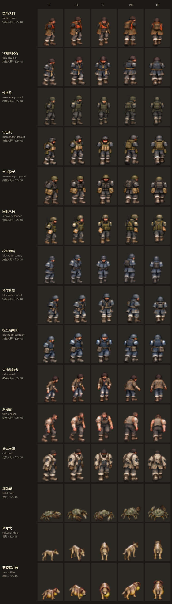

# C 组受击姿态美术任务书（给 Sol）

2026-10-25，Refs [#75](https://github.com/xuys2025/escape-bincov/issues/75)。维护者要求把 #81 其余原型的受击姿态交给 Sol 画。本页可以直接转发；排期见 [打击感任务排期](../hit-feel/TASKS.md) 的 H-08。

## 为什么要画

敌人中弹时，A 组四类（#99）和 B 组三类（#103）会先显示受击姿势约 90 ms，再显示恢复姿势约 60 ms，然后回到站立或走路。#81 合入的另外 15 类原型有自己的身体图，但没有这两帧，中弹时只有闪白和 2 像素后退，和旁边的敌人放在一起显得发木。

只补受击和恢复两帧。攻击动作、尸体、倒地、走路帧都不动。

## 范围

15 类，全部是 32×48 逻辑像素，锚点 (16,48)。模板第 0 列已经放好现有站立帧，和游戏里的帧逐像素一致。

| 类型 | 角色 | id | 模板 |
| --- | --- | --- | --- |
| 持械人形 | 盐枭头目 | `raider-boss` | [模板](../../assets/hit-feel/templates/raider-boss-hurt-template-v1.png) |
| 持械人形 | 守潮执仪者 | `tide-ritualist` | [模板](../../assets/hit-feel/templates/tide-ritualist-hurt-template-v1.png) |
| 持械人形 | 侦察兵 | `mercenary-scout` | [模板](../../assets/hit-feel/templates/mercenary-scout-hurt-template-v1.png) |
| 持械人形 | 突击兵 | `mercenary-assault` | [模板](../../assets/hit-feel/templates/mercenary-assault-hurt-template-v1.png) |
| 持械人形 | 支援枪手 | `mercenary-support` | [模板](../../assets/hit-feel/templates/mercenary-support-hurt-template-v1.png) |
| 持械人形 | 回收队长 | `recovery-leader` | [模板](../../assets/hit-feel/templates/recovery-leader-hurt-template-v1.png) |
| 持械人形 | 检查哨兵 | `blockade-sentry` | [模板](../../assets/hit-feel/templates/blockade-sentry-hurt-template-v1.png) |
| 持械人形 | 巡逻队员 | `blockade-patrol` | [模板](../../assets/hit-feel/templates/blockade-patrol-hurt-template-v1.png) |
| 持械人形 | 检查站班长 | `blockade-sergeant` | [模板](../../assets/hit-feel/templates/blockade-sergeant-hurt-template-v1.png) |
| 徒手人形 | 失神盐蚀者 | `salt-dazed` | [模板](../../assets/hit-feel/templates/salt-dazed-hurt-template-v1.png) |
| 徒手人形 | 追潮者 | `tide-chaser` | [模板](../../assets/hit-feel/templates/tide-chaser-hurt-template-v1.png) |
| 徒手人形 | 盐壳重躯 | `salt-hulk` | [模板](../../assets/hit-feel/templates/salt-hulk-hurt-template-v1.png) |
| 兽形 | 潮蚀蟹 | `tidal-crab` | [模板](../../assets/hit-feel/templates/tidal-crab-hurt-template-v1.png) |
| 兽形 | 盐背犬 | `saltback-dog` | [模板](../../assets/hit-feel/templates/saltback-dog-hurt-template-v1.png) |
| 兽形 | 囊腹喷吐兽 | `sac-spitter` | [模板](../../assets/hit-feel/templates/sac-spitter-hurt-template-v1.png) |

“持械”指游戏会从肩点画手臂、拿枪或长柄；“徒手”和“兽形”用爪击，游戏不画手臂。

可以分三批交：持械人形 9 类、徒手人形 3 类、兽形 3 类。每批交完就可以验收。

## 每个角色交一张图集

- 3 列 × 5 行的透明 PNG，整张 768×1920。每格是逻辑像素放大 8 倍（最近邻），256×384。
- 行从上到下是 E、SE、S、NE、N；朝西的三个方向由游戏镜像，不用画。
- 第 0 列是站立帧，原样保留；第 1 列画受击，第 2 列画恢复。
- 直接在模板上编辑。

## 姿势

**受击（第 1 列）**：中弹后一瞬间的身体反应。

- 人形：缩肩、低头、躯干收紧、膝盖微屈；不要明显前倾或后仰，方向感由游戏里的 2 像素后退提供。兜帽、衣摆、背负物、挎带可以甩动 1–2 像素。
- 重甲和大块头（盐枭头目、突击兵、支援枪手、检查站班长、盐壳重躯）反应更小更沉。
- 失神盐蚀者、追潮者可以更松垮，像被打得一晃。
- 潮蚀蟹：壳下压，钳和腿收向身体。盐背犬：低头、压背、四腿弯曲撑地，不要弓背。囊腹喷吐兽：头缩回、囊腹往下一沉。
- 兽形身体大小基本不变：宽度最多少 1 像素，不透明面积保留 90% 以上，可以略微横向变宽；不要整只等比缩小。潮蚀蟹收钳收腿时面积会少一些，按姿势本身判断。（#122 首稿的犬和喷吐兽整只缩小，按这一条返工过。）

**恢复（第 2 列）**：介于受击和站立之间，大约回复一半。

在 1 倍原尺寸下要看得出受击：轮廓至少有一处和站立帧差 2 个逻辑像素。

## 必须守住（验收时用程序逐项检查）

1. **第 0 列逐像素不变**，包括半透明像素的颜色和透明度。
2. **像素格对齐**：每个 8×8 块只有一种颜色。
3. **只用已有颜色**：第 1、2 列里的每种颜色，都必须是同一行站立帧里已经用过的颜色。动身体时按像素整块挪动、复制已有像素；不要重新上色、加阴影、抗锯齿或模糊缩放。#81 的身体图有很多半透明的边缘像素，最容易在这一步出新颜色。
4. **头顶下移**：轮廓最高的一行，受击比站立低正好 2 个逻辑像素，恢复低正好 1 个。兽形按整个轮廓的最高点算（蟹的壳顶、犬的头或背）。
5. **脚不动**：轮廓最低的 4 行和站立帧逐像素相同。
6. **肩线不动（只限持械人形 9 类）**：第 19、20 行和站立帧逐像素相同，手臂从这里接出。徒手人形和兽形不受这一条限制。
7. **不出格**：身体横向重心（按透明度加权）相对同方向站立帧偏移不超过 1 像素；人物不能超出格子；背景是真透明，不能画进棋盘格。（原写法“身体中心保持在 x=16±1”有歧义：很多站立帧本身就不在这个范围，#122 验收时改为相对口径。）

## 风格

- 和第 0 列保持同一个角色、同一套配色、同样的描边、光照和像素颗粒。
- 在 32×48 下要是清楚的大块形状；不要 Q 版，不要平滑上色。
- 不画血、伤口、文字、地面、影子、动作线、特效或标签。

## 工具上的坑

B 组上次交付时，第 0 列有 2–12 个半透明像素颜色差了 1 级。原因是那批模板经过了浏览器画布，画布按预乘透明度保存，会改动半透明像素。这次的模板没有经过画布，第 0 列是精确的。

请用不会改动半透明像素的方式编辑和保存：不要把整张图经过 HTML canvas 或会预乘透明度的工具重新导出。如果某个工具一定会改动，最后把模板的第 0 列原样贴回。切帧脚本能自动还原单个通道差 1 级的误差，但更大的差异会直接拒收。

## 交付方式

1. 从最新 main 新建分支 `art/hit-feel-poses-c`，开草稿 PR，标题写明“C 组受击姿态美术”，正文 Refs #75，按仓库模板填写。
2. 每张图存为 `assets/hit-feel/sources/<id>-hurt-sheet-v1.png`；返修依次存 v2、v3，旧版保留。
3. 只提交这些图和必要的说明，不改 `src/`、运行图、素材清单或其他文档。
4. 每批交完在 PR 里说一声，附 1 倍和 3 倍的审图（可以用模板同样的排列）。

## 验收与接入（由 Claude 做）

- 按上面 7 条用程序逐格检查，并在游戏里 1280×720、1920×1080 下看实际效果，和闪白、后退叠在一起不别扭。
- 不合格的格子写明位置和原因，在同一 PR 返修；不靠擦除、裁切或逐帧居中来掩盖。
- 通过后由接入 PR 切帧：`scripts/export-hurt-poses.ts` 的 `POSE_KINDS` 加上这 15 类，运行帧按原型名命名（如 `coast-raider-boss-body-e-f5-v1`）。换帧判断已按原型样式工作，代码只需小改：肩线检查只对持械人形生效，图集文件名按类记录版本。

模板第 0 列的来源帧和 SHA-256 记在 [sources-c.json](../../assets/hit-feel/templates/sources-c.json)（main `974a3a8`）。如果之后某类原型的身体图变了，按新图重新生成模板。
