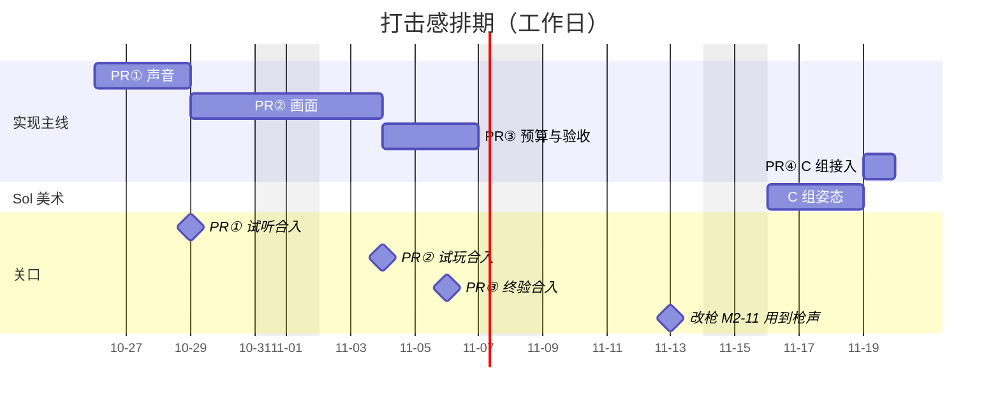

# 打击感剩余任务与排期（#75）

2026-10-25 排期。维护者要求把 [#75](https://github.com/xuys2025/escape-bincov/issues/75) 剩下的打击感改进排期、准备制作，美术写任务书交给 Sol。本页合入 main 表示已排期，和[改枪排期](../gunsmith/TASKS.md)同样的约定：实现另开 PR，任务在 PR 内逐个提交，合并要维护者明确同意。

本页是实现入口：已完成什么、谁在做什么、剩下的任务和日期。研究依据在 #75 正文和三条进度评论；实际进度以 #75 和各实现 PR 为准。

## 1. 现在的起点

核对 main `974a3a8`（10-24，已含 #103 B 组姿态、#98 改枪 M0+M1、#105 产物改由 CI 构建）。

**已合入**

| 研究项 | PR | 结果 |
| --- | --- | --- |
| P0-1 慢帧时序、受击方向、当帧闪白 | #88、#94、#97 | 闪白和后退从命中当帧画起，低帧率也至少画一帧；后退顺着子弹 |
| P0-3 声音区分 | #97 | 玩家中弹 `pain`、敌人中弹 `hit`、击杀 `kill`、暴击 `crit` |
| P0-4 命中分级（部分） | #97 | 普通、暴击、击杀、暴击击杀四档标记 |
| P1 受击 / 恢复姿态 | #96 美术，#99 A 组，#103 B 组 | 7 类敌人中弹先显示受击帧约 90 ms，再显示恢复帧约 60 ms |

**别人正在做（不在本页重复排）**

| PR | 内容 | 本页怎么接 |
| --- | --- | --- |
| [#113](https://github.com/xuys2025/escape-bincov/pull/113)（Ready） | 散弹命中音按开火和目标合并：`hurt` 带可选弹丸 UID，`SampleSound` 用 `shot.shotId` / `shot.pellets` 关联 | H-04 在它之上把闪白和血迹也按开火合并，等它合入再开工 |
| [#119](https://github.com/xuys2025/escape-bincov/pull/119) | 枪身回缩候选：开枪后的帧沿枪轴回缩 3 像素、80 ms 内恢复，所有枪一样 | 已同步 PR ②，回缩归入试枪场“打击感：新版 / 旧版”开关，旧版不回缩。维护者 10-26 试玩认可新版，同意合入；H-09 在它合入后按枪种调幅度 |
| [#106](https://github.com/xuys2025/escape-bincov/pull/106)（草稿，改枪 M2） | M2-11 在“#75 按枪种的枪声”上加消音等配置变体，开火事件带音色和消音状态（11-13） | H-02 必须在 11-13 前合入，并提供 M2-11 要用的音色族；两边都改 `SynthAudio.shot`，开工前在 #75、#80 互相登记 |

**代码入口**

- 枪声：`src/audio.ts` 的 `SynthAudio.shot(kind)` 只分 `spit`、`knife`、`shotgun`、`enemy` 和其他；`src/coast-view/sound.ts` 的 `shot` 分支传入 `e.weapon`。开火事件 `shot` 只带外观 `WeaponLook`，不带枪 id。
- 受击画面：`src/coast-view/scene.ts` 的 `blow()` 固定 2 像素后退、70 ms 闪白、80 ms 后退；姿态时长 `HURT_POSE` / `RECOVERY_POSE`。
- 命中点：`impact` 事件已带 `surface`（wall/door/actor）；画面只出火花，声音只有一种 `SynthAudio.impact`。
- 镜头：`scene.ts` 的 `recoil` 合成进镜头位置，已有开枪后坐；#102 的 `leadRoom` 管地图边前探。
- 预算：音源上限 `SynthAudio.maxVoices = 96`；`src/coast-view/fx.ts` 的 `spawn` 没有上限，只有贴花上限 400。
- 试枪场：`src/range/panel.ts` 的 `RangePanel`。

## 2. 交付方式

| PR | 内容 | 维护者要做的 |
| --- | --- | --- |
| ① 声音 | H-01、H-02 | 试听签收枪声 |
| ② 画面 | H-03、H-04、H-05、H-06 | 试玩看手感 |
| ③ 预算与验收 | H-07、H-09、H-10 | 真人 A/B、手机外放和耳机 |
| ④ C 组姿态接入 | H-08 | 看游戏内截图 |
| Sol 美术 PR | C 组 15 类受击姿态图集，按[任务书](../hit-feel-art/TASK-C.md) | 定插在 Sol 队列的哪里 |

- 同一时间一条实现主线，一个 PR 一个主 agent。② 的四项都改 `scene.ts`，放在同一个 PR 里避免自己和自己冲突。
- 1 工是一个 agent 一个工作日，含自测和 CI，不含等评审。日期按工作日排，周末不排。
- 每个 PR 开工前 fetch main，和在途 PR 试合并；进度在 #75 更新；PR 合入后在本页对应任务末尾补一行实际用时，并重排后面的日期。

## 3. 要维护者定的事

| 事项 | 默认做法 | 何时定 |
| --- | --- | --- |
| C 组美术插在 Sol 队列的哪里 | 不挤改枪美术：排在改枪 M3-07 之后（11-16 → 11-18），再接 #47 商场。要更早，就会推迟改枪 M2-09 之后的美术 | 合入本页时 |
| P2 硬直、逻辑击退、全局顿帧 | 本轮不做：会改战斗节奏，顿帧要先设计计时契约，不能靠少调 `Runtime.advance()`。P0–P1 做完试玩后再定 | PR ③ 试玩后 |
| #119 枪身回缩的去留 | 保留：维护者 10-26 试玩认可新版；H-09 在它合入后做 | 已定（10-26） |
| 枪声 | 按音色族合成，不用外部音频素材，保持单文件离线 | PR ① 试听时 |

## 4. 排期总览

| 交付 | 任务 | 估算 | 日期 | 关口 |
| --- | --- | --- | --- | --- |
| PR ① 声音 | H-01、H-02 | 2 工 | 10-26 → 10-28 | 10-29 试听合入（改枪 M2-11 在 11-13 用到） |
| PR ② 画面 | H-03 至 H-06 | 4 工 | 10-29 → 11-03 | 11-04 试玩合入 |
| PR ③ 预算与验收 | H-07、H-09、H-10 | 2 工，维护者试玩 | 11-04 → 11-06 | 11-06 终验合入 |
| Sol C 组美术 | 15 类 × 受击、恢复 | Sol 3 工 | 11-16 → 11-18（默认） | 验收通过 |
| PR ④ C 组接入 | H-08 | 0.5 工 | 11-19 | 11-19 合入 |
| 合计 | | 约 8.5 工，Sol 3 工 | 10-26 → 11-19 | |

## 5. 任务

负责一栏：“实现”是该 PR 的主 agent，“维护者”是评审或试玩。

### PR ① 声音

| 编号 | 任务 | 产出与完成判据 | 依赖 | 负责 | 工 | 日期 |
| --- | --- | --- | --- | --- | --- | --- |
| H-01 | 试枪场新旧对比开关（P0-5） | `RangePanel` 加一个开关，把增强表现做成视图选项：关掉时回到改动前的声音和画面，供本页每一项做 A/B。不进存档；`test:range` 覆盖开关 | — | 实现 | 0.5 | 10-26 |
| H-02 | 分枪种枪声（P0-2） | 按音色族重做 `SynthAudio.shot`：九毫米手枪、重弹手枪、冲锋枪、双管、泵动 / 半自动霰弹、步枪、精确步枪 / 栓动、支援机枪，覆盖[改枪目录](../../src/gunsmith/catalog.ts)的 20 把枪。现有开火事件只带外观，先按外观映射，枪 id 到音色族的表留给 M2-11 用。每族分起音、主体、机械声和尾声；敌人开枪仍弱化。用 #97 的离线方法测响度，不比现在响太多；渲染 WAV 放进 GitHub 临时分支给维护者试听，听完删除。`tests/coast-sound.test.ts` 覆盖映射，`node scripts/coast-audio-test.mjs` 通过（不在 CI，本地跑） | H-01；#113 合入或已试合并 | 实现、维护者 | 1.5 | 10-27 → 10-28 |

实际：H-01、H-02 于 10-25 在 `feat/hit-feel-sounds` 完成（排期合入当天提前开工），经 #121 合入（`ae2ad6b`）。11 个音色族现在按外观映射，游戏里的四把枪各用一族；`TIMBRE_OF_GUN` 留给 M2-11。

### PR ② 画面

| 编号 | 任务 | 产出与完成判据 | 依赖 | 负责 | 工 | 日期 |
| --- | --- | --- | --- | --- | --- | --- |
| H-03 | 强冲击档（P0-4 剩余） | `blow()` 的后退距离和闪白时长按武器冲击等级、同一枪打中同一目标的弹丸数、暴击和致死分档，不只看扣血（1 血的目标被双管打死不该是最轻的反馈）。伤害规则不变；“减少动态效果”下限幅。`test:shooting` 检查 g 扩到各档的位移和时长 | PR ① | 实现 | 1 | 10-29 |
| H-04 | 闪白与血迹按开火合并（P1） | 在 #113 的弹丸 UID 关联上，同一枪同一目标只出一次闪白和后退、血迹按弹丸数加量而不是叠多次；没有来源的旧弹走原路径 | #113 合入 | 实现 | 1 | 10-30 |
| H-05 | 表面反馈（P1） | 按 `impact.surface` 区分墙和门的火花与声音，不按贴图猜材质；打中人维持现状 | — | 实现 | 1 | 11-02 |
| H-06 | 镜头方向脉冲、重击短停（P1） | 玩家中弹时镜头沿来弹方向小幅脉冲，致死重击时姿态短停；“减少动态效果”下关闭，连续中弹限幅，和开枪后坐、#102 的地图边前探共用现有镜头合成。按屏幕尺度验收，1280×720 与 1920×1080 截图 | — | 实现 | 1 | 11-03 |

实际：H-03～H-06 于 10-26 在 `feat/hit-feel-visuals` 一起完成（提前三天开工），规则集中在 `src/coast-view/blow-feel.ts`。

- H-03：档位暂按弹丸数、暴击、致死分；“武器冲击等级”留给改枪接入枪 id 后再加。
- H-06：“姿态短停”做成重档受击帧多停 30/70 ms，只作用于挨打的角色，不是全局顿帧（全局顿帧仍归 P2）。
- 检查新增在 `test:shooting` 的检查 i，没有改检查 g（0 档就是原来的受击）。

### PR ③ 预算与验收

| 编号 | 任务 | 产出与完成判据 | 依赖 | 负责 | 工 | 日期 |
| --- | --- | --- | --- | --- | --- | --- |
| H-07 | 声音与粒子预算（P1） | 粒子加上限；拥挤时先丢装饰性的尾声和远处粒子，不丢玩家自己的开火和命中确认。多人混战场景下记录音源和粒子峰值 | PR ② | 实现 | 1 | 11-04 |
| H-09 | 枪身回缩按枪种调幅度 | 在 #119 的回缩上按音色族给不同幅度和时长（手枪轻、霰弹重） | #119 合入、H-02 | 实现 | 0.5 | 11-05 |
| H-10 | 验收 | 帧耗时分布、粒子与音源峰值对比；维护者按 #75 正文做真人 A/B（A 现在、B 增强、C 再加镜头表现），手机外放和耳机各听一遍 | H-07 | 实现、维护者 | 0.5 | 11-05 → 11-06 |

实际：H-07 于 10-26 在 `feat/hit-feel-budget` 完成，规则在 `src/feedback-budget.ts`。

- 上限：粒子软 220、硬 320（原来没有上限）；声道软 64、硬 96（96 是原有上限，原来到顶后新的声音一律丢，混战里击杀确认音和玩家中弹声会被挤掉）。
- 过了软上限不再加装饰（烟、尘、弹壳、碎屑、枪声尾音、机械声、脚步，以及离玩家远的粒子和声音）；到硬上限时核心反馈顶替最老的装饰。
- 新增 `test:shooting` 检查 k（j 已被 #119 的枪身回缩检查占用），main 构建上失败、本分支通过。
- H-10 的帧耗时与峰值实测见[证据](../evidence/issue75-budget/README.md)；维护者 10-26 在局域网另一台电脑上试玩本分支构建（`f356bad`）后认可：“体验不错 通过了”；手机外放和耳机试听没有单独确认。H-09 的前置 #119 于 10-26 合入（`34e9ba7`）后，H-09 当天在同一分支完成，见下。

实际：H-09 于 10-26 在 `feat/hit-feel-budget`（#126）完成。`weapon-retraction.ts` 的 `RETRACTION` 按音色族给幅度和时长：九毫米手枪 2 像素 / 60 ms，卡宾枪和步枪保持 3 像素 / 80 ms，双管和泵动 5 像素 / 130 ms，其余族在两者之间；每族都短于该族最快的连发间隔。60 帧/秒下开枪后手枪画 1、1、0 像素，卡宾枪和 M4A1 画 2、2、1、1，双管画 4、4、3、2、2、1、1。`test:shooting` 检查 j 扩到四种枪，main 构建上手枪和双管失败、本分支通过；两档分辨率逐帧图见[证据](../evidence/issue75-retraction-families/README.md)。手枪幅度经维护者同日试玩认可，不改。

### C 组受击姿态

| 编号 | 任务 | 产出与完成判据 | 依赖 | 负责 | 工 | 日期 |
| --- | --- | --- | --- | --- | --- | --- |
| H-08a | C 组美术 | 按[任务书](../hit-feel-art/TASK-C.md)交 15 类图集，可分三批；模板在 `assets/hit-feel/templates/` | 维护者定插队位置 | Sol | 3 | 11-16 → 11-18（默认） |
| H-08 | C 组接入 | `POSE_KINDS` 加 15 类、图集文件名按类记录版本；肩线检查只对持械人形生效；检查 g 加一类持械、一类兽形；两档分辨率截图 | H-08a 验收通过 | 实现 | 0.5 | 11-19 |

实际：Sol 于 10-25 交付 #122，比默认排期早三周，没有占用改枪美术的时段；首轮验收让盐背犬、囊腹喷吐兽返工一次（整只缩小），复验后 15 类签收，#122 合入（`7d1827c`）。H-08 于同日在 `feat/hurt-poses-c` 接入。

## 6. 风险

- H-02 和改枪 M2-11 改同一个函数。H-02 晚于 11-13，M2-11 就要先自己做一版枪声，之后再合并两套，所以 PR ① 排在最前。
- #113、#119、#106 和本页的 PR 都会碰 `sound.ts`、`scene.ts`。每次开工前试合并；产物已不入库（#105），冲突只会出在源码和文档上。
- 枪声和镜头脉冲的好坏只能靠试听、试玩判断，自动检查只保证时序、上限和不回归。
