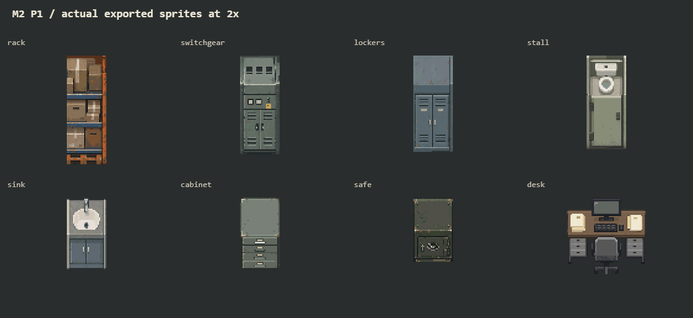
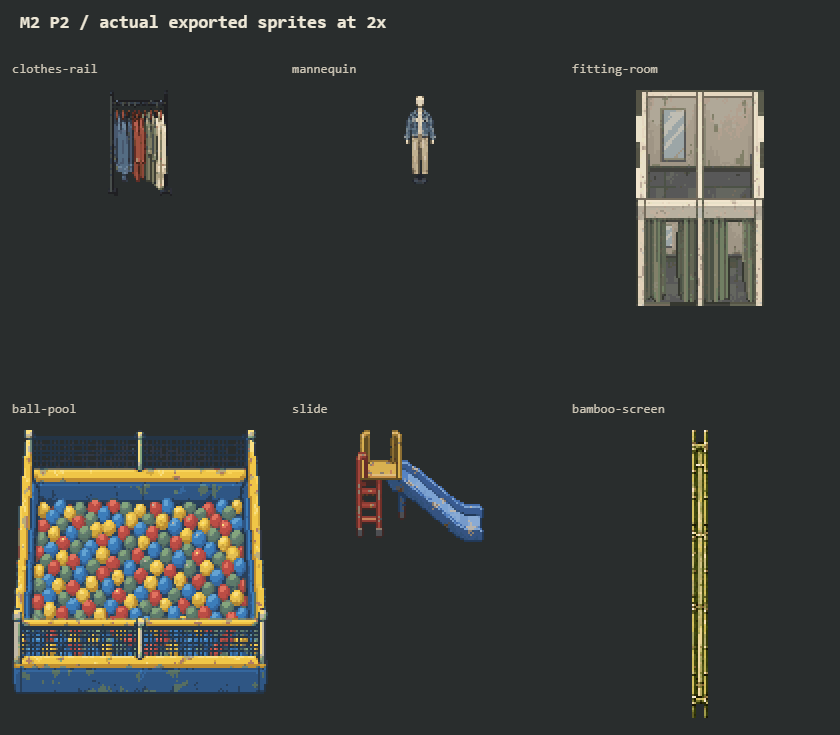
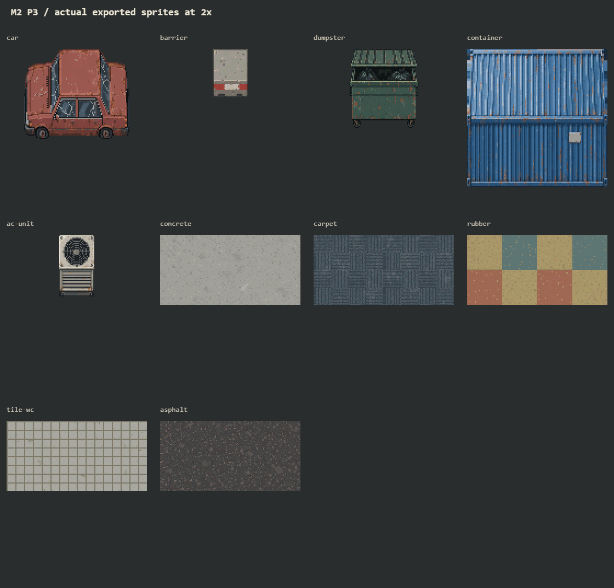
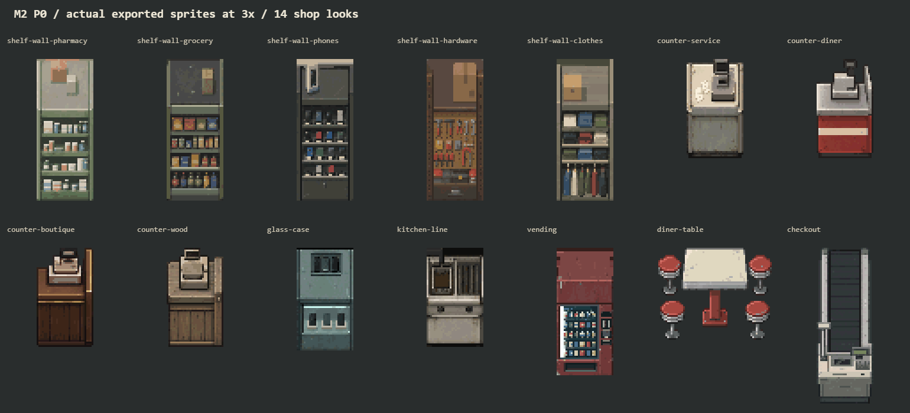

# M2 素材交付

2026-10-27，按 [TASK](TASK.md) 的 P0 → P1 → P2 → P3 顺序交齐家具表的 **26 种类型**及五种地面，继续 [PR #127](https://github.com/xuys2025/escape-bincov/pull/127)。共 **105 本体 + 11 emit + 10 地面 = 126 张 PNG**，manifest 修订 5，原有 110 项不变。本次是素材交付与注册；布置表仍选程序绘制件，游戏里尚未换图。游戏内视觉签收、真机与建筑补图仍未完成。

| 批次 | 本体 | emit | 地面 | 实际像素总览 / 提示词 |
| --- | --- | --- | --- | --- |
| P0 店铺 | 58 | 6 | 0 | [总览](p0-overview.png) · [提示词](p0-prompts.json) |
| P1 后场与办公 | 28 | 5 | 0 | [总览](p1-overview.png) · [提示词](p1-prompts.json) |
| P2 服装与儿童区 | 10 | 0 | 0 | [总览](p2-overview.png) · [提示词](p2-prompts.json) |
| P3 室外与地面 | 9 | 0 | 10 | [总览](p3-overview.png) · [提示词](p3-prompts.json) |

文件分别在 `assets/mall/m2-p0/` 至 `m2-p3/`。P1 包含仓储货架、配电柜、更衣柜、厕所隔间、洗手台、文件柜、保险柜、办公桌；P2 包含衣架、人台、试衣间、球池、滑梯、竹屏风；P3 包含弃车、隔离墩、垃圾箱、集装箱、空调外机与五种 64×64 地面的 A/B。全部连排件均有五段，三个发光类型均有独立遮罩。





地面经 [2×2 A/B 铺贴](ground-repeat.png) 复核：儿童垫原斜拼图在边缘断线，重新生成正交方垫；厕所砖缝校正为 8 px 周期。低对比随机材质共用边缘采样；有规则图案的地面保留有意的色块/砖缝边界，不强行令不同材质块边缘同色。

**竹屏风规格冲突已显式保留：** 表中特别要求立在三格中线，与通用“B 类画满占地”不一致。本图遵循该薄件特例，画布仍是 32×144、B 碰撞仍是 1×3，仅中间 8 px 有画面，左右各 12 px 透明；与原 `PAINTED_BASE` 中线底座一致。其他矩形 B 柜体填满投影，车/垃圾箱/球池保留轮廓且画满宽度与南边线；未改变任何碰撞。

## P0 逐项规格



共 58 张本体、6 张发光遮罩，全部为 1 倍 PNG，alpha 只有 0/255。每种连排外观都有 `end-w`、`end-e`、`mid-a`、`mid-b`、`single` 五段。

| 外观组 | 数量 | 画布 | 碰撞 |
| --- | --- | --- | --- |
| 靠墙货架 pharmacy / grocery / phones / hardware / clothes | 25 | 32×80 | B |
| 柜台 service / diner / boutique / wood | 20 | 32×56 | M |
| 玻璃柜台 | 5 本体 + 5 emit | 32×58 | M |
| 油炸线 | 5 | 32×56 | B |
| 售货机 | 1 本体 + 1 emit | 32×72 | B |
| 快餐桌与四张圆凳 | 1 | 64×52 | M |
| 南北向收银通道 | 1 | 32×88 | M |

- 文件在 [`assets/mall/m2-p0/`](../../../assets/mall/m2-p0/)，ID 前缀为 `mall-prop-`、后缀为 `-v1`。例如 `mall-prop-shelf-wall-pharmacy-end-w-v1`、`mall-prop-glass-case-single-emit-v1`。
- [manifest 修订 5](../../../assets/mall/manifest.json) 保存尺寸、占地、lift、南边锚点 `[0, h]`（地面 `[0, 0]`）、碰撞类别、emit ID、来源矩形和 SHA-256。原有 110 项的条目与 PNG 不变。`src/coast-view/mall-assets.ts` 由原有生成器注册全部 236 项。
- B 类柜体投影填满画布与占地；不加地面或外投影。每种外观共用最多 28 色。连排开口两列逐行一致，保留外端收口。
- [逐段和连排预览](p0-contact-sheet.png) 左侧为 1 倍独立图，右侧为实际 PNG 以 2 倍拼接；上方总览为 3 倍。两图都是本批导出资产的像素预览，**不是游戏内实现截图**。
- 任务书称“25 种”，但家具表与 `PAINTED_LIFT` 实际各有 26 种；本批依表交付 7 种类型、14 种外观，不据标题漏掉任一项。

## 原图与可重复导出

创作使用内置 **image_gen**，40 张原图（38 张当前采用的图集/单件图，另有竹屏风、儿童垫两张修订前原图）保留在 `assets/mall/sources/m2-p0/` 至 `m2-p3/`。四批完整提示词见上表；每批 `p*-sources.json` 保存原图哈希与共用调色板。没有使用 CLI/API fallback。

导出只做确定性的裁切、最近邻采样、顶面/正面基准对齐、硬透明、共用调色板及接缝归一。柜台端头原图有偏高围板，普通段从密集台面行裁切；单件保留收银机。售货机灯条比一个缩小采样间隔窄，导出时在对应像素区域保留原图实际存在的最亮灯像素。发光遮罩只提取本体已有的亮色灯条，没有外部光晕。

从仓库根目录运行：

```bash
node docs/mall-2-5d/m2/export-p0.mjs
node docs/mall-2-5d/m2/export-m2.mjs p1
node docs/mall-2-5d/m2/export-m2.mjs p2
node docs/mall-2-5d/m2/export-m2.mjs p3
node scripts/mall-assets.mjs
node docs/mall-2-5d/m2/validate-m2.mjs
node docs/mall-2-5d/m2/review-m2.mjs
```

验证器独立读取 PNG 字节，并加载当前 `MALL_FURNITURE` / `PAINTED_LIFT` 核对全部 26 种类型的占地、碰撞与 lift；还检查哈希、尺寸、alpha、调色板、锚点、矩形 B 覆盖/异形 B 范围/竹屏风特例、遮罩、54 对开口接缝及 20 组地面 A/B 周期。旧清单对照固定为接手的 PR head `60a0d938753baf12eeaa376bcf333668e0dc44cd`；浅克隆需要先取得这个提交。P0 PNG 在共享导出器下重导出后字节不变。

## 本次实际验证

接受基线 `origin/main` 为 `0d208570ab35d3a4b9da1e25fedbaf83268867c6`；接手 PR #127 head 为 `60a0d938753baf12eeaa376bcf333668e0dc44cd`。在 `C:/bincov/test-results/mall-m2-art` 的隔离工作树交付，原工作树与其他分支不动。

| 检查 | 结果 |
| --- | --- |
| 原图 / 导出 PNG / 源码合同 / 周期 | [通过](m2-validation.json)：40 原图哈希、126 张交付、26 类型、110 张原有素材、11 个有效遮罩、54 对接缝、20 组地面周期 |
| `pnpm test` | 921/921；首跑沙箱账号的 `os.userInfo` 报 `uv_os_get_passwd ENOMEM`，正常宿主账号重跑通过 |
| `pnpm package` | 通过，含 TypeScript 严格检查；HTML SHA-256 `224d158dd9c31e05213eb73610f2474cb0543653fde49a00705dd48d44be54fd`；生成物未提交 |
| `pnpm test:mall-sample` | 23/23，无错误/外部请求；含 1280×720、1920×1080 和资源重挂；检查现有程序绘制路径，不替新素材游戏内视觉签收 |
| `git diff --check` | 通过 |
| CI | 推送后的准确 head 以原 PR 检查为准；本地通过不能代替 CI |

Windows、Node 24.22.1、pnpm 11.19.0、Chrome 156.0.8078.48。没有改布局、碰撞、存档格式、状态事务或玩家进度；没有新依赖或游玩网络请求。

## 接手与剩余

1. `src/coast-view/mall-dressing.ts`：26 种 `furniture:` 项改选本批 ID，地面选新 A/B；按邻居选择端头/中段/单件，并保留程序绘制后备。M 类现有 `PAINTED_BASE` 需按实际图中底座复核；B 类不能继续沿用售货机旧的窄底座。竹屏风保留中线底座。
2. 玻璃柜台、售货机、配电柜选择同名 `-emit-v1`，确认宿主按本体位置叠加遮罩。
3. 跑 `pnpm test`、`pnpm package`、`pnpm test:mall-sample`，在 1280×720 与 1920×1080 留真实接入截图；检查灯光、像素密度、家具/人物比例、遮挡和落地线。当前浏览器回归仅证明原路径继续工作。
4. 维护者确认游戏内观感；外立面、检修核顶面、专用楼梯/扶梯与可选招牌仍未交付，需要另定画布与接入规格，不因家具/地面齐备而视为完成。
