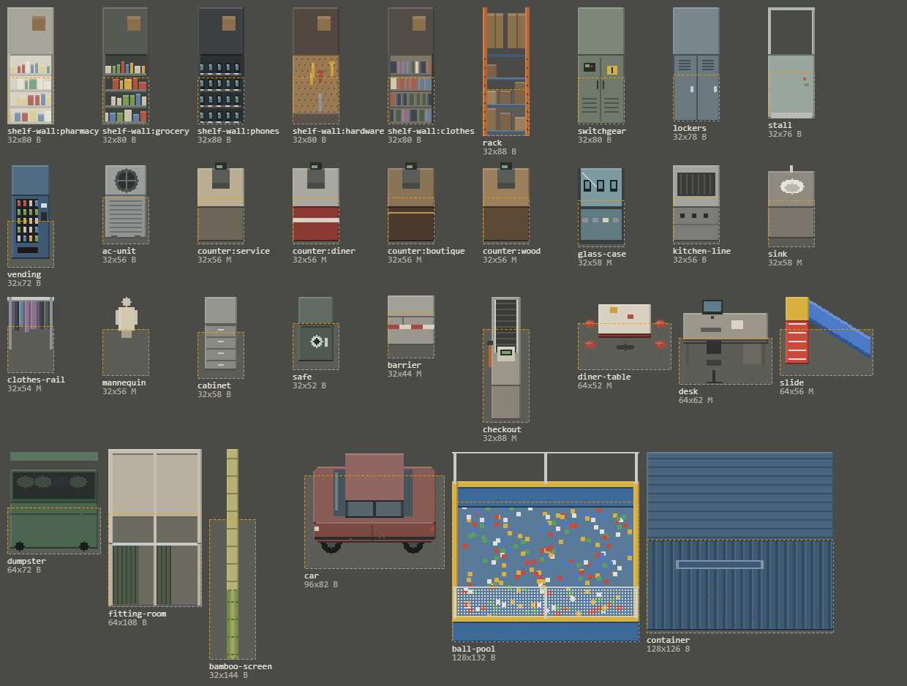

# 商场 M2 素材任务书（给 Sol）

2026-10-27，Refs [#47](https://github.com/xuys2025/escape-bincov/issues/47)。维护者决定布局四版一次铺完其余 29 个区域，新家具先由视图程序绘制，正式素材交 Sol。本页可以直接转发。布局与画法见[商场 2.5D 实施记录](../README.md#布局四版mall-v4--mall-layout-42026-10-27)。

## 为什么要画

布局四版给药房、炸鸡店、便利店、数码店、五金店、仓库、配电间、服务间、收银区、二层服装、食品与非食品卖场、竹木区、促销区、儿童乐园、办公室、财务室、仓库、电房、厕所和四片室外街区都摆了家具。其中 25 种家具第一批素材里没有，现在是代码画的占位件：能认出用途，但细节和质感比不上第一批。

碰撞和位置已经定了（存进存档），**换图不能改占地、画布大小和锚点**。

## 通用规格（与第一批相同）

- 1 倍 PNG，透明度只有 0 和 255；光从左上；不画投影（游戏按底座画投影和接触暗线）。
- 画布宽 = 占地宽 × 32，高 = 占地深 × 32 + 高度；画布底边就是占地的南边线。比例尺：24 像素约 1 米，人物画出来 39 像素高。
- **挡子弹的件（B）请画满占地。**现在的车、空调外机、垃圾箱、售货机比占地窄，地面的接触暗边会露出碰撞格的轮廓。只挡人的件（M）可以比占地窄，例如人台、衣架。
- 连排件（表中“连排”）像货架一样交端头和中段：`-end-w`、`-end-e`、`-mid-a`、`-mid-b`，再加单格的 `-single`（只有一格的连排，如便利店门边的收银台）。
- 文件名 `mall-prop-<类型>[-<外观>][-<段>]-v1.png`；发光的部分另交 `-emit` 遮罩（售货机正面、玻璃柜台、配电柜指示灯）。
- 交付时更新 `assets/mall/manifest.json`（修订 5），每件写 SHA-256、尺寸、占地、碰撞类别；原图和提示词随交付保留。

## 家具（25 种）

| 类型 | 名称 | 占地 | 画布 | 高度 | 碰撞 | 连排 | 外观 / 说明 | 用在 |
| --- | --- | --- | --- | --- | --- | --- | --- | --- |
| `shelf-wall` | 靠墙货架 | 1×1 | 32×80 | 2 m | B | 是 | 五种：`pharmacy` 药品、`grocery` 零食饮料、`phones` 手机展示、`hardware` 洞洞板工具、`clothes` 挂衣墙 | 药房、便利店、数码店、五金店、服装区 |
| `rack` | 仓储货架 | 1×1 | 32×88 | 2.3 m | B | 是 | 橙色立柱、蓝横梁、纸箱 | 一层仓库、服务间，二层仓库、临时仓库 |
| `switchgear` | 配电柜 | 1×1 | 32×80 | 2 m | B | 是 | 灰绿柜体、仪表、警示牌 | 配电间、电房 |
| `lockers` | 更衣柜 | 1×1 | 32×78 | 1.9 m | B | 是 | 有的柜门半开 | 服务间、二层服务通道 |
| `stall` | 厕所隔间 | 1×1 | 32×76 | 1.8 m | B | 是 | 从上看到马桶，南面是门（有的开着） | 厕所 |
| `vending` | 售货机 | 1×1 | 32×72 | 1.8 m | B | 否 | 发光正面，饮料罐；可有碎玻璃 | 便利店、两层东南大堂、服务间、二层服务通道 |
| `ac-unit` | 空调外机 | 1×1 | 32×56 | 1.2 m | B | 否 | 顶面风扇格栅 | 东侧巷 |
| `cabinet` | 文件柜 | 1×1 | 32×58 | 1.3 m | B | 否 | 四层抽屉 | 办公室、财务室 |
| `safe` | 保险柜 | 1×1 | 32×52 | 1 m | B | 否 | 转盘、把手 | 财务室 |
| `counter` | 柜台 | 1×1 | 32×56 | 1 m | M | 是 | 四种：`service` 普通、`diner` 快餐红白、`boutique` 深色木加铜条、`wood` 木质；少数段上放收银机或纸张 | 药房、炸鸡店、便利店、五金店、服装区 |
| `glass-case` | 玻璃柜台 | 1×1 | 32×58 | 1 m | M | 是 | 柜里有手机 | 数码店 |
| `kitchen-line` | 油炸线 | 1×1 | 32×56 | 1 m | B | 是 | 不锈钢、油锅或铁板 | 炸鸡店 |
| `sink` | 洗手台 | 1×1 | 32×58 | 0.9 m | M | 是 | 白色台盆、龙头 | 厕所 |
| `clothes-rail` | 衣架 | 1×1 | 32×54 | 1.5 m | M | 是 | 横杆上挂满衣服，两端立柱 | 服装区 |
| `mannequin` | 人台 | 1×1 | 32×56 | 1.7 m | M | 否 | 穿着店里的衣服 | 服装区 |
| `diner-table` | 快餐桌 | 2×1 | 64×52 | 0.75 m | M | 否 | 桌子加四张圆凳 | 炸鸡店 |
| `desk` | 办公桌 | 2×1 | 64×62 | 0.75 m | M | 否 | 显示器、键盘、文件，前面拉出的椅子 | 办公室、财务室 |
| `checkout` | 收银通道 | 1×2（南北向） | 32×88 | 1 m | M | 否 | 北段传送带，南端收银机朝外，通道号立杆 | 收银及南门厅 |
| `slide` | 滑梯 | 2×1 | 64×56 | 1.2 m | M | 否 | 西端梯子、向东的滑道 | 儿童乐园 |
| `barrier` | 水泥隔离墩 | 1×1 | 32×44 | 0.8 m | M | 是 | 红白反光带 | 步行街、东侧巷、南街 |
| `dumpster` | 垃圾箱 | 2×1 | 64×72 | 1.4 m | B | 否 | 盖子半开，垃圾袋 | 东侧巷、南街、卸货区 |
| `fitting-room` | 试衣间 | 2×2 | 64×108 | 1.8 m | B | 否 | 两格，南面帘子半拉 | 服装区 |
| `bamboo-screen` | 竹屏风 | 1×3（南北向） | 32×144 | 2 m | B | 否 | 立在三格中线上 | 竹木区 |
| `car` | 弃车 | 3×2（东西向） | 96×82 | 1.3 m | B | 否 | 侧面朝南；可有碎窗、锈迹、瘪胎 | 步行街、东侧巷、南街 |
| `ball-pool` | 球池 | 4×3 | 128×132 | 1.5 m | B | 否 | 软包矮墙、立柱和网、彩球 | 儿童乐园 |
| `container` | 集装箱 | 4×2（东西向） | 128×126 | 2.6 m | B | 否 | 瓦楞侧板和顶板 | 卸货区 |

画布尺寸来自 [`PAINTED_LIFT`](../../../src/coast-view/mall-dressing.ts)，占地和碰撞来自 [`MALL_FURNITURE`](../../../src/mall-layout-v2.ts)；两处与本表不一致时以代码为准，并告诉 Opus。

## 地面与其他（同一批或下一批）

- 地面，64×64 两种变体（`-a`、`-b`），与第一批地面同规格：
  - `ground-concrete`：后场水泥地（仓库、配电间、服务间、电房、二层仓库与服务通道）；
  - `ground-carpet`：办公地毯（办公室、财务室）；
  - `ground-rubber`：儿童区橡胶垫；
  - `ground-tile-wc`：厕所小方砖；
  - `ground-asphalt`：路面（南街、卸货区，可带残留标线）。
- 第一批已知缺口：外立面朝外的一面（现在用室内立面图）、封存检修核顶面的实心填充（现在一整块平灰）、S-W 和 S-E 楼梯与 E-C 扶梯的画法（现在是一格的通用小图）。
- 可选：店铺门头招牌（药房、炸鸡、便利、数码、五金），挂在东西向门洞的门头上。

## 交付顺序与验收

1. P0 店铺：靠墙货架五种、柜台四种、玻璃柜台、油炸线、快餐桌、收银通道、售货机。
2. P1 后场与办公：仓储货架、配电柜、更衣柜、厕所隔间、洗手台、文件柜、保险柜、办公桌。
3. P2 服装与儿童区：衣架、人台、试衣间、球池、滑梯、竹屏风。
4. P3 室外与地面：弃车、隔离墩、垃圾箱、集装箱、空调外机，五种地面。

每批交完就能接：Opus 把素材 id 接进布置表（程序绘制件保留作素材缺失时的后备），跑 `pnpm test`、`test:mall-sample`（M20 检查每个区域、1280×720 和 1920×1080 截图），提交对比截图。验收看三点：画布、锚点与表中一致；挡子弹的件画满占地；放进游戏后和第一批的光照、颜色、像素密度一致。真人观感由维护者看截图或试玩确认。
