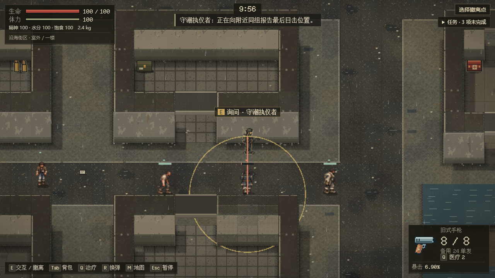
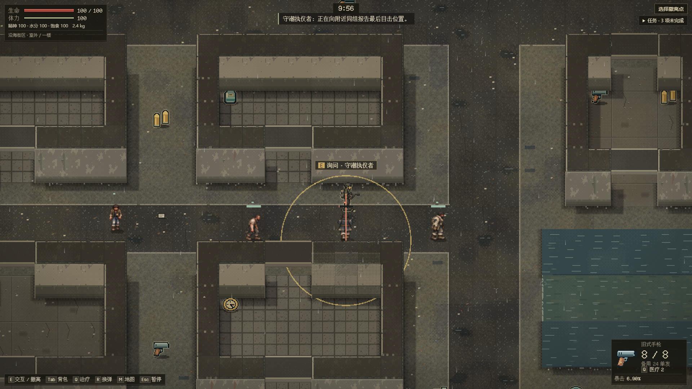
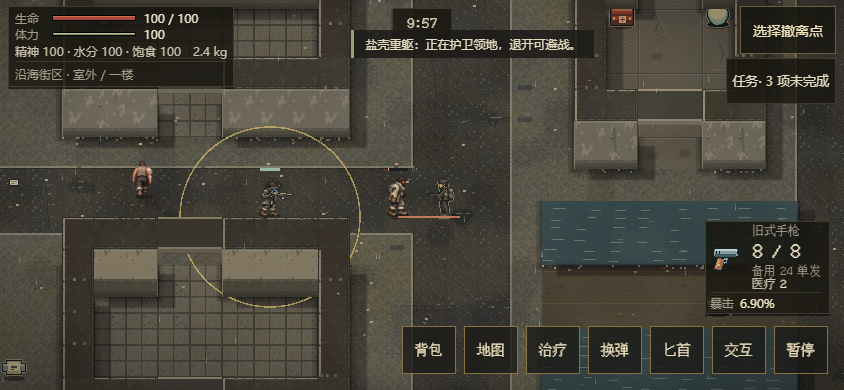

# EN-15：停业市场后场盐蚀者样板

承接[Issue #78](https://github.com/xuys2025/escape-bincov/issues/78)/[PR #81](https://github.com/xuys2025/escape-bincov/pull/81)。新街区seed%15==2（如47/62）增加四种危险个体，替换既有人口，世界仍25。原三种拾荒者保留，两名剧情物资守卫不替换。这里是已有停业告示旁的后场，不是医疗队列、住民安全区或新规划区域。普通seed42三人测量基线保持原样。

[岗位](../../src/enemy-affected.ts)在格(18,34)/(24,34)/(28,34)/(32,34)，分别为失神者、追潮者、执仪者、重躯。前两名反复走一格短路线，执仪者守侧路，重躯留守宽后场。两潮位身体、路线、出击/出口/楼梯隔离和西侧公共道路绕行均验证。所有身体仍10像素半径；体型表现没有改变碰撞或允许穿门。

失神者用1.2秒确认，听声只去最后声源，不能凭声音隔墙锁定玩家；刺激过期后返回。追潮者仍是准备→最多0.3秒/90像素扫掠扑击→1.4秒恢复，不能刷新续扑或转向追踪。重躯用1.6秒确认，开始攻击前按最多1.1弧度/秒转身；准备1.3秒、恢复1.7秒，锁向后不会跟随侧移。既有正面120度护甲与侧后弱点保留。

执仪者按匹配种子交替持长柄或旧枪：47为枪，62为长柄。枪械为实际rifle攻击/卡宾枪装备，85生命、240像素射程、12伤害、四发弹匣/八发备弹、2.4秒换弹；发射真实有归属弹丸，消耗与掉落同源。长柄仍64像素、17伤害，双手持握与前刺；两者从同一持久规则投影外观、阶段、弹量，不另抽一把武器。先驱离，四秒警告后才升级；可以询问与绕行，询问不清除已交火状态。失控者不能被执仪者指挥，没有患者/温和派或具名剧情人物被替成敌人。

这些能力只在新出击安装`EnemyTactics.version=2`及严格program。旧v1各原型/原四类保持原规则；原活动行动不迁移。外层仍7/3/5，原始双备份不变，实际旧端拒绝与事务边界见[存档合同](enemy-save-contract.md)。

## 验证记录

本批10项能力回归、734完整单测、62CI守卫、package通过。三尺寸普通UI新增15例，含两种实际武器，全部等待真实攻击、暂停/刷新并严格核对完整四人组；共132案例/124截图、零错误/请求。正常save-browser/UI与portable通过。两个独占性能组（各12Runtime/六浏览器）通过原预算，见[性能记录](enemy-performance.md)。

三尺寸与完整十分钟属于角度归一化前候选1c0ad62d...：[自然输入记录](../enemy-street/natural-affected-pre-angle.json)保留原时间、次数与制品。后续复查修复重躯长时间转身累计角度，新增4,000次绕行和严格保存回归；最终734单测、package/portable重新通过。最终HTML7,979,796字节，SHA-256 94d0d453601ec5800c85c08ebf074486504ed929ebb41e14d66b63837ebb4475，便携ZIP5,235,421字节；该版本[完整自然输入](../enemy-street/natural-affected-final.json)于02:52:04.943～03:02:19.804 UTC通过，26次击杀、两次撤离、32次原生拖放，零错误/外部请求；准确head `71cf986` 的[完整CI 40056388894](https://github.com/xuys2025/escape-bincov/actions/runs/40056388894)全部通过。CPU性能签收边界、真机/真人平衡和全地区仍归EN-21/19。

