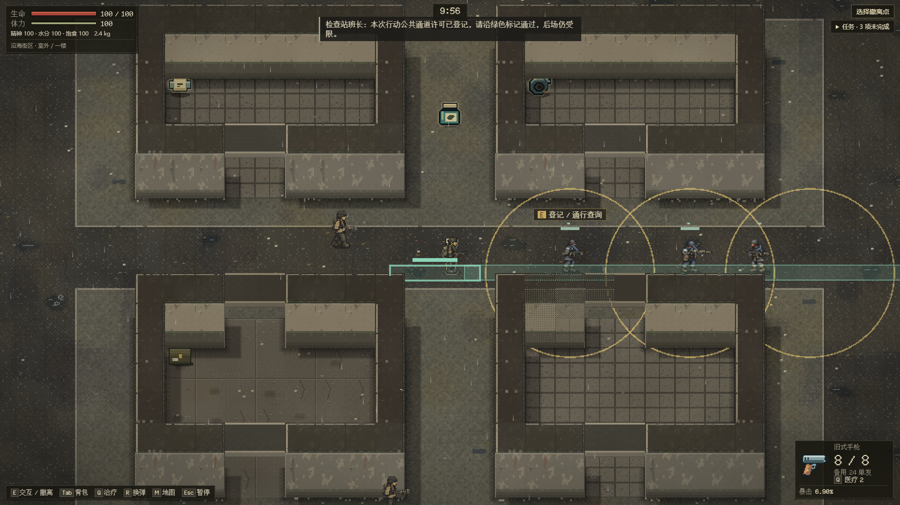
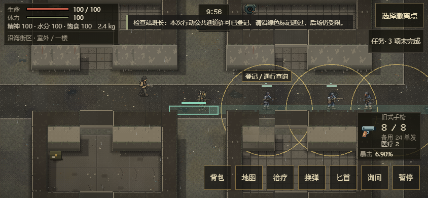
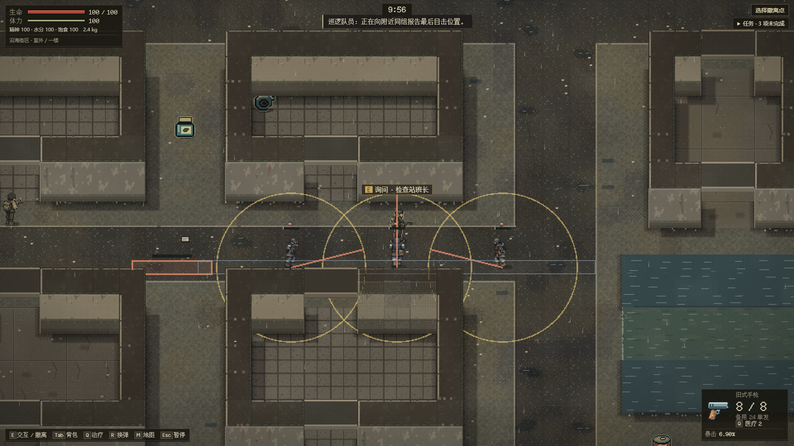

# EN-17：临时检查站、登记与公共通行

承接 [#78](https://github.com/xuys2025/escape-bincov/issues/78) / [PR #81](https://github.com/xuys2025/escape-bincov/pull/81)。新街区 seed%5==4（如49）在现有停业市场后场设置临时检查线：哨兵(24,34)、班长(28,34)、巡逻(32,34)，巡逻走30/32列、33/34行。三人复用旧名册槽，人口仍25、前三拾荒者及两名剧情守卫保留。这是现有地图样板，普通班长不替代钟队长等具名人物，十个未建地区仍由地图专题承接。

## 2026-10-24 最新主线整合

正常合入main `f73e9de`（#96/#99受击姿态与素材），保留A组旧四类的受击/恢复帧，以及本PR十八原型自己的身体、阶段形变与角色过滤。B组三种拾荒者的专属受击帧和后续枪声接入仍由#75接续，不借旧四类帧替代。此前32cf5f4的完整CI和ac1f62b3...报告保留为整合前证据，整合后准确制品/验证见下方新记录和原PR。

维护者已明确取消便携ZIP的5 MiB上限；本次不为卡包体更换新受击帧的编码，保留原40张PNG、清单和哈希。单文件离线、严格保存和正常钩子继续保留。

组合候选HTML8,019,165字节、SHA-256 `eda19651f349f6523641da16b48957c93552c2d2e51b9dda5e1ea0e98d46cc7d`，便携ZIP5,252,978字节。763/763单测、62/62CI守卫、package和完整shooting（含五档帧率的A组受击/恢复帧）本地通过。敌人/离线/标准性能及准确组合head完整CI的最终结果由原PR与`test-results/enemy-main-poses-*.log`签收；不套用旧制品的十分钟或性能结果。

## 玩家可见规则

默认持枪、接近和询问都不直接敌对。限制圈仍为90像素、连续四秒警告；在未伤人、未付出不可取消攻击前退回，可逐步解除。实际受到玩家攻击、对亲眼可见玩家付出不可取消的射击前摇，或亲眼看到近期致死攻击及其真实来源，才锁定本次行动的交火状态；普通警告报告、空枪和对NPC自卫不凭空给玩家定罪。已经承诺的前摇/换弹按原代价完成，刷新不能免除攻击、补弹或恢复许可。

在金色等候区域按E/触屏动作发起登记，先成功保存再告知已受理；该标记内登记优先于告示阅读；附近箱体搜刮、门和楼梯保留正常优先级，原告示可在附近标记外阅读。玩家须在等候区连续停留四个行动秒，且班长能实际看见，才取得本局公共通道许可。暂停不计时，刷新保留已付等待时间，离开等候区重新等待。班长阵亡无法新发许可，会说明外围公共道路仍可绕行。

许可只覆盖同一横街上明确标记的公共通道，获准后显示绿色。后场仍受限制；不收新税费、不加钥匙/任务物品、不增永久声望。哨兵与班长留守，巡逻有实际短路线；两潮位的岗位、等候区、通道、楼梯/出击/撤离隔离及外围绕行均检查。三尺寸普通出击实测包括真实登记、等待中暂停刷新、键盘/触屏摇杆通过公共通道、越界后的实际准备与再次刷新。

## 所有权与兼容

[enemy-blockade.ts](../../src/enemy-blockade.ts)拥有固定岗位/地面标记和候选登记；[blockade-checkpoint.ts](../../src/raid-runtime/blockade-checkpoint.ts)根据实际视线推进等待，通信只在同队320像素内分发状态，不携带未知玩家坐标。`program.kind=blockade`保存本局班长UID、none/waiting/granted/engaged、已等待秒和阶段时间。固定地图/岗位、三种不同角色、同图同队自指班长、时间和许可顺序严格校验；跟随者不能凭空先于班长获得许可。

角色与世界仍一次原子提交；失败保留当前原文及两份原始备份，重试只提交一次。外层7/3/5不变，旧actor v1保持原行为。七个固定旧客户端对真实等待/获准/交火档及正反例共154例通过；未知能力拒绝整个活动档且失败后零写入。实际结算移除行动后，固定1b884f2旧端可读、初始化并继续保存，两份原始备份逐字相同，见[合同](enemy-save-contract.md)。

地面提示来自同一持久许可和静态几何的只读投影，不另建界面计时器；随角色的可见性过滤，隐藏房间不泄露检查状态或攻击。射击、伤害与弹药仍由原控制器/Runtime处理。

## 32cf5f4街区阶段验证（整合受击主线之前）

最终制品HTML7,993,985字节、SHA-256 `ac1f62b3b8920330e01c0a3e739d14efd7763cbed2366060b28a9ff61a61de9f`，便携ZIP5,240,246字节；8MiB/5MiB预算保留。761/761完整单测（含[16项检查站回归](../../tests/enemy-blockade.test.ts)）、62/62 CI守卫、严格类型/打包、save-browser、portable与双尺寸UI通过；源/生成物一致。检查站测试包含真实登记失败/重试、重复询问、可见连续等待/离开重置、暂停恢复、通道范围、越界准备、未开火退回、实际伤害归属、近期目击与隐藏死亡、班长缺失、空枪报告与换弹退回、真实箱体守恒、幸存巡逻继续投影以及严格坏档。

最终[156敌人浏览器案例/148截图](../enemy-street/blockade-browser-final.json)通过，零错误/外部请求；报告明确绑定上述最终SHA。新增三尺寸实际登记、等待中暂停刷新、真实键盘或触屏摇杆穿过完整公共通道；三种角色均等到实际越界射击准备后再暂停刷新，巡逻先观察实际移动。原告示抢占、错误清理已启动Runtime、空枪报告与换弹退回的首败保留，没有弱化断言。

最终[十分钟自然输入](../enemy-street/natural-blockade-final.json)：2026-10-24T05:06:20.218Z～2026-10-24T05:16:26.220Z，606.0秒，3次撤离/25击杀/29次原生物资拖放，零页面错误/外部请求。只读hook配合真实键鼠/E/物资拖放，没有改时钟/生命/敌人/RNG；自动化不等于真人平衡。更早de251b2a...候选的[自然输入](../enemy-street/natural-blockade-pre-interaction.json)保留原归属。

最终标准与检查站撤退负载各12Runtime/六浏览器的原绝对预算通过；固定五组A/B的present p95中位2.9/3.0ms、advance2.5/2.5ms，十个单样本原绝对预算通过。原单次历史同比BUDGET_BLOCKED、近距死亡短样本和触屏未完成ERROR全部保留，配对诊断不覆盖原失败，详见[性能记录与复现](enemy-performance.md)。真手机、GPU完成帧率、真人识别/平衡和十二区域未签收。准确head完整CI在原PR核对，保留草稿，未合并/上线。

## 首轮CI搜刮夹具修复

`df30df8`的[完整CI40065883806](https://github.com/xuys2025/escape-bincov/actions/runs/40065883806)构建及其余七组浏览器通过，第8组在seed44第二次出击建立搜刮夹具时失败。本地原样复现：测试`quiet()`用`placeEnemy()`停车，连带改写检查站的固定home，下一笔真实SaveSession候选被严格校验正确拒绝。现在让已冻结的recovery/blockade成员留在原岗位，其余停车、输入、事务断言和正式校验均保留；未修改游戏源码或制品。

[修复后48项搜刮回归](../enemy-street/blockade-loot-fixture-regression.json)通过：两档桌面各22项，844触屏4项，包括真实三秒撤离、死亡/超时、拖放、失败保存/重试和跨窗口保护。62CI守卫通过；上述最终HTML哈希与十分钟/性能证据继续有效。首败没有记为通过，修复提交准确head的完整CI仍由原PR签收。

