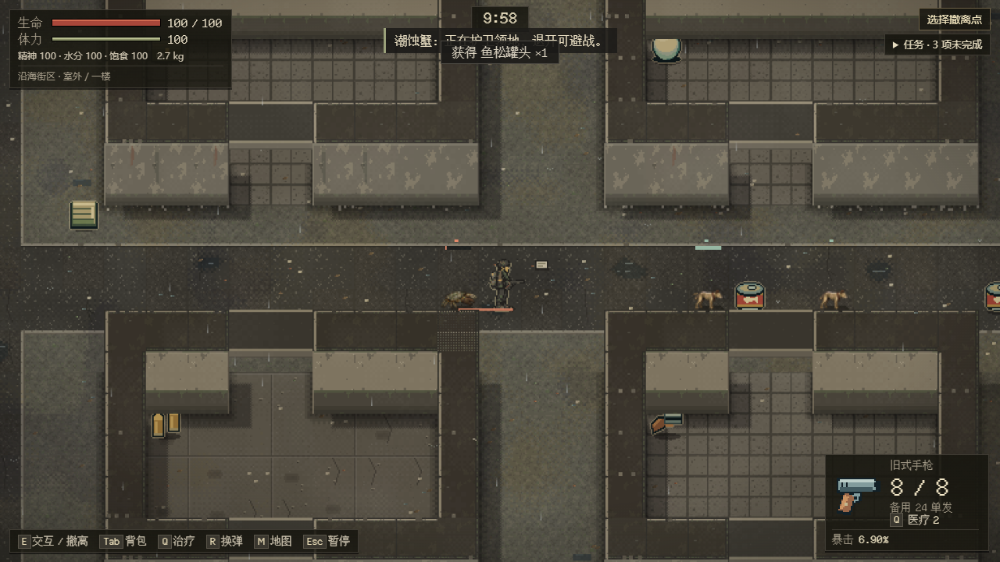
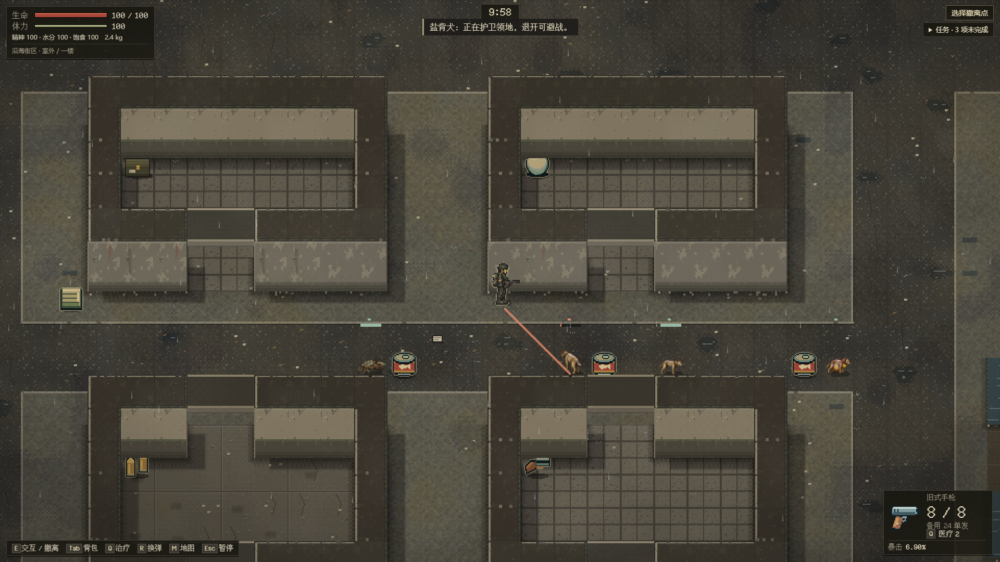
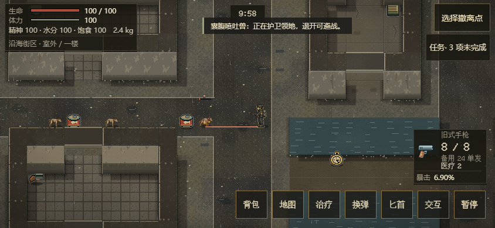

# EN-14：市场背街动物食源样板

继续 [Issue #78](https://github.com/xuys2025/escape-bincov/issues/78) / [PR #81](https://github.com/xuys2025/escape-bincov/pull/81)。普通新街区 seed%5==1（例如46）替换四名既有成员：潮蚀蟹一只、盐背犬两只、囊腹喷吐兽一只。原三名拾荒者保留，世界人口25；本局共七名新原型，与头目三人变体互斥。两名剧情物资守卫不参与替换。当前是现有市场背街的生态样板，不新建或冒领十二规划地区。

## 食源、巢点与身体

[enemy-fauna.ts](../../src/enemy-fauna.ts) 定义出生点：蟹 `(18,34)`、两犬 `(24,34)/(27,34)`、喷吐兽 `(32,34)`。巢点就是持久 home，分别护住格 `(19,34)/(25,34)/(31,34)` 的食品；两犬共享中间食源。所有点位是室外，身体与返巢线路在两种潮位合法；西侧高架公共道路距所有巢点至少340像素，可绕行。

食源使用已有“鱼松罐头”物品。四只动物原有携带食品预算共四份，初始化时把其中三份从各自 supplies 移到地面，另一只犬保留一份。地面＋携带＋死亡尸体始终只有四份这组预算；没有另设随机食品奖励。物品实体序号在单次初始化候选内分配，整笔写成功才发布；重复初始化拒绝，刷新不会再投放。食品拾取沿原生E/触摸交互、背包与世界同笔事务处理。

三种动物使用既有独立身体、脚点、尸体、阶段姿态和声音：蟹正面120度盐壳防护，侧后可绕；犬扑击最多0.3秒/90像素，分段扫掠不能穿门墙，锁向后不能瞬间反扑；喷吐兽喉腹准备、有限210像素酸液、真实墙挡和1.6秒恢复。酸液痕迹短暂消退，沿既有规则不造成永久地图/装备破坏。所有出生身体仍遵守现有10像素身体半径与落点校验，不以放大渲染精灵扩大碰撞。

## 动物行为与持久化

进入巢边领地时先示警，退开可避免升级；没有人类广播指挥。两犬只有看得见另一只同组犬时才分出正面与小幅侧向接近，并各自观察目标；失去同伴视线就回到普通接近，不共享未看到的玩家坐标。攻击开始后仍受原锁向/阶段限制。失去刺激七秒或越过领地后结束搜索并返巢；严重受伤沿原撤退规则返回。

食品、home/target/path/timer、观察/阶段/锁向、弹药/携带全部沿现有严格 schema 保存，本批无新字段或新版本。发布的阶段 total 修为实际时长：扑击 release为0.3秒、普通瞬时release和idle为0、recovery沿真实恢复时长；不改变攻击逻辑或消费动画时钟。

## 实际验证

- 718完整单测、62 CI守卫、package通过；[生态/守恒/重试/投影/物理回归](../../tests/enemy-fauna.test.ts) 覆盖四成员与四份食品预算、拾取/死亡/重复恢复、初始化写失败与重试、可见同伴和返巢、两潮位/绕行、真实Runtime酸液射程/墙挡及飞行中恢复不重发。
- 真实射程单测先由实际控制器释放，再冻结无关NPC移动以隔离弹道；这仅为物理单测，不冒充自然游玩。最初东向夹具实际撞上既有建筑，改为独立确认畅通的北向通路后保留210像素断言；游戏弹道未修改。
- 117敌人浏览器案例、109截图、零页面错误/外部请求。额外九例来自普通UI seed46出击，覆盖三种动物×三尺寸；只移动玩家到合法观察点，等待真实攻击阶段，暂停/刷新核对四只动物及食品。蟹场景先用真实E/触摸拾取一份巢边食品，验证背包+1、地面移除、刷新不再生。
- 当前HTML SHA-256 `a7aa5f6f6afb7a2c56cbc3a62c92c11c66d71456c603f8c4485452fc83d988e4`，7,299,350字节，便携ZIP4,693,930字节。完整自然输入01:02:35～01:12:42 UTC通过（10分7秒、41次结果、15次原生拖放，零错误/请求）；便携/普通流程/UI通过。三组独占性能均通过，见性能记录。

精选实景见下；完整三尺寸109截图保存在本地和CI证据中。真手机、实际GPU完成帧率与真人平衡仍归EN-21。

标准seed42同比、seed46七人配置及靠近喷吐兽64像素的正常交战＋Q治疗三组，各12个Runtime样本/六个浏览器样本通过。近距Q只消费原随身物资，未增加生命上限或物资；不启用Q的近距记录中有四个5Hz/两个触屏样本死亡，保留为未签收，不能当作硬件预算超限或被后续通过覆盖。上述均是特定正常输入轨迹，敌人可能被提前击杀，不代表所有动物持续同时释放攻击的上限或真人平衡签收。