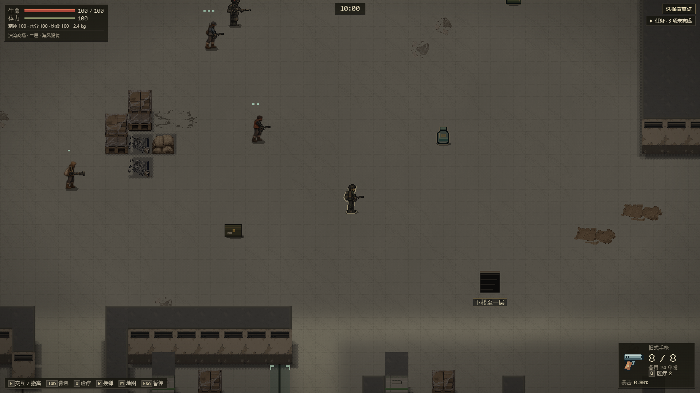
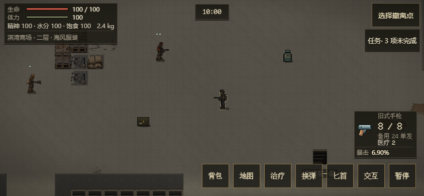

# EN-19 / R06：商场三版二层遭遇

承接 [#78](https://github.com/xuys2025/escape-bincov/issues/78)。街区阶段 [#81](https://github.com/xuys2025/escape-bincov/pull/81)已获授权合并为 `67a7468`，本批从该主线继续 `feat/enemy-mall-r06`，交付现有商场布局的一个独立遭遇。R06 和 EN-19～22 保持开放，卸货区盐枭、一层配给/交涉、其余地区、#47 布局四版及全图素材不因这一小队完成而核销。

维护者授权合并104时，#98刚合入主线`49894e9`，因此在原分支再次正常同步，保留改枪实例/迁移和商场初始化；源码自动合并，生成物经正式package重建。最新组合HTML为`7d25ceb34e543884c9e5d4c5d7171026ae3440543f9121ca6b22da378e4b05d1`、8,056,122字节，portable5,266,798字节。873单测、62守卫/package已过；三尺寸、真实旧v7商场迁移和实际#98 v8客户端读取见[摘要](../enemy-mall/validation.json)。最终自然输入、完整回归、独占性能及准确head CI按原PR104实际结果记录。维护者的合并授权持续有效，检查通过后正常合并，不绕过门禁。

此前同步`f74ff91`（#102）的132c931e组合已通过774单测、62守卫/package、165敌人浏览器案例/151截图、三尺寸商场10案例含实际f74ff91旧端、射击与便携。商场首局600.516真实秒超时，随后死亡/撤离、共四次切层；经典609.397秒/12结果/61次物资拖放，均零错误/外部请求。这些历史证据完整保留在摘要的`preGunsmithSync`，其内`preMainSync`是更早c35。不得用于签收最新7d25制品；自然游玩有并行功能负载，帧时不作独占性能。

## 玩家路线与人口、物资

普通新商场行动选择 `mall-v3/mall-f2/mall-layout-3`。二层海风服装区 `F2-01` 有近身掠夺者、拾荒枪手、望风者三人，使用 [enemy-mall.ts](../../src/enemy-mall.ts) 中固定岗位及有限备用点；备用点只处理既有精英占位。三人可互相通报可信目击，使用既有确认、有限弹药、前摇/恢复与脱离规则。

两条东侧楼梯 `S-N`、`S-E` 及东侧家居/露台通路远离三人的出生视线；中央扶梯、西侧通路仍可往返，所有岗位离楼梯落点至少 144 像素。这是现有布局的可绕行遭遇，不将现有一层称为已建成的医疗或配给安全空间。

- 总人口仍 25，楼层人数仍 16/9；只替换二层三个非精英槽，保留两名既有精英的完整实体。
- 一层世界状态逐字段保持；不增加 RNG 抽取或实体 UID。场景散落物和箱内物资不增殖；敌人携带改用各原型既定配置，消耗后与尸体同源，不声称和旧敌人随机掉落完全等价。
- 平移二层一只既有周转箱，保留 ID、内容、容量与物品 UID；固定二层资源锚点 `MALL_ANCHORS.box2` 保持。
- 三类继续使用各自的正式身体、阶段和声音；普通入口显示完整商场，专项测试不依赖样板 URL 的压暗效果。

## 保存与兼容

唯一调用在 `SaveSession.beginRun` 的新三版商场候选内，部署前一次原子提交。只复用 actor v1、expansion 3 / raid 5，不新增程序字段、世界 ID 或敌人版本号；外层遵守已合入#98的session v8。`gunsBackup`保留首次迁移的实际v3～7原文，原`enemyBackup`、`perksBackup`、`systemsBackup`字节和旧端拒绝规则保持。实际649b791/v7原生商场档读入后保留迁移后的完整行动与原备份，不重投；实际49894e9/v8旧客户端能读取本批新商场档。更早v7客户端不能读取v8，不能沿用旧证据声称能读取。

活动旧商场布局 1/2/3 和旧行动不重投敌人，不把恢复当新初始化；显式历史夹具用 `legacyEnemies: true`。新一/二版布局也保留旧规则。严格解码继续校验装备、弹药、阶段、完整两层和名册，不能为本批放宽。

## 验证入口与当前边界

[单测](../../tests/enemy-mall.test.ts)覆盖 100 种子、人口/精英/随机数/物资守恒、有效坏档反例、保存失败后重试、原始备份、旧三布局恢复、携带阶段与导出导入，以及双潮位东侧绕行。[浏览器模块](../../scripts/enemy-mall-browser.mjs)由现有 `test:enemy` 执行，三尺寸验证真实出击、上下层隐藏、真实 E/触屏楼梯、专属身体图、实际攻击及暂停刷新后的完整行动一致。

下图来自普通商场出击，在二层观察位置冻结 AI 后取图；等切层淡入结束，不改敌人或素材。冻结画面只证明布置与贴图，攻击和保存恢复由上述独立步骤实测。

本地额外用实际 `67a7468` HTML 读取新商场行动及原双备份，不改写旧解码器；该固定旧 HTML 探针需显式 `priorClient`，不冒充所有 CI 都执行它。常规 CI 仍执行全部三尺寸新商场场景。

商场真实计时检查使用现有 `test:layered-play`，键鼠、购物、战斗和上下楼均为原输入；它沿东侧通路验证可避让和返程，不等同于自然进入新小队领地的平衡验收。经典 `test:play`、完整敌人/商场/存档/便携回归与准确 head CI 另核实际结果。帧时使用同一 `enemy-native-performance-v1 --world=mall`，与街区分开标识，禁止跨世界同比；仍需独占运行，真实手机与真人评价未验。

商场站定/横移/直接后退的五次性能尝试均未获得有效全矩阵，保留死亡短样本和idle失败。输入追踪确认触屏跳过举枪、浏览器可选中屏外目标；当前采样器修正为[输入修订与固定观察后退避场景](enemy-performance.md)，仍要求完整12秒、实际原生出手及原预算。避战场景和持续交火分别记录，不能相互替代；准确结果只按承接PR实际报告签收。

本轮 [制品与已完成流程摘要](../enemy-mall/validation.json)绑定 HTML `c35fdd152d46d327f8814a23cdbdf43d4a9c0bd941a9cfac3fb455a089c69774`：165 项完整敌人浏览器案例、三尺寸独立商场 10 项（含实际旧端）、商场三局超时/死亡/撤离（首局 600.583 真实秒、四次切层）、经典约 623 秒的 13 次结果及 49 次物资拖放均通过，零错误/外部请求。自然游玩同时有其他检查负载，其帧时不当作独占性能结论；原预算性能与最终准确 head CI 在承接 PR 记录。

最初完整单测 767/768，旧四类兼容夹具的三版新出击产生了本批三类，改为显式历史部署后 768/768；正式新三版的独立 100 种子覆盖保留。首次 CI 守卫发现新增浏览器共用模块尚未登记用途，按实际调用登记 support 后重测；未修改必需检查或放宽产品校验。后续准确结果以承接 PR 和 #78 为准。
