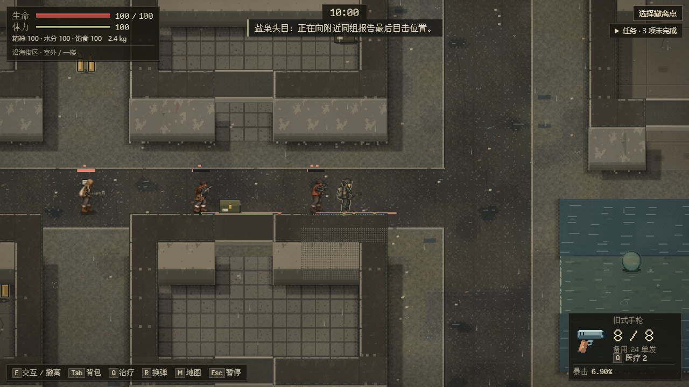
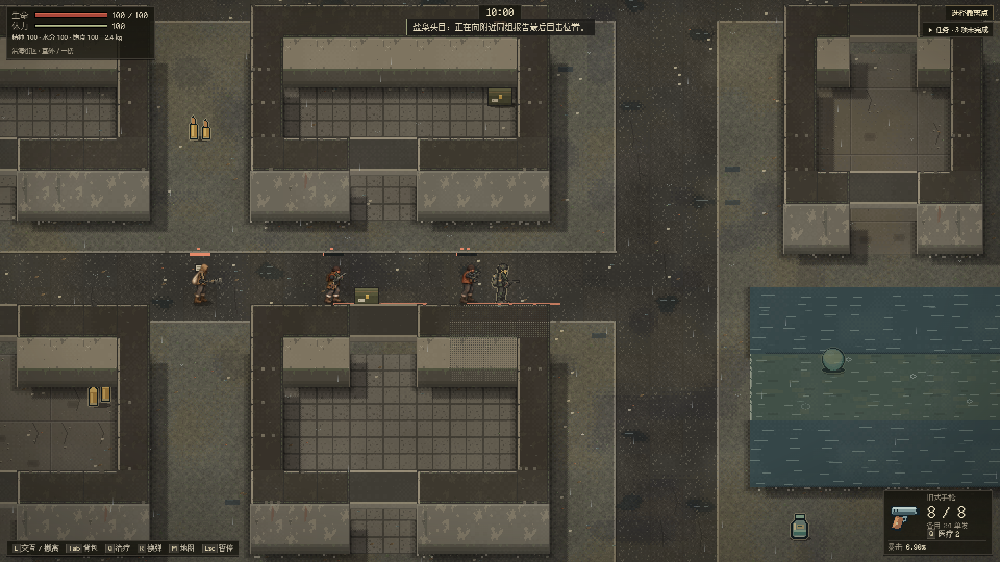
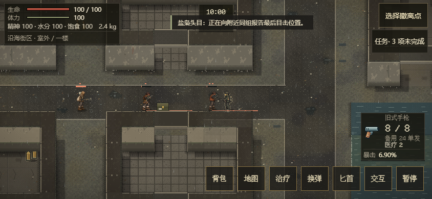

# EN-13：街区头目物资据点

继续 [Issue #78](https://github.com/xuys2025/escape-bincov/issues/78) / [PR #81](https://github.com/xuys2025/escape-bincov/pull/81)。普通新出击种子能被五整除时，街区已有名册中的三人替换为一名盐枭头目、近身护卫与持枪护卫；原三人拾荒样板保留。全世界仍为 25 人，两个既有剧情物资守卫与其身份、位置保留。其他种子及已开始的旧行动不补生据点。

## 真实空间与物资

据点位于当前沿海街区市场建筑旁的公共道路，属于现有地图的敌人场景，不能算作十二规划地区中的新地图。头目在格 `(24,34)`，两侧护卫在 `(20,34)`、`(28,34)`。每人有两处短巡查点；备用站位为 `(30,34)`、`(26,34)`、`(32,34)`。玩家可走西侧高架公共道路，在双方视距外绕行。所有主/备用/巡查点均校验身体空间、出生/撤离/门梯安全间距及高低潮通行。

初始化从当前地图选择最近的一箱既有补给，移到格 `(25,34)`。箱子 UID、容器内容、数量和已有经济来源保持不变；不生成额外物资，不移动样本/船运登记等固定线索。敌人死亡仍只掉落其真实装备、剩余弹药和携带补给。头目沿已有 120 生命、短射程霰弹枪、有限弹药及护甲规则作战，护卫负责两个侧向岗位。

## 岗位与恢复

[enemy-posts.ts](../../src/enemy-posts.ts) 拥有固定编组名 `market-raiders-v1` 和岗位坐标。只有该编组且 home/id 匹配的成员采用这些岗位；历史 `street-salvage` 及其他原型行为不受此岗位配置影响。巡查的当前目标、路径和等待时间使用既有 `EnemyState.target/path/timer`，战斗、观察、弹药和撤退仍使用 `tactics`，全部随已有严格格式保存。没有新增存档字段、隐形计时器或人口事件。

闲时在两个合法点间巡查，每次换点先等待两秒。接敌时维持岗位周围 96 像素范围；近身护卫不会沿楼梯放空据点。头目亲眼看到至少半数护卫损失，或满足已有低生命/弹药耗尽条件后，进入撤退并走向备用位置。未目击的阵亡不触发损失判断；撤退锁存由已有 stance 持久化，刷新不恢复弹药或取消撤退。原有攻击前摇仍须支付完成。

## 验证入口和边界

- [岗位回归](../../tests/enemy-posts.test.ts)：五种正式种子、人口/剧情守卫/物资守恒、高潮/低潮、门梯安全距离、公共绕行、真实 Runtime 检查点恢复与目击损失撤退。
- [首批遭遇回归](../../tests/enemy-tactics.test.ts)：100 种子，每五个种子六名新原型，其余三名；初始三原型的固定位置仍逐一核对。
- [跨层回归](../../tests/enemy-pursuit.test.ts)：增加据点护卫岗位限制，原两人追击预算保留。
- `test:enemy`：每种尺寸从普通 UI 新出击 seed45，不向档案注入头目；只移动玩家到观察位置，AI 正常运行，等待头目真实攻击阶段并拍照，再暂停/刷新核对完整编组档案。
- [性能预算](enemy-performance.md)：首轮扩量门槛沿用，必须运行同比及六人种子的有界采样；实测结果在完成后追加。

角色都是通用敌人岗位，不扮演林满仓、鲍经理等具名剧情人物。当前据点不新增地图、任务或剧情身份。三尺寸自动化和自然游玩记录将按实际制品补记；真人难度和真手机仍归 EN-21。

## 本批已完成验证

710 项完整单测通过，目录状态更新后六项目录回归复跑通过；62 项 CI 守卫、两次 package 通过且制品哈希一致。108 敌人浏览器案例（含三次普通 seed45 出击/攻击/暂停/刷新）、100 截图通过，零页面错误/外部请求。首轮触屏暂停选择器误写 data-do=pause 而超时，修为真实 data-pause 按钮后完整重跑通过，未改游戏控件。

独占标准同比与六人种子负载均通过，具体指标、走位策略与失败边界见性能记录。当前 HTML `7ba664aeca05ccfc01a27b85c9dd0739be552880529a23cb44bfd1f9a39766f0`，7,297,822 字节；完整真实计时街区/分层游玩及便携/普通流程正在执行，最终结果与准确提交 CI 更新原 PR，不提前计为通过。

