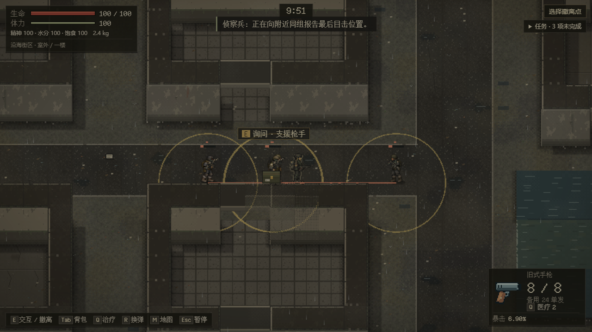
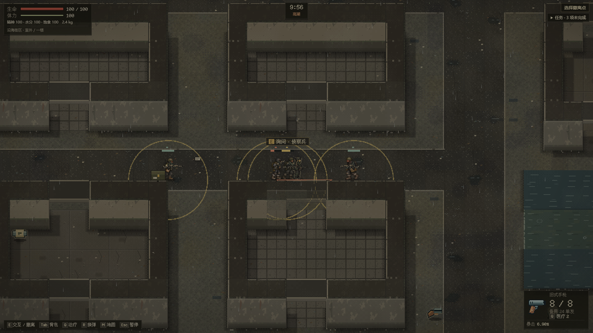
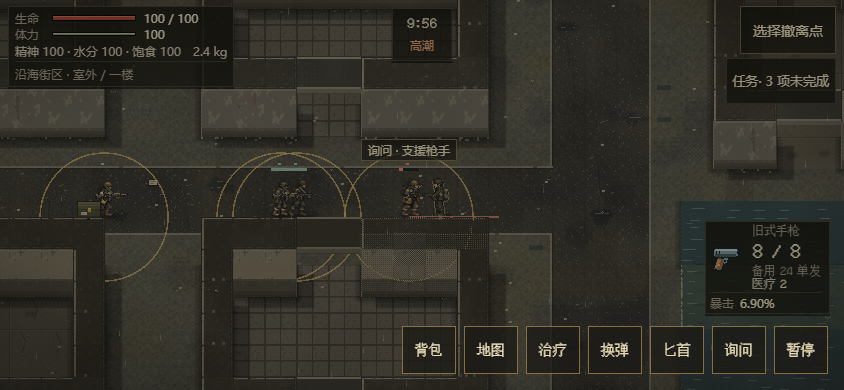

# EN-16：停业市场后场回收队

承接 [#78](https://github.com/xuys2025/escape-bincov/issues/78) / [PR #81](https://github.com/xuys2025/escape-bincov/pull/81)。新街区 seed%5==3（如48）在同一次部署候选中以四个既有名册槽位安装侦察、突击、支援、队长。世界仍25人，原三类拾荒者和两名剧情守卫保留；每队恰好一名支援枪手。该样板复用现有停业市场后场，不代表新规划地区已经建成。

[初始化与路线](../../src/enemy-recovery.ts)将一只已有非空物资箱移到格(18,34)，保留箱体/物品UID、数量和RNG。队长走到箱边、真实等待4秒，再沿(24,34)→(28,34)→(32,34)搬运；交付6秒后撤到各自备用位置。箱子始终是同一世界容器，只有存活且正在搬运的队长会在普通Runtime更新中移动它。队长死亡后箱子留在原处，搜刮、世界位置和背包仍走同一原子事务，失败回滚与重试不复制物资。

[目标推进器](../../src/raid-runtime/recovery-objective.ts)只分发静态路线阶段，不携带玩家坐标。侦察先看下一段；突击与支援按路段交替前进/掩护。攻击继续走原有视线、可信目击/报告、两秒有限压制、有限弹药和实际弹丸路径。可信观察不足不会取得玩家当前位置。通信限同队320像素；失联超过12秒或亲眼见到队长死亡才撤退，远处成员不会立刻感知死亡。队长看见物资箱被取空、自己重伤或观察到足够同伴损失也会撤回。

四类默认条件敌对。移动队员的实际身体周围64像素为可见警告边界，边界与感知共用同一规则；持续闯入4秒才升级，退回可解除未交火警告。普通询问说明回收/交付阶段，持枪本身不触发攻击。西侧公共路两潮位均可绕行，路线不占出击点、撤离点或楼梯入口；回收队不跨层追人放弃箱体。

能力仍属严格 actor v2，程序保存 leader/crate 引用、阶段、路段、阶段时间与最后收信时间。解码器检查固定街区地图/岗位、同图同队、唯一箱体主人、四个不同岗位及收到的阶段不能先于队长；未知能力拒绝整个活动档。外层7/3/5、既有v1行为和两份精确原始备份保持既有合同，见[存档说明](enemy-save-contract.md)。

## 验证

[11项回归](../../tests/enemy-recovery.test.ts)覆盖人口/物资守恒、部署失败、严格引用、每个阶段实际移动与新Runtime恢复、搬运中搜刮失败/重试、通信距离/失联、交替掩护、四类付费射击、箱空与队长死亡、两潮位可达及公共绕行。完整745单测、62 CI守卫通过。首次完整回归的暴击迁移夹具选中了新增护甲目标，已明确选无甲目标后通过；打包缺两字字形按固定字体源重建后通过。

六个固定历史客户端对实际搬运/交付/撤退档及正反例共132项通过，旧端拒绝后零写入并保留原档。[结算后固定71cf旧端继续保存](../enemy-street/recovery-settled-old-reader.json)也通过，双备份逐字保留。

[三尺寸普通出击](../enemy-street/recovery-browser.json)新增12例，四岗位都验证真实攻击与暂停/刷新；队长的三例另观察箱体实际随身搬运。合计144案例/136截图，零错误/外部请求；UI通过。该组来自岗位校验修复前的35146fc8...制品，首次观察点在墙内的失败保留。最后增加固定地图/岗位绑定的有效反例，先复现拒绝缺失再修复；最终完整745单测、package、save-browser/portable通过。

最终HTML7,986,545字节，SHA-256 `408ae6f97b5e487aa948d0b5cf5fb2db200e88e86eb25ceb77112d5af9e19f42`，便携ZIP5,237,293字节。两组最终独占性能（标准42与seed48队长64像素走位/原物资治疗）各12Runtime/六浏览器样本通过原预算，见[性能记录](enemy-performance.md)。最终[完整十分钟自然输入](../enemy-street/natural-recovery-final.json)从seed48开始，于2026-10-24T03:37:35.871Z～2026-10-24T03:47:57.886Z通过，2次结算、30次原生拖放，零错误/请求。只读hook与真实键鼠，没有改时钟/生命/敌人。真人、真手机和全地区仍未验；准确head完整CI继续原PR核对。

