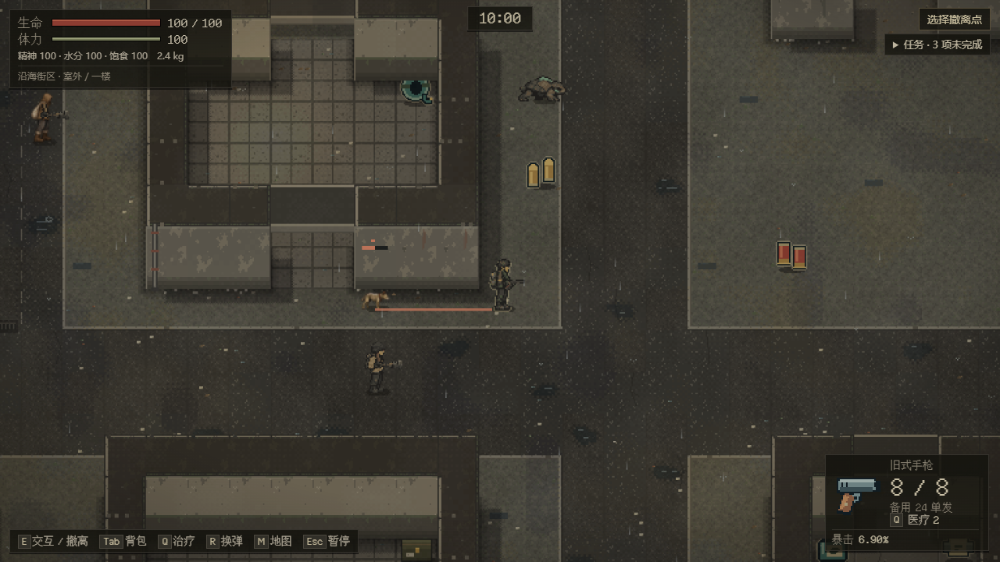
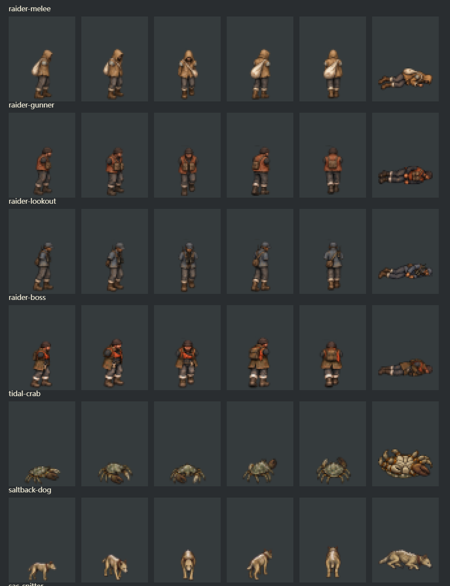
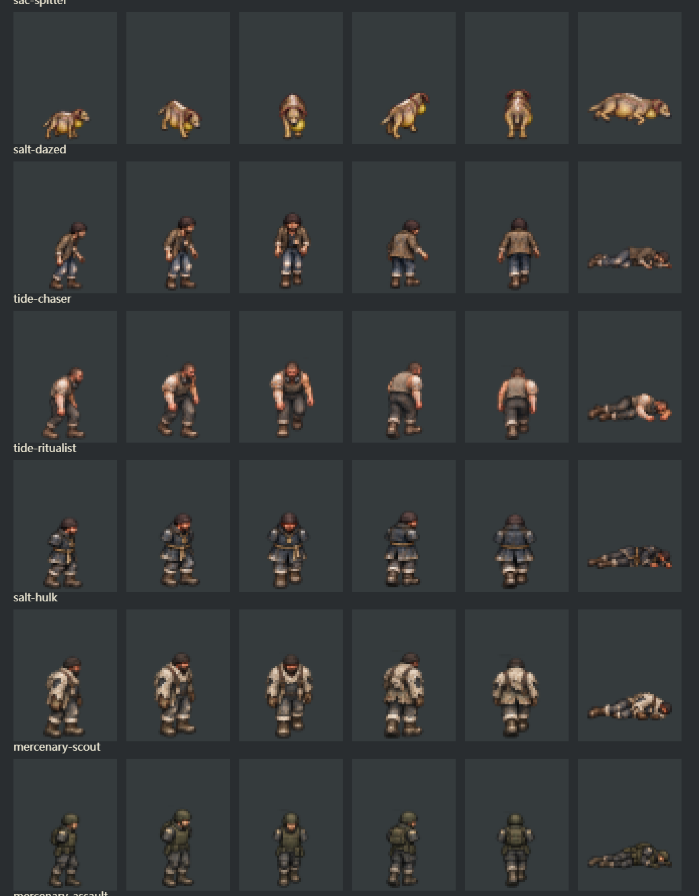
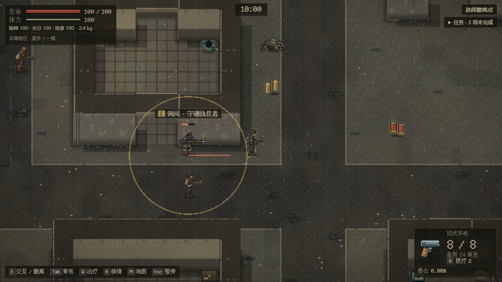
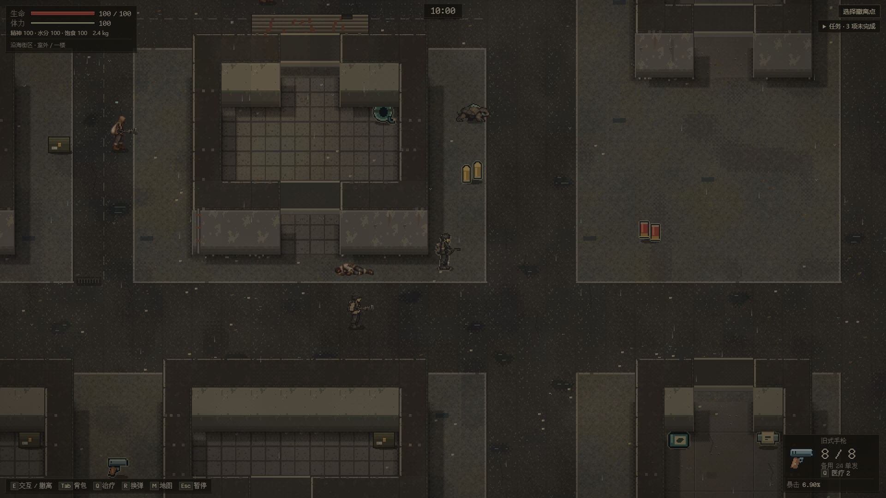
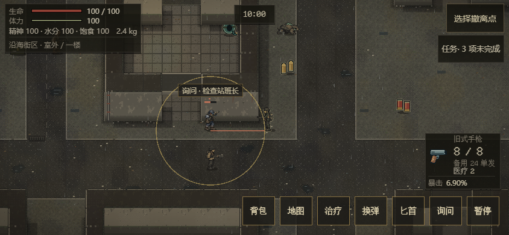
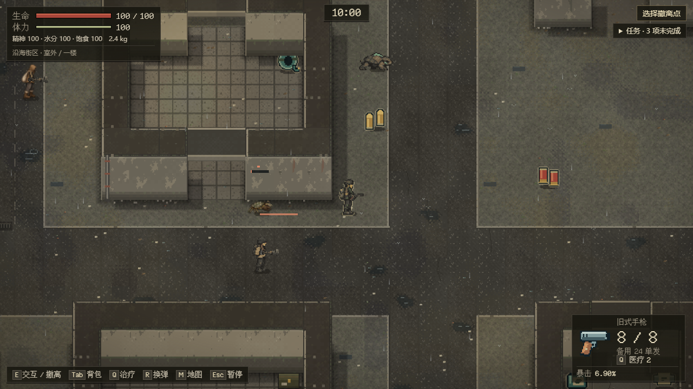
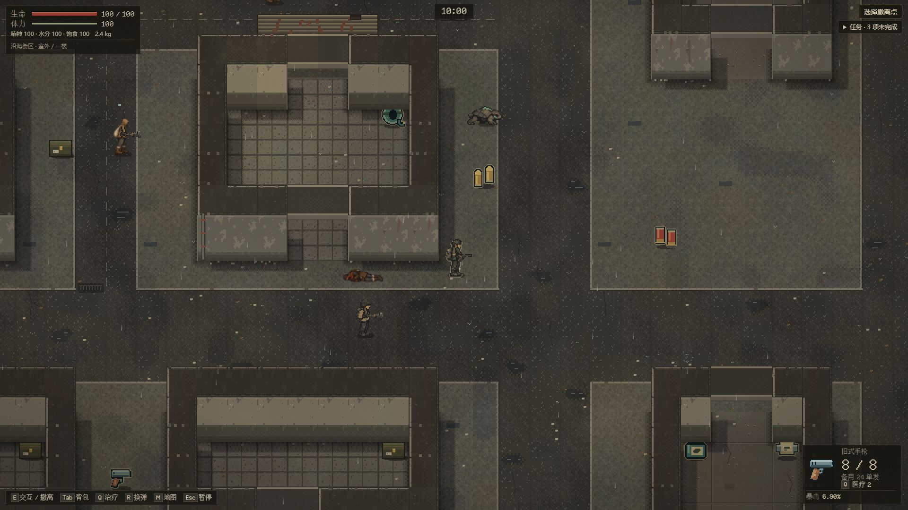
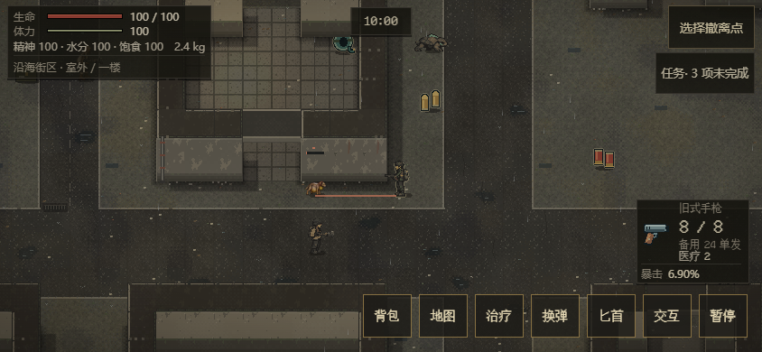
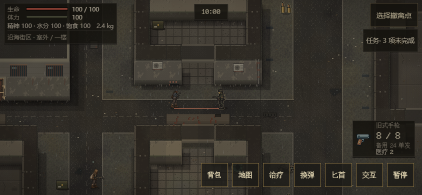

# 敌人角色素材与接入

**当前范围：** 十八个不同原型都已接入本分支的普通街区出击，包括[检查站登记/等待/公共通道](enemy-blockade.md)。人口仍25，旧活动行动不迁移。全地区与真人真机验收仍开放；以下各批范围、截图及哈希保留原归属。

**2026-10-24 盐蚀者续作：** [停业市场后场](enemy-affected.md)按seed%15==2投放四类危险个体；执仪者有实际枪械/长柄两种保存变体。当前十一类有普通出击场景，七类组织场景仍开放。下文各批范围、截图与哈希保留原归属。

**2026-10-24 动物续作：** 现有街区增加[蟹、双犬、喷吐兽食源样板](enemy-fauna.md)，seed%5==1替换四名既有成员，世界人口仍25。当前七个不同原型有普通出击场景；下文三/四类与十五/十四类等为各批历史范围。

## 十八原型接入核对

各行身体/尸体均已接入五朝向×idle/四步态与尸体，沿本页来源清单/逐帧哈希和许可导出；动作由真实阶段驱动，声音沿可见事件与原音效合同。人形枪械复用共用动作/枪声，不宣称每种枪都有独立录音；动物/重躯为有限形变与合成音。真实普通出击按下表种子复现，三尺寸离线实景/阶段/隐藏过滤由最终[156案例/148截图报告](../enemy-street/blockade-browser-final.json)覆盖；真手机和主观辨识仍待EN-21。

| 原型 | 普通街区种子 | 已接入阶段/声音 |
| --- | --- | --- |
| 01 近身掠夺者 | 42 | 棍击/回收；身体/尸体完成 |
| 02 枪手 | 42 | 举枪/换弹；身体/尸体完成 |
| 03 望风者 | 42 | 举枪/通报；身体/尸体完成 |
| 04 盐枭头目 | 45 | 举枪/换弹；身体/尸体完成 |
| 05 潮蚀蟹 | 46 | 收钳/回落；身体/尸体完成 |
| 06 盐背犬 | 46 | 蓄力/扑击/落地；身体/尸体完成 |
| 07 囊腹喷吐兽 | 46 | 蓄液/湿咳/酸液；身体/尸体完成 |
| 08 失神盐蚀者 | 47 | 后摆/粗喘；身体/尸体完成 |
| 09 追潮者 | 47 | 伏身/冲撞；身体/尸体完成 |
| 10 守潮执仪者 | 47枪/62长柄 | 举枪或后收刺击；身体/尸体完成 |
| 11 盐壳重躯 | 47 | 后倾/重击；身体/尸体完成 |
| 12 侦察兵 | 48 | 举枪/通信；身体/尸体完成 |
| 13 突击兵 | 48 | 举枪/换弹；身体/尸体完成 |
| 14 支援枪手 | 48 | 举枪/有限压制；身体/尸体完成 |
| 15 回收队长 | 48 | 举枪/通信；身体/尸体完成 |
| 16 检查哨兵 | 49 | 警告/举枪；身体/尸体完成 |
| 17 巡逻队员 | 49 | 警告/举枪；身体/尸体完成 |
| 18 检查站班长 | 49 | 警告/举枪；身体/尸体完成 |

## 2026-10-24 正式头目据点续作

当前新增普通 seed45 出击的头目＋两护卫三尺寸场景，等待真实攻击阶段后截图、暂停/刷新核对整组持久状态。108 敌人案例、100 截图、零页面错误/外部请求；新增三张实景见[据点记录](enemy-market.md)。下方 105 案例、仅前三类投放及各制品哈希是动作/素材批当时的记录。
## 攻击动作与辨识声音（2026-10-24 续作）

十八类身体/尸体之后，补齐阶段驱动的动作和声音。身体姿态由发布的 `phase/left/total/aim` 重建，刷新不重播准备动作，也不运行另一套战斗时钟。脚点和碰撞不变；受击轮廓与身体共享缩放/倾斜，死亡继续使用原倒地与尸体管线。

| 原型 | 已实现攻击表现 | 合成声音 |
| --- | --- | --- |
| 近身掠夺者 | 单手收棍、挥击、回收 | 衣物摩擦与挥动 |
| 枪手、望风者、头目 | 举枪、枪口/弹壳、换弹、恢复 | 装备准备、枪声、装填 |
| 潮蚀蟹 | 前摇撑宽、释放收钳、恢复回落 | 双段硬钳碰响 |
| 盐背犬 | 蓄力伏低、扑出伸展、落地回收 | 低吼与扑咬 |
| 囊腹喷吐兽 | 喉腹扩张、喷出后回缩、恢复 | 蓄液、湿咳和酸液落点 |
| 失神盐蚀者 | 后摆准备、前挥、缓慢归位 | 粗喘与衣物擦动 |
| 追潮者 | 伏身、向锁定方向冲出、回收 | 粗喘与冲撞 |
| 守潮执仪者 | 双手长柄后收、直刺、回收 | 木柄摩擦与破空 |
| 盐壳重躯 | 后倾蓄力、前压重击、恢复支撑 | 壳体刮擦与低沉撞击 |
| 侦察兵、突击兵、支援枪手、回收队长 | 各自步态/袖色与共用举枪、开火、换弹管线 | 装备准备、警告通信与装填 |
| 检查哨兵、巡逻队员、检查站班长 | 各自制服/持握、边界和警告阶段、枪械动作 | 警告通信、装备准备与装填 |

人形持械使用既有关节手臂；六类无持械身体使用有限形变，不额外宣称绘制了完整攻击图集。减少动态效果时关闭身体形变，保留方向线、边界、准备/恢复进度。声音只在可见角色的新阶段播放；隐藏、死亡、远处或暂停时静音，揭示房间及继续游戏不补播旧阶段。释放声允许浏览器跨过零时长释放帧后，按前摇→恢复边缘播放一次。枪声沿既有事件，喷吐仍为独立湿声。

本轮 706 单测、62 CI 规则、package、105 敌人浏览器场景、14 项真实音频回归、browser/ui/portable 通过，零页面错误和外部请求。浏览器额外用 Web Audio 渲染 8 类音色 × 4 种动作共 32 个非零、方向正确的缓冲；这验证合成输出，不冒充实际遭遇或枪声背景下的主观辨识。动作探针检查六类准备/释放/恢复与减少动态效果，97 张三尺寸截图保留在 `test-results/enemy-browser`。

已正常整合 main `98c69b4` / #93 检查导航；保留双方交接，登记 `test:enemy` 和三个敌人辅助脚本。本轮 HTML 7,296,349 字节，SHA-256 `3f05c772a6900fbd098ffde560712f884b9742573b04cd3ca58bdbc32ee66c05`，便携 ZIP 4,693,174 字节。未改 AI、伤害或存档。正式遭遇、完整岗位/目标机制、地区接入与真人真机验收仍按 #78 开放。

## 当前批次：十八类身体与尸体（2026-10-24）

十八原型均已有五朝向 × idle＋四步态和尸体，共 **468 张运行 PNG**；本批新增 286 张，之前七类 182 张的 SHA-256 全部不变。普通街区仍投放首三类，其余十五类使用严格解码通过的保存场景验证，正式遭遇另行验收。身体/尸体完成不等于 EN-18 的动作、声音与场景整项完成。

| 新增原型 | 身体 / 尸体源图 | 识别与持握 |
| --- | --- | --- |
| 失神盐蚀者 | v2 / v1 | 松垮旧外套、低垂双臂 |
| 追潮者 | v2 / v1 | 前倾体态、不对称盐结肩臂 |
| 守潮执仪者 | v2 / v1 | 深蓝短罩衫、粗绳与信物；双手长柄鱼叉 |
| 盐壳重躯 | v1 / v1 | 宽厚骨白盐壳、拖行步态与工牌 |
| 侦察兵 | v1 / v1 | 轻盔、短背包和紧凑携具 |
| 突击兵 | v2 / v1 | 完整头盔、护目镜和胸前弹袋 |
| 支援枪手 | v2 / v1 | 突出的腰侧携弹包 |
| 回收队长 | v2 / v1 | 防水任务袋和通信天线 |
| 检查哨兵 | v1 / v1 | 蓝灰制服与短雨披 |
| 巡逻队员 | v2 / v1 | 蓝灰制服、贴身对讲机 |
| 检查站班长 | v2 / v1 | 蓝灰护具、侧挂硬质文件盒 |

长柄沿现有程序化武器管线绘制，前摇后收、释放前刺、恢复回收，两手跟随真实持握点；仍复用原有近战规则，不添加库存物品或存档字段。其余持枪者使用相应袖色与既有枪械。原始提示词见 [v5](../../assets/enemies/sources/prompts-v5.json)、[v6](../../assets/enemies/sources/prompts-v6.json)、[v7](../../assets/enemies/sources/prompts-v7.json)；七张图集因行间距不足返修，选用版本及原稿哈希保留在清单。

验收：702/702 单测、56/56 CI 规则、package、98 个敌人浏览器场景（97 张截图）、test:shooting、test:browser、双尺寸 test:ui、test:portable 全部通过，零页面错误/外部请求。468 帧均非空；5 帧有 alpha 16～49/255 的低透明度边缘触及最左列，alpha ≥64 的身体轮廓均未触及左右边界，整数倍检查未见相邻帧、头脚或肢体截断。1280×720、1920×1080 与触屏仿真 844×390 已核对；真机及真人平衡未验。

初次扩展验收在追潮者尸体场景读到上一页的前摇：旧宿主可在写入新夹具与导航之间自动保存。现在每例关闭旧页，再在新页应用启动前写入指定保存档；阶段、死亡与实际纹理断言保持。修复后 98/98 通过。

本批 HTML **7,293,418 字节**，SHA-256 `89ef7a00acbb51d43ad8cb6f588927f1381cffbd81da7c84639f5daddfe1ae97`；便携 ZIP 4,692,263 字节。Windows / Node 24.19.0 / Chrome 155，证据在 `test-results/enemy-complete-*`。未改 AI、伤害、存档或正式投放。父提交 ae7513e 的完整 [CI 39982136292](https://github.com/xuys2025/escape-bincov/actions/runs/39982136292) 已成功，本批准确提交 CI 记录在原 PR。

## 喷吐表现与首帧冻结修复（前批）

囊腹喷吐兽沿既有弹道使用低位黄绿色酸液弹、湿咳与溅落声音，命中位置保留 1.4 秒后消退的湿痕；不生成枪口火光、弹壳、金属撞击声或弹啸，不增加地面伤害、持久贴花或存档字段。未揭示房间的喷吐表现仍隐藏。单测覆盖声音映射、可见性及角色身份重置；浏览器额外一例用合法保存角色和合成发布事件验证渲染合同，不计作实际交战。

`44f1996` 的 CI 39978503866 暴露美术夹具时序问题：在浏览器异步请求冻结 AI 前，短前摇已走完。测试现用已有专用入口的 `?test=1&freezeAI=1` 在 Runtime 构造时冻结；普通游戏入口不读取该开关。本轮 702 单测、43 敌人场景、14 项真实音频输出回归、package、browser/ui/portable 通过。音频输出回归覆盖原有声音和恢复；新喷吐的事件选择由单测验证。HTML SHA-256 `dd3ddb8dd473c1ca540e13da755e152cd31bec44544f9cbae424fc403cf8e5e5`，准确 head CI 在原 PR 更新。

## 七类身体与尸体（前批）

2026-10-23，继续 #78 / [PR #81](https://github.com/xuys2025/escape-bincov/pull/81)，基线 main `04736f7`。首三类之外新增盐枭头目、潮蚀蟹、盐背犬、囊腹喷吐兽，共 **182 张运行 PNG**，比首批增加 104 张。首批 78 张逐字节不变。普通街区仍只投放首三类；新增四类用通过正式解码的 session 7 / raid 5 夹具验证外观，未把夹具算作正式地图遭遇。

| 新增原型 | 可辨识特征 | 原图选用版本 |
| --- | --- | --- |
| 盐枭头目 | 防水外套、防护背心、橙布条、钥匙束 | 身体 v2、尸体 v1 |
| 潮蚀蟹 | 宽扁盐壳、不对称双钳；尸体翻腹、足肢收拢 | 身体 v1、尸体 v2 |
| 盐背犬 | 显肋犬形、破项圈、断续背部盐结 | 身体 v2、尸体 v1 |
| 囊腹喷吐兽 | 犬形肩背、下垂腹部、浑黄喉囊 | 身体 v3、尸体 v3 |

仍为每类 E/SE/S/NE/N × idle+4 步态及一张尸体，身体 32×48、尸体 48×32。动物保留完整四足/钳足，人形持握沿用 Runtime 手臂与武器。此次只补身体、步态、尸体和轮廓映射；专属攻击动作、辨识声音、环境痕迹及另外十一类素材仍按 EN-18 开放。

内置 `image_gen` 的初稿与返修提示词保存在 [prompts-v2.json](../../assets/enemies/sources/prompts-v2.json) 和 [prompts-v4.json](../../assets/enemies/sources/prompts-v4.json)。喷吐兽的蛙形初稿不符合犬类来源，已拒收，未进入来源清单或交付。头目和喷吐兽图集返修了帧间透明间距，蟹尸体返修为明确倒地姿态。切帧只沿附近完整透明行/列进行，一张图共用缩放、每方向共用脚点，保留步态内的相对偏移；找不到透明间隔立即失败，不裁掉头脚或用擦除掩盖错误。首三类保留旧导出变换。

实际通过：701 单测、56 CI 规则、`pnpm package`、42 个 `test:enemy` 场景、`test:browser`、两尺寸 `test:ui`、`test:portable`。182 帧边界检查无空图或左右贴边，已审阅整数倍对照图及三种尺寸实景，浏览器零页面错误/外部请求。当前 HTML 为 6,286,217 字节，SHA-256 `2b1f896fe37ec63c056e3e48d6bbe7549aa9a83b8f6d7bec271503839e034bb1`；便携 ZIP 3,964,732 字节。证据在 `test-results/enemy-art-batch2-*`。Windows / Chrome 155，触屏为仿真，真机与真人平衡未验。

本批未改 AI、战斗、存档或正式投放；上一整合提交 `a5f5782` 的完整 CI [39974169630](https://github.com/xuys2025/escape-bincov/actions/runs/39974169630) 已通过，新的准确 head CI 继续记在 PR。下方十分钟游玩与历史哈希属于当时制品，不挪作本批素材的游玩记录。

## 首批三原型历史记录

承接 #78 EN-09 / EN-18，继续 [PR #81](https://github.com/xuys2025/escape-bincov/pull/81)。仅三类街区角色有本批素材；其余十五类及十八原型整体验收保持开放。

| 原型 | 身体辨识 | 运行帧 |
| --- | --- | --- |
| 近身掠夺者 | 沙色兜帽、偏瘦身体、白色斜挎编织袋 | E/SE/S/NE/N × idle+4步态，尸体1张 |
| 拾荒枪手 | 宽肩锈橙背心、黑帽、胸前弹袋 | 同上 |
| 望风者 | 短蓝灰上衣、贴身小包、望远镜和对讲机天线 | 同上 |

共 78 张 PNG，身体 32×48、脚点 `(16,48)`，尸体 48×32、中心 `(24,16)`。身体不带手部/武器；Runtime 继续绘制关节手臂、持握、前摇/换弹/恢复与倒地过渡。不是额外生成完整攻击动画帧；当前攻击动作的阅读仍依靠真实阶段投影、持握和提示。新角色受击闪白、遮挡轮廓和尸体均从对应原型贴图派生，不能退回旧身体。

## 来源与可复现导出

使用内置 `image_gen` 生成原始图，未下载第三方角色图、未调用 API/CLI 替代。最终提示词及一次透明边缘修订保存在 [prompts-v1.json](../../assets/enemies/sources/prompts-v1.json)，六张选用原图在同目录。PNG 的非透明部分与透明通道保留；预览显示的棕色 RGB 不代表实际不透明背景。

[enemy-export-art.mjs](../../scripts/enemy-export-art.mjs) 仅按固定 5×5 网格切帧、统一缩放与脚点、导出运行尺寸；不重绘素材。身体全部 25 帧共享一个坐标变换，避免逐帧居中造成滑步。尸体独立居中适配。`assets/coast/enemy-v1/` 是实际运行图，原始大图不会内嵌游戏。

[素材清单](../../assets/enemies/manifest.json) 记录来源、SHA-256、尺寸和锚点；构建核对源图、帧图、总导入清单与哈希。新角色只有存在对应素材时才选该外观；旧四类、旧档以及显式占位模式保持原选择。所有实际 PNG 由打包器内嵌，普通游玩无外部请求。

## 当前证据

`test:enemy` 覆盖两种桌面尺寸的三原型前摇/尸体，枪手换弹/恢复、交涉，以及 844×390 横屏触摸的三原型与交涉。测试从严格解码通过的真实保存状态进入离线 HTML，断言实际绘制纹理和原型一致，记录浏览器错误及网络请求。新增测试初次使用枪手参数构造近战样本，被存档校验拒绝；现按原型的弹药与前摇上限构造，未放宽解码器。

22 个敌人浏览器场景通过，零页面错误/外部请求；599 单测、53 CI 规则、正式流程 `test:browser`、两尺寸 `test:ui` 和 `test:portable` 均通过。已检查整数倍对照图、1280×720 前摇、1920×1080 尸体实景和横屏触摸截图。真手机、原生 GPU 和真人平衡未验。

同一最终 HTML（SHA-256 `acec21fe0d82c654e3bce99fdc7af4a733512fe2d73d1d355bf0a2f1ecc63aeb`）于 2026-10-23 13:47:10～13:57:14 UTC 完成 10 分 4 秒新街区实际输入游玩：前摇、恢复与枪手换弹均有观测，零页面错误/外部请求。脚本在低生命情况下也继续出击，包含多次短撤离与死亡，不能据此证明数值平衡；完整 JSON 留在 `test-results/enemy-art-natural-play.json`。旧世界固定输入 9/9 A/B 与 `76adbd6` 相同。本批制品 HTML 5,973,711 字节、便携 ZIP 3,761,720 字节。

本批先存为 `fc56573`，再正常合入 main `160c6f3`（#89）。合入后 601 单测、package 通过，HTML、两份 ZIP 与清单字节完全不变；前述实际运行证据仍对应同一制品。

## 2026-10-24：保留原图的无损包体压缩

整合已接受的 main4141503 后，HTML8,600,598字节/便携ZIP5,655,203字节超过原8MiB/5MiB预算。当前保留621张原PNG、全部原始哈希/脚点/尺寸，以[打包工具](../../scripts/pack-coast-art.py)生成19张无损WebP图集（720,560字节），只在加载时还原原尺寸Canvas。正常package直接使用已提交图集，无Python依赖；维护者重新导图时使用Python3＋Pillow11.0.0（可用BINCOV_ART_PYTHON指定解释器），导出器随后调用打包工具。

编码后逐帧原始RGBA字节完全相同；Chrome对PNG与WebP半透明像素有不同预乘舍入，故不能声称浏览器RGBA完全相同。最初严格比较的失败保留。本次[实际浏览器检查](../../scripts/asset-load-test.mjs)对621帧/923,734像素验证：alpha与全不透明颜色完全相同，半透明边缘的预乘颜色差最多1/255；349,187个透明通道存在舍入差异。源素材没有缩放、量化、锐化或重新绘制。冷加载decode/draw失败与同页重试四例通过。

本批HTML7,977,494字节，SHA-256 a3cd0046de706c76dd3f4fbf02dec11359114fb0eb07bf61bd881eb32ba642b8；便携ZIP5,234,907字节，固定包体门槛恢复通过。724单测、62CI守卫、package、117敌人场景/109截图、portable/UI通过。主线整合的shooting、14项真实音频、11项普通选图入口通过。性能及十分钟游玩仍保留其各自制品归属，不把前批结果挪作当前图集制品。后续盐蚀者能力仍在工作区开发，未计入此图集提交。
