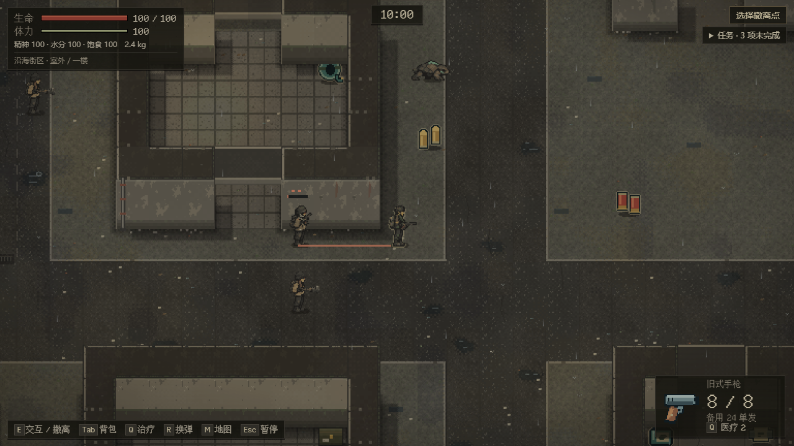
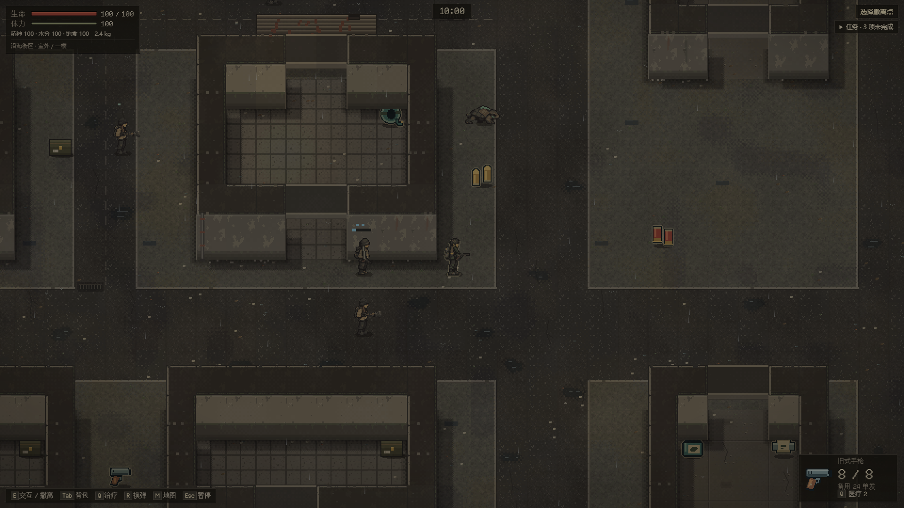

# 街区三原型样板：当前实现与验证

**当前范围：** 十八个不同原型都已接入本分支的普通街区出击，包括[检查站登记/等待/公共通道](enemy-blockade.md)。人口仍25，旧活动行动不迁移。全地区与真人真机验收仍开放；以下各批范围、截图及哈希保留原归属。

**2026-10-24 盐蚀者续作：** [停业市场后场](enemy-affected.md)按seed%15==2投放四类危险个体；执仪者有实际枪械/长柄两种保存变体。当前十一类有普通出击场景，七类组织场景仍开放。下文各批范围、截图与哈希保留原归属。

**2026-10-24 动物续作：** 现有街区增加[蟹、双犬、喷吐兽食源样板](enemy-fauna.md)，seed%5==1替换四名既有成员，世界人口仍25。当前七个不同原型有普通出击场景；下文三/四类与十五/十四类等为各批历史范围。

**2026-10-24 续作：** 新街区每五个种子之一新增市场头目＋两名护卫，替换已有名册成员，整图仍 25 人；四个不同原型已正式投放。岗位、既有物资与备用撤退路线见[头目据点](enemy-market.md)。其余十四原型的完整遭遇仍开放。十八类阶段姿态和辨识声音已接入，见美术记录；下文三类/十五类与旧版本号属于各批历史说明。
**2026-10-23 整合更新：** 正常合入 Perk #92 / main `8b6192d`。新街区行动改为 session 7 / expansion 3 / raid 5，同时启用新敌人和 Perk 弹丸快照；原敌人 6/2/4 与 Perk 5/3/3 活动行动保持原规则直到结算。双备份与版本矩阵见[当前存档合同](enemy-save-contract.md)，下文旧版本号和验证是各批历史记录。

承接 [#78](https://github.com/xuys2025/escape-bincov/issues/78) / [PR #81](https://github.com/xuys2025/escape-bincov/pull/81)。这是 EN-05～09 的首批实现，不代表十八原型、十二规划区域或正式美术全部完成。

## 正式入口与范围

新出击“沿海街区”在初始化事务中把三名原人口替换为近身掠夺者、拾荒枪手、望风者，整图仍为 25 人。具体布置与安全检查归 [enemy-encounters.ts](../../src/enemy-encounters.ts)。三名分别位于像素 `(656,592)`、`(912,720)`、`(816,432)`，没有增加 NPC、地图或外部援军。普通入口不依赖 `?test=1`。

旧活动沿海/街区/商场行动仍按保存时的四类 ID 和原行为完成。商场尚未投放新原型；十二规划区域依赖 #82 的真实地图/任务边界，不用当前街区冒充。内部 `legacyEnemies` 部署选项只用于重现旧行动回归和固定基线，玩家界面不提供该切换。

## 行为与状态

[enemy-archetypes.ts](../../src/enemy-archetypes.ts) 保留 18 个独立原型参数；当前只有三名街区原型通过普通出击接入。其余参数及条件警告、扑击、喷吐规则仍需各自场景、素材和验收，不能视作完整原型已交付。

[tactical-enemy.ts](../../src/raid-runtime/tactical-enemy.ts) 的感知、最后观察、攻击阶段、警告、装备、弹药、一次通报锁均保存在 `EnemyState.tactics`；时间单位是行动秒，位置为当前地图像素。Runtime 独占事件、UID、实际伤害、门事务和弹丸。失去视线后只搜索最近观察点，七秒失联或越出岗位范围后回归。感知与阶段在 Runtime 子步边界推进，单步不跳过多个释放，帧率可产生不超过一个子步的边界取整差异；不承诺不同帧率逐位完全同轨迹。

近战前摇锁定方向，挥空进入恢复；枪手有有限弹匣和备弹，换弹结束才转移弹药，耗尽后撤。望风者首次确认后只报告 320 像素内同组已有成员的最后目击值，锁存随档保存，没有持续共享玩家坐标。受伤立即自卫；低血撤回岗位。新原型中仅近身掠夺者和突击兵可沿亲眼见到的楼梯跟随，同时最多两名已登记成员；攻击中、听声和报告不登记跨层事件，抵达清除原层坐标并重新观察，弹药和通报锁保留。旧四类追击路径不变；完整小队岗位仍属 EN-10 余项。

尸体由同一个敌人 UID 生成一次，内容直接来自其实际武器、剩余弹匣/备弹及携带补给，使用后的弹药不回填；新原型不叠加旧的随机掉落或好运复制。[组织与立场合同](enemy-relations.md) 已接入同层目标、跨势力伤害与玩家独立击杀统计。NPC 击杀保留真实凶手并生成一次尸体，不发玩家训练或击杀标记；友方及未迁移旧敌人的身体拦截新 NPC 攻击但不受该攻击伤害。

条件敌对原型支持边界外询问，警告倒计时与黄色限制圈从真实状态投影；询问不改变敌对、警告或存档。当前该入口由合法保存场景验收，尚未把检查站职责、资格任务或相关兵种投放到普通出击中，不能把接口当成 EN-12/17 已全量交付。

画面显示锁定攻击方向、准备/恢复进度、换弹动作和职责标记。十八类敌人现在各用独立五朝向、五步态身体与尸体，共 468 张图；西向镜像，持握/袖色与原型一致，执仪者有独立长柄持握和刺击投影。首三类正式投放，其余十五类用合法保存场景验图；专属动作/声音和完整场景仍属 EN-18 余项。提示与身体使用相同房间可见性；来源、导出和实景证据见[本批美术记录](enemy-street-art.md)。

## 存档边界

使用 **session v6 / LayeredRaid v4**；当前 ExpansionState 仍为 v2。v5 / ExpansionState v3 / LayeredRaid v3 已由并行 Perk 工作使用，后续整合必须同时维护两方合同，不能仅重编号。

只有新街区出击成功写入后才升级；第一次的精确原主档保存为 `enemyBackup`，此后不嵌套、不覆盖 `systemsBackup`。旧活动敌人不补新字段。未知版本、未知字段、非法弹药、未来观察时间、非法装备和伤亡归属会拒绝。弹药、攻击阶段与完整世界同一条原子记录提交，失败保留旧记录与可重试状态。[合同与历史探针](enemy-save-contract.md) 记录具体调用点。

## 已运行证据与仍需检查

- 582 项单测、53 项 CI 规则通过；[新增规则回归](../../tests/enemy-tactics.test.ts) 包含 100 种子布置、视线丢失、侧躲、墙挡、有限弹药、一次通报、警告解除、非法档、旧档注入拒绝、阶段恢复与尸体守恒。
- 新客户端真实合法 session v6 样本交给固定 `35b3a38` / `76adbd6` 历史客户端，合计 40 项通过：原始与便携导入明确拒绝，加载失败后直接 commit 和两次 persist 均零写入，原字节保留。命令见 `scripts/enemy-old-client-probe.ts --candidate test-results/enemy-valid-session6.json`。
- `pnpm test:enemy` 在 1280×720、1920×1080 从真实合法保存阶段启动离线宿主，六种画面组合通过，零页面错误/外部请求。该套件已加入 CI 第八组，截图在本地 `test-results/enemy-browser`。
- `pnpm test:browser` 两分辨率正式流程通过，覆盖新出击、射击、死亡、撤离、超时与刷新恢复。`pnpm package` 通过，新增中文字按固定来源/固定工具重做内嵌字体子集。
- `pnpm test:save-browser` 通过，包含失败结算保留、备份跨来源导入及多窗口冲突；原“新行动导出 v4”断言明确更新为 v6，基地尚未升级时仍校验 v4。
- 经典沿海自然游玩通过（2026-10-23 12:25:30～12:35:42 UTC，约 10 分 12 秒）：9 次行动、5 次撤离，零浏览器错误/外部请求。该轮不是新街区验收。旧世界固定基线 `76adbd6` 的 9/9 行为与末态 A/B 相同，各 18 次重复及中途恢复通过。数据保存在 `test-results/enemy-street-natural-play.json`、`enemy-street-legacy-ab.json`。
- 新街区自然游玩通过（2026-10-23 12:42:12～12:52:29 UTC，约 10 分 17 秒）：2 次行动均撤离，实际看到枪手/望风者前摇与恢复，零浏览器错误/外部请求；换弹由独立固定保存阶段浏览器场景覆盖。数据在 `test-results/enemy-street-layered-natural-play.json`。这对应首批 `16e1e24`，其完整 CI [39955257251](https://github.com/xuys2025/escape-bincov/actions/runs/39955257251) 已通过。
- 准确最终 head 的 CI、真手机/原生 GPU 和真人平衡以实际最终报告补记；上方自动检查不冒充这些验收。

后续顺序：三原型真人可读性验收 → 组织正式场景与通行资格 → 生物和其余原型素材/场景 → 已就绪地图接入 → 最终综合核销。组织关系、最小交涉和部分兵种差异已见[组织合同](enemy-relations.md)。原任务未完成，继续同一 PR。
