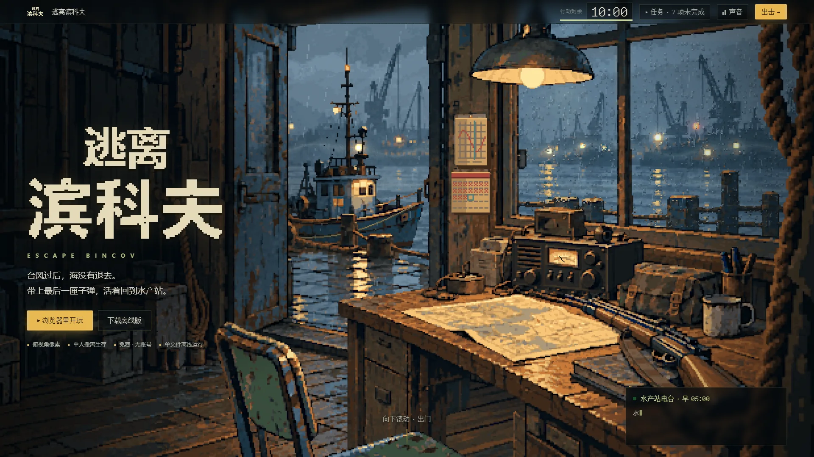
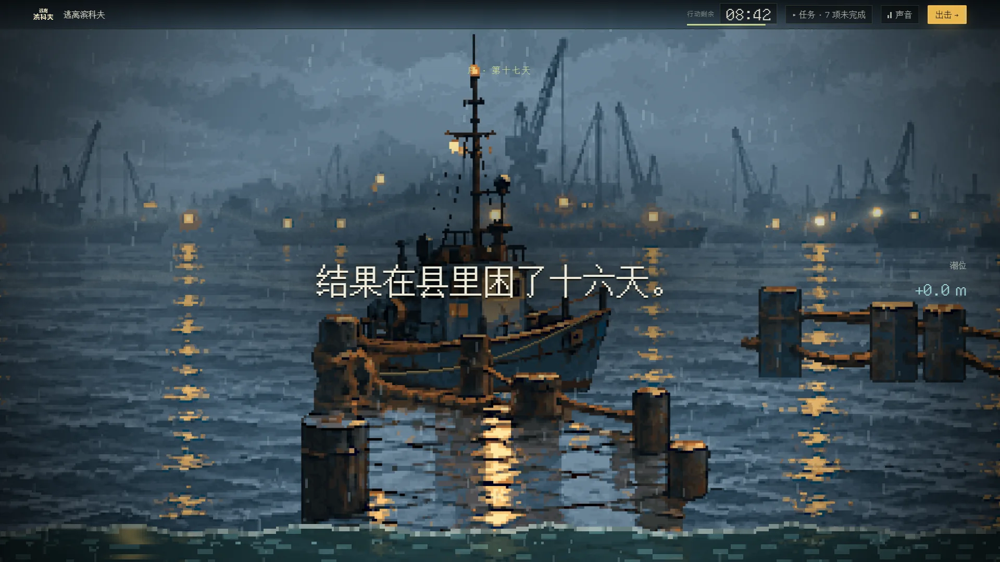
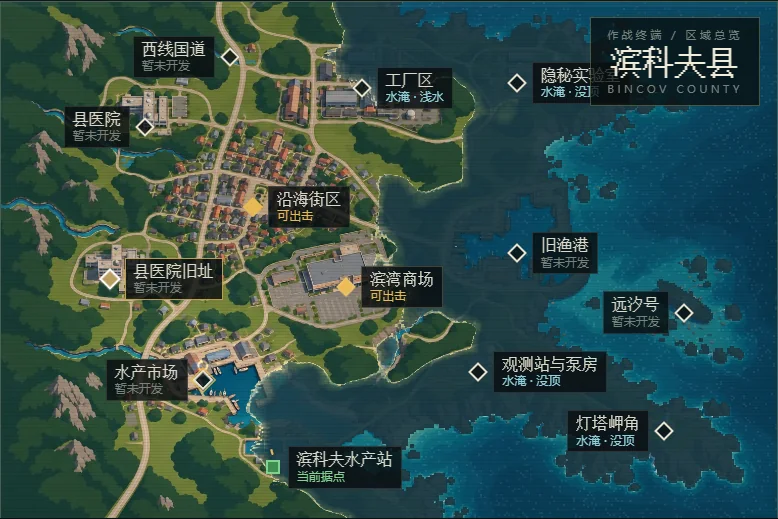
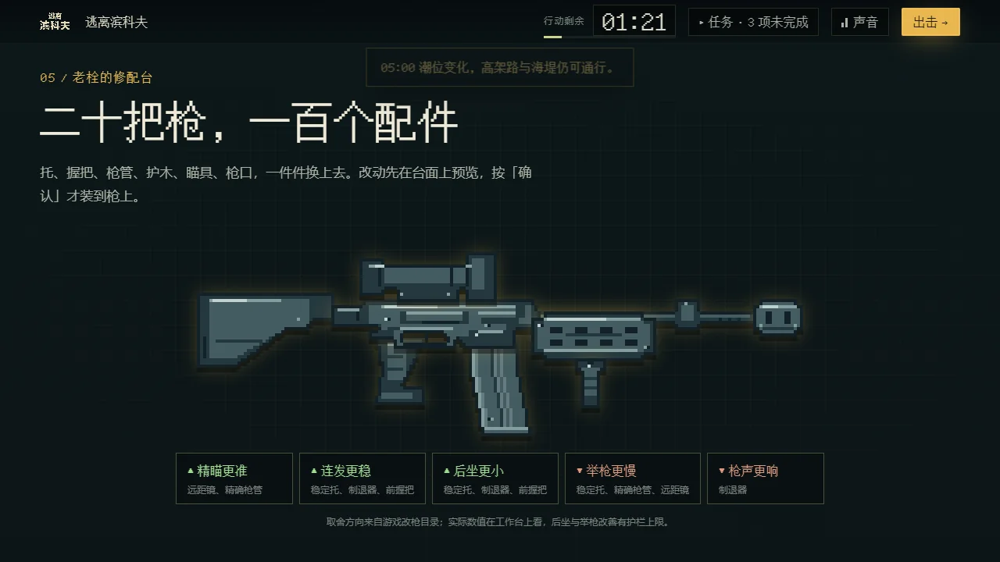
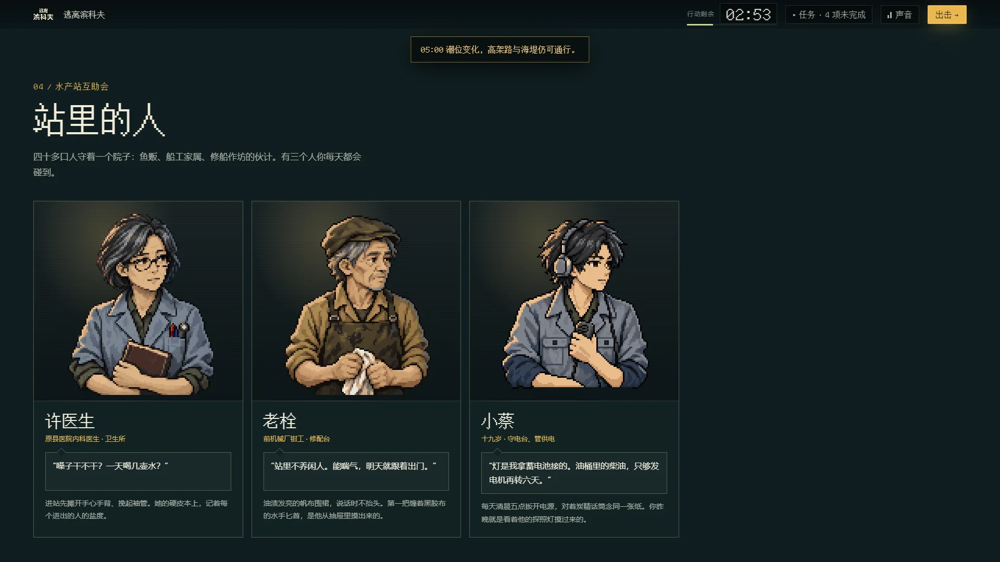
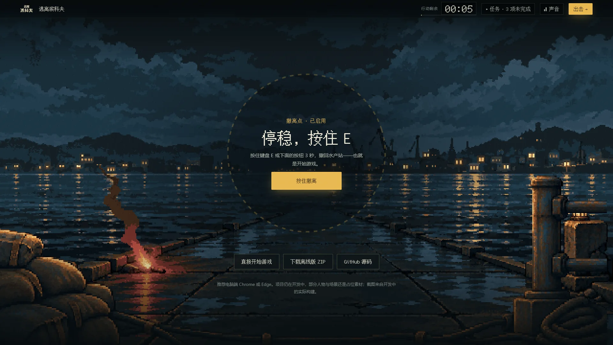

# 官网首页：Pages 根目录是官网，游戏移到 `play/`

2026-10-31 · 分支 `feat/official-site` · 基线 main `278b7e24`

## 需求

维护者要一个“炫酷”的纯静态官网，并且 **Pages 首页就是官网，点一下才进去玩**。原型先在仓库外做（`D:\bincov\官网-20261031`，本地），本 PR 把它接进仓库，并改 Pages 的发布方式。新画的美术由 Sol 按任务书在同日交付（P0 图标与分享卡片，P1 人物与敌人大图，P2 撤离段场景），已经接入，见 [Sol 素材](#sol-素材)。

## 地址变化

| 地址 | 之前 | 之后 |
| --- | --- | --- |
| `https://xuys2025.github.io/escape-bincov/` | 游戏 | 官网 |
| `…/escape-bincov/play/` | 不存在 | 游戏（与 `dist/index.html` 逐字节相同） |
| `…/escape-bincov/?sample=village`、`?range=1` 等 | 游戏入口 | 官网首页的内联脚本立刻转到 `play/`，参数和 `#` 原样保留 |

- 转发只认游戏自己读取的参数：sample、range、test、entry、opening、at、freeze、freezeAI、art、collapse、crisp、debug、mood、view、weather、xray（各自在 `src/` 的 `URLSearchParams` 读取处）。微信分享自动加的 `?from=…`、`?isappinstalled=…` 之类留在官网。以后游戏新增入口参数，要同步 `site/index.html` 开头的列表。
- **存档不受影响**：游戏用 `localStorage`，按网站（origin）而不是路径区分，`/` 和 `/play/` 是同一个网站。多窗口保护同理。
- 离线包、`main-latest` 发布和发布清单不变：清单的 `htmlSha256` 仍是 `dist/index.html` 的哈希。
- **新加坡镜像**：服务器脚本从 Pages 根地址取游戏 HTML 核对哈希，要改成取 `play/`（[CI 说明](../CI.md#pages-与镜像)）。脚本不在本仓库。改之前它会核对失败、按设计跳过并保留现有版本；先改哪边都不会坏，只是在两边都改好之前镜像停在旧版本。

## 构建与部署

- 官网源码在 [`site/`](../../site)：纯静态，无构建步骤、无第三方库、无 CDN，只用浏览器自带的 WebGL2、ES 模块和 Web Audio。仓库里只放官网自己的东西：代码、点阵字体子集、五张实机截图（webp）和 Sol 为官网画的十六张图（`site/assets/art/`）。
- 标题分层、县域地图与情报插图、敌人的行走精灵帧、九个改枪零件由 [scripts/site/build.mjs](../../scripts/site/build.mjs) 从 `assets/` **原样复制**，不再存一份。精灵横条在浏览器里由 [strip.js](../../site/js/strip.js) 用原帧拼出。
- `pnpm site:build` 组装 `pages/`（生成物，不入库）。CI 的 build job 在 `pnpm package` 之后运行它，`pages/` 随 `built-game` 上传，`Deploy Pages` 改为部署 `pages/`。`pages/index.html`、`pages/play/index.html` 记入校验和。
- 字体：寒蝉点阵体 16px 按官网用字裁出的子集（`Bincov Site`，861 字，35 KB），许可文本随官网发布（`assets/OFL-ChillBitmap.txt`）并在页脚署名。游戏的 `THIRD_PARTY_NOTICES.md` 会打进游戏单文件，所以没有改它。官网文案出现字表里没有的字时，`site:build` 直接报错；按 [scripts/site/subset-font.py](../../scripts/site/subset-font.py) 开头的说明重新生成即可。
- 本地预览：`pnpm package` 后运行 `pnpm site`，打开 `http://127.0.0.1:5180/`。ES 模块和 WebGL 纹理不能走 `file://`。

## 页面内容

整页是“一局行动”：顶栏是局内 HUD，`10:00` 随滚动倒计时，在 45% 和 50% 处弹出游戏原文的 04:30 电台预警和 05:00 潮位变化；“任务 · 7 项未完成”同时是目录。页尾是撤离点，按住 E 或按钮 3 秒进入游戏；按住时滚动会提示“移动中，撤离中断”。旁边保留普通链接。

| 段落 | 做法 |
| --- | --- |
| 序章 | WebGL2 按景深重建标题画面 13 层，像素保真采样；滚动推镜穿过门洞；窗玻璃雨滴折射、吊灯摆动与闪烁、远灯、程序雨、闪电；像素化海水上涨淹没画面，接到正文。文案取自 [MAIN-STORY 序章](../MAIN-STORY.md) |
| 行动流程 | 五张实机截图，吸顶横向滚动（窄屏改竖排） |
| 县域地图 | 12 区针脚与情报插图（数据同 `src/station-view/deploy-map.ts`）；拖动潮位：地形图里最大连通海域的精确欧氏距离当地势，GPU 实时淹没，退潮后留盐碱印 |
| 潮里的东西 | 五类敌人，名称与设定取自 [ENEMY-DESIGN](../ENEMY-DESIGN.md)。大图是 Sol 的档案像，角落“局内”框是游戏里的行走精灵 |
| 站里的人 | 许医生、老栓、小蔡的半身像（Sol），鼠标悬停或键盘聚焦时切到说话帧；台词与细节取自序章和 [WORLD-REGIONS-STORY](../WORLD-REGIONS-STORY.md) 第 6 节 |
| 老栓的修配台 | M4A1「稳定型」爆炸图（锚点同 `tests/fixtures/gunsmith-assemblies.json`），滚动逐件装回；只写取舍方向，不编数值 |
| 撤离 | Sol 的三层码头夜景：随鼠标与滚动视差，信号烟火闪烁，叠斜雨；按住 3 秒，进度环、滚动打断、成功后进入 `play/` |

声音默认关闭，全部由 Web Audio 合成。系统开启“减少动态效果”时不推镜、不闪电、不做模糊过渡、雨减半、数字不滚动。没有 WebGL2 时，序章退回 2D 静态分层，地图显示原图。

体积：`pages/` 里官网 125 个文件、2.20 MB；首屏约 560 KB（标题分层 389 KB、字体 35 KB、代码约 130 KB），地图等滚到附近才加载。

## Sol 素材

Sol 10-31 交付在仓库外 `D:\bincov\官网素材-Sol-20261031\`，交付说明里有提示词、生成原稿、复现脚本和逐文件 SHA-256。下面十六张原样复制进 `site/assets/art/`，哈希与交付说明逐一核对一致；未采用的是无字分享卡背景和撤离中、近景的 640 宽标准版（余量版已包含）。

| 文件 | 原生尺寸 | 用在哪里 |
| --- | --- | --- |
| `icon-16.png`、`icon-32.png` | 16、32 | 标签页图标，也合成 `site/favicon.ico` |
| `icon-180.png`、`icon-512.png` | 180、512 | iPhone 主屏、`site/site.webmanifest` |
| `og-card.png` | 1200×630 | 分享卡片（`og:image`） |
| `npc-xu.png`、`npc-shuan.png`、`npc-cai.png` | 96×128 两帧 | 站里的人，桌面 3 倍、手机 2 倍 |
| `enemy-raider-boss.png`、`enemy-tide-ritualist.png`、`enemy-recovery-leader.png`、`enemy-blockade-sergeant.png` | 96×128 | 敌人档案像 |
| `enemy-saltback-dog.png` | 128×96 | 敌人档案像（横幅） |
| `extract-far.png`、`extract-mid-overscan.png`、`extract-near-overscan.png` | 640×360、680×360 | 撤离段：三层共用一个 640×360 画框按覆盖缩放，中、近景左移 20 美术像素后按 ±10、±20 视差 |

接入后游戏里的站内人物精灵不再复制到官网。

## 检查

`pnpm test:site`（[scripts/site/check.mjs](../../scripts/site/check.mjs)，排在 CI `batch-3`）组装一份 Pages 目录并逐项检查：

- 1280×720 与 1920×1080：序章 WebGL 画出；三个入口都指向 `play/`，没有指向旧根地址的链接；故事字幕；点针脚切换情报；高潮位淹没针脚；敌人档案像加载、局内精灵由原帧拼好；三张半身像就位，悬停切到说话帧；改枪装回；撤离场景三层加载；按住撤离后进入 `play/`，游戏页加载。
- 旧链接：`?sample=village`、`?range=1`、`?sample=mall#x` 转到 `play/` 并保留参数；`?from=singlemessage&isappinstalled=0` 留在官网。
- 390×844 手机与“减少动态效果”：无横向溢出、顶栏不换行、序章与地图可用。
- 全程无页面错误、控制台错误、失败请求、4xx 响应或外部请求。

本地（Windows，Chrome）结果：18 步全过；`pnpm check:ci` 139 项、`pnpm package` 通过，`pnpm test` 1113 项（只改游戏以外的文件，接图后未重跑）。第一次提交 `0d50456` 的完整 CI 全部通过（[运行 41215165430](https://github.com/xuys2025/escape-bincov/actions/runs/41215165430)）。

| 1920×1080 首屏 | 序章字幕 |
| --- | --- |
|  |  |
| **潮位 85 的县域地图（1280×720）** | **改枪装回（1280×720）** |
|  |  |
| **站里的人：Sol 的半身像（1920×1080）** | **撤离：Sol 的三层夜景（1920×1080）** |
|  |  |

另有 [1280×720 首屏](official-site/hero-1280x720.webp)、[390×844 手机首屏](official-site/hero-390x844.webp)、[敌人档案](official-site/threats-1920x1080.webp)和 [1280×720 撤离](official-site/extract-1280x720.webp)。截图来自无头 Chrome 的实际构建。

## 未验与遗留

- 真机（iPhone、安卓）的帧率和发热、Safari 与 Firefox、高刷屏、真实网速都没测。
- 院子截图来自 10-11 的验收，比现在的游戏旧，有新截图时替换 `site/assets/shots/yard.webp`。
- Sol 和维护者还要看接入后的效果定稿：1600×900 与 390×844 两档截图在仓库外 `D:\bincov\官网-20261031\sol-review-20261031\`。
- 镜像脚本改取 `play/`，需要维护者在服务器上更新。
- 游戏里还没有回到官网的入口；要不要加由维护者定。
