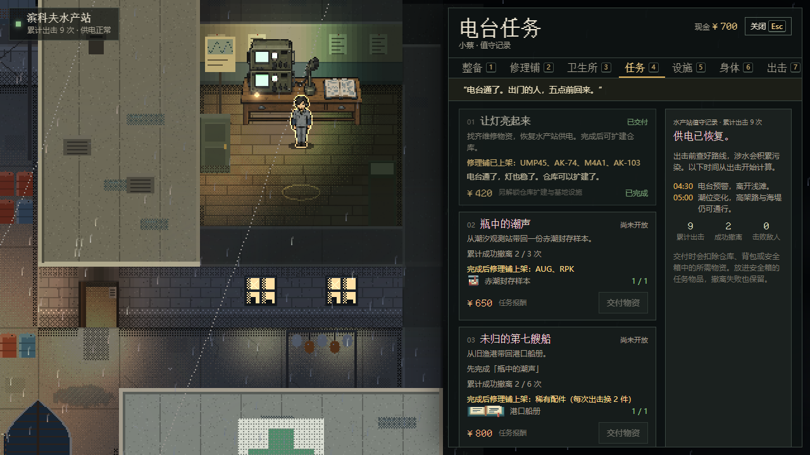
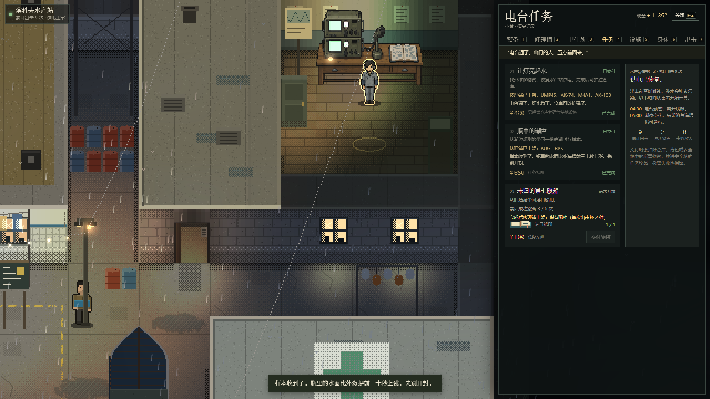

# 电台任务与货架解锁节奏（#153）

任务：[#153](https://github.com/xuys2025/escape-bincov/issues/153)。2026-10-30 用户明确要求解决；原 M4 经济 PR #150 已合并，没有承接本修复的开放 PR，因此从 main `e3a749618870a0925418713505a2e64cf77118d4` 建 `fix/radio-quest-progression`。这里只修任务进度，M4-06 真人试玩继续归 #80。

## 最终行为

三个任务原来只检查材料，可以一次回站连续交付；只加前置任务也挡不住预先集齐物资后连交。本次用既有成功撤离统计拉开阶段：

| 任务 | 条件 | 货架与成长 |
| --- | --- | --- |
| 让灯亮起来 | 原维修材料，数量不变 | 恢复供电、仓库扩建、设施和第一批常规枪保持前期可得 |
| 瓶中的潮声 | 完成维修、累计成功撤离 3 次、原样本 1 份 | AUG、RPK |
| 未归的第七艘船 | 完成样本任务、累计成功撤离 6 次、原船册 1 份 | 稀有配件后期货架；精工定制仍另需工作台 3 级 |

累计次数包含更新前和前置任务之前的成功撤离。死亡、超时、放弃和单纯出击不增加成功次数；物资仍可提前收集、安全箱仍可保留。没有随机降低任务物品刷新，也没有改地图、物资数量、任务报酬或枪价。3/6 次是本次试调值，真人节奏尚未签收。

`domain.ts` 的 `questRequirements` 同时供实际交付、院子、旧页签和行动任务清单使用。缺前置时显示「尚未开放」、列出任务与成功撤离进度并禁用交付；运行时入口也检查，不能靠库存或旧 UI 绕过。

## 存档与事务

不加字段或版本；沿用 `quests` 和 `stats.extracts`。已完成旧任务即使不满足新条件，也保留任务、报酬和货架；不补写前置任务、不重复发奖。未完成旧任务直接使用已有统计。任务提交仍经原会话事务：扣物资、任务完成、报酬和派生货架同时生效，写入失败全部回滚，重试及刷新不重复奖励。没有新增依赖或离线网络请求。

## 同口径样本

两次都运行 `node --import tsx scripts/economy-sample.ts --campaigns=60 --runs=20`，沿用原习惯和种子；[基线](radio-quest-progression/baseline.json)与[候选](radio-quest-progression/candidate.json)。样本假设主动寻找任务物品概率为 80%，战斗/搜刮为概率模型，不是真人数据。

| 指标 | main 基线 | 修复后 |
| --- | --- | --- |
| 首次记录维修/样本/船册完成的局号中位数 | 2 / 2 / 2 | 2 / 5 / 8 |
| 第 3 行的完成比例 | 93% / 85% / 78% | 93% / 0% / 0% |
| 第 20 行完成比例 | 100% / 100% / 100% | 100% / 100% / 100% |
| 行动中弹药耗尽比例 | 11% | 12% |
| 买不起计划弹药比例 | 7% | 5% |
| 工作台达到 3 级中位局号 | 11 | 11 |
| 第 20 行现金中位数 | 2031 | 2288 |

**局号口径**：原工具在每局出发前交任务，在该局结算后记录。第 5 行首次显示完成，表示第 4 局结束后、出发第 5 局前交付；不能把它说成必须打完第 5 局。未修改工具或历史 M4 报告。装备选择改变会影响后续随机消费，其他差异只能作为本模型结果，不能证明真实生存率或手感提高。

## 验证

首轮 `d951adbf` 的 [CI 41087792229](https://github.com/xuys2025/escape-bincov/actions/runs/41087792229) 已全部成功。等待期间 main 合入 #160，随后正常同步 `61cd6c55`：只需合并双方 `handoff.md` 的新增段落，游戏代码没有文本冲突，保留手机菜单重绘修复。同步后 1118 单测、139 工程守卫、package、任务界面专项 13/13 与手机菜单 I3/I3b 2/2 再次通过，便携 ZIP 6,120,406 字节。以下截图、哈希与详细本地数据属于首轮；同步后组合提交与远端 CI 的准确结果见 [PR #161](https://github.com/xuys2025/escape-bincov/pull/161)，不拿首轮 CI 替代新 head。

Windows、Node 24.21.0、pnpm 11.19.0、Chrome 156.0.8078.48、离线正式 HTML（SHA-256 `f461ee2b9b8219e6726f6b6e70d33c342d2364a0e4c7d8978cc5f7730b5ab162`）。本次证据保留于 `test-results/quest-progression/`，长期截图与样本提升到本目录同名子目录。

| 检查 | 实际结果 |
| --- | --- |
| `pnpm test` | 1118/1118；新增囤物资绕过、前置/次数边界、失败行动、旧进度保留、Runtime 写失败及重读断言 |
| `pnpm package` | 通过；便携 ZIP 6,120,367 字节，只记录大小；生成物不提交 |
| `test:station-tier1` | 13/13；新增两档桌面的院子/旧页签门槛、真实按钮交付、旧任务保留及刷新 |
| 旧版负对照 | 用原 main 的 `domain.ts` 执行新增囤物资回归，在「无前置/次数也能交样本」处真实失败；[失败记录](radio-quest-progression/negative-control.txt)；随后恢复候选 |
| `pnpm check:ci` | 139/139 工程守卫通过 |
| `test:ui` / `test:qol` / `test:save-browser` / `test:hideout` | 全部通过；UI 38 项、存档 17 项，含两档桌面、触屏 QOL、真实下载/导入、多窗口冲突和写后发布失败 |
| `test:browser` / 远端 CI | 完成状态见承接 PR 的准确 head 检查 |

首败：新纯逻辑测试误用不存在的 `abandon` Outcome，类型检查发现后改为实际 death/timeout（会话把放弃映射 death）。原 `save-flow`、UI 与存档浏览器夹具默认无进度交样本，在新规则下正确被拒；补齐显式进度后继续验证原交付/回滚断言，UI 另保留未开放断言。

实际构建截图，使用明确的物资、任务和统计夹具；不代表自然游玩获得：

[旧页签 1920×1080](radio-quest-progression/radio-tabs-locked-1920.png)。真人、手机真机未验；未合并、未部署。
