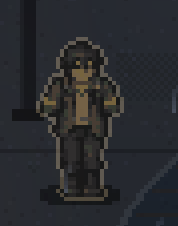

# 水产站玩家空手手臂与手（#26 F16）

承接 [PR #131](https://github.com/xuys2025/escape-bincov/pull/131)；绘制实现提交 `750d6a9a050495a56e7fe8eaf45d334de3d5069e`，后续提交补记录和 CI 专项入口，游戏绘制源码不变。

维护者截图反馈“水产站里这个人看上去没有手”，[原因核查](https://github.com/xuys2025/escape-bincov/issues/26#issuecomment-6446761015)已确认：共用的行动身体素材按分层约定不画前臂和手，院子只取了身体图。2026-10-28 维护者授权修复并开 PR；基线 main `02b5e1e5c5261f5caea55dccc875c8ae93e3120b`，任务分支 `codex/f16-station-hands`。本项独立交付，不接管 #26 其他反馈；准确 head、CI 与审阅状态以本项 PR 为准。

## 实现入口与边界

- [art/player.ts](../../../src/station-view/art/player.ts) 的 `paintStationPlayer` 按现有五种原始方向和五帧的袖口位置补像素前臂及手套，再连同身体一起镜像成八方向；走动时小幅摆臂。侧面与后斜面只补可见的近臂，远臂被身体或背包遮住。
- [scene.ts](../../../src/station-view/scene.ts) 的 `playerTex` 将完整空手姿态放入原有纹理缓存；玩家描边、光照与发光遮挡继续读取同一完整姿态。画布仍为 32×48，脚底、头部、定位及碰撞不变；缺少 PNG 时继续使用原程序人物回退。
- 不改共用 PNG、清单或行动画面的手臂／武器组合，不新增依赖、持久字段或网络请求。旧存档及结算行为不涉及本次改动。
- 回归入口是 [station-browser-test.mjs](../../../scripts/station-browser-test.mjs) 的 H15，由 `test:station-hands` 在 CI batch-2 定向执行；完整 `test:station` 仍是手动验收项。两入口共用同一检查，覆盖两尺寸各 40 帧的手部像素、与身体连通、左右镜像、头脚保护和源画布不变，另用真实 D 键行走留图。

## 本次验证

环境：Windows、Node.js 24.22.1、pnpm 11.19.0、Chrome 156.0.8078.48 无头浏览器；打包 HTML 禁网路由，隔离的新存档。仅在 `?test=1` 放置玩家与读取纹理；走动使用真实键盘事件，不是手机真机或真人观感验收。

本次受检 HTML SHA-256：`de91a6185df296cbdc5fe70370d57f6cd08bb5d1e961eb30f2f725e6517556b9`。

| 检查 | 结果 |
| --- | --- |
| 修复前负对照 | 最终 H15 在基线构建实际失败：方向 0、站立帧缺少手部像素（0）；0/1，页面错误与外部请求均为 0 |
| `pnpm test` | 1020/1020 通过 |
| `pnpm package` | 通过；生成物未提交 |
| `pnpm check:ci` | 73/73 通过 |
| H15 定向 | 1/1 通过；1280×720、1920×1080 各 8 方向 × 5 帧，共 80 帧 |
| `pnpm test:station-hands` | 1/1 通过；与上述 H15 相同检查，使用 CI 的正式专项命令 |
| `pnpm test:station` 完整 | 78/79；唯一失败为 I3 手机菜单切修理铺超时，H15 通过；页面错误与外部请求均为 0 |
| I3 基线对照／修复构建定向 | 两者均为 0/1，同一 `timeout: arms tab`，是原 main 可复现的问题；本项保留该失败，不拼成完整通过 |
| `pnpm test:coast-animation` | 8/8 通过 |
| `pnpm test:asset-load` | 站内与行动的 decode/draw 四项通过 |

本地原始日志与 JSON 在 `test-results/f16-*`。最初沙箱运行 `tsx` 时 `uv_os_get_passwd` 返回 ENOMEM；在正常本机权限下启动后，负对照与回归才实际执行，此环境错误不计为产品反例。新增检查最初只数轮廓外像素，侧视手部画在腿前时不足；改为检查手部区域颜色变化与整体连通，并重新在旧构建上得到有效失败。

## 真实画面

以下均来自实际游戏或维护者原始截图。两档成品截图以同一新开局、应急供电、院内位置 `(15.6,16.4)` 为夹具；走动图为向右走。没有用概念图代替实现。

| 维护者反馈时 | 修复后 1280×720 | 修复后 1920×1080 |
| --- | --- | --- |
|  | [站立](screens/idle-1280x720.png) · [行走](screens/walk-1280x720.png) | [站立](screens/idle-1920x1080.png) · [行走](screens/walk-1920x1080.png) |

I3 的原 main 对照与修复构建结果分别在 `test-results/f16-baseline-i3/`、`test-results/f16-fixed-i3/`。本项没有改变菜单输入；该已有问题需要另行核查，不以改手部的任务冒充修好菜单。

未验：手机真机、真人对补绘姿态的观感；没有改变规则或代替这些验收。尚未合并、尚未发布。

[八方向五帧的合成贴图](screens/frames-8x5.png)是从实际站内纹理缓存导出的 6 倍最近邻展示，供逐帧审看；实景以以上四张游戏截图为准。
